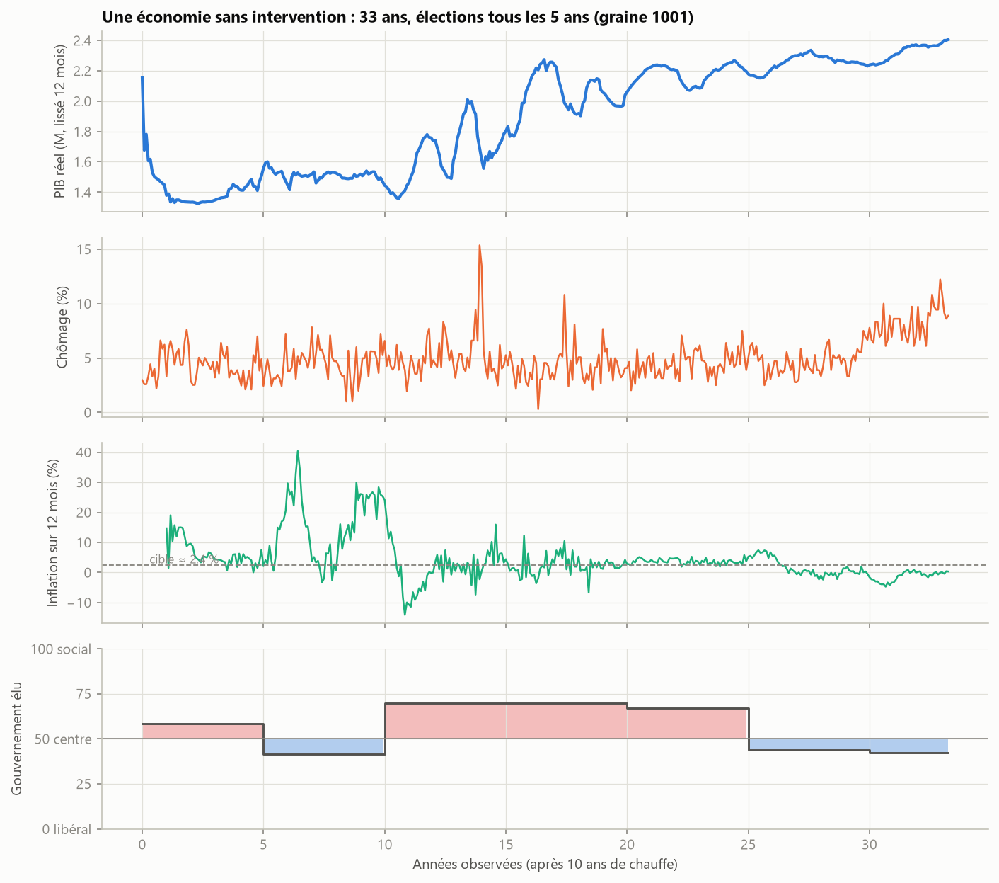
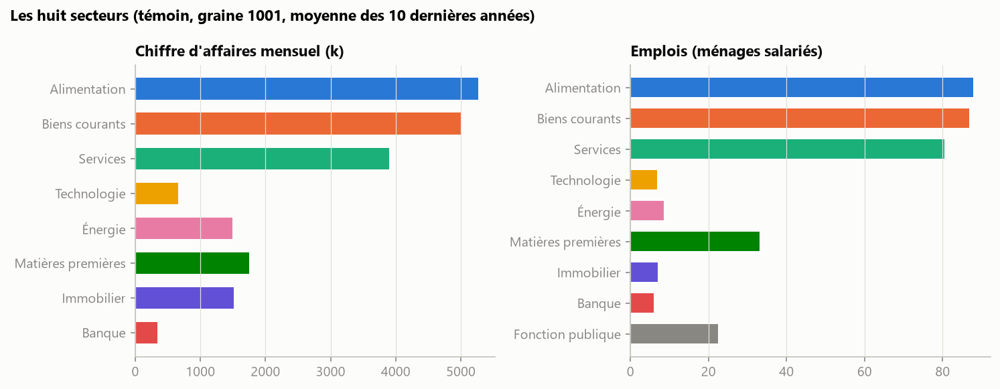
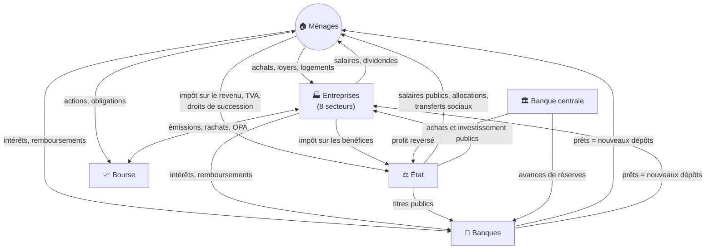
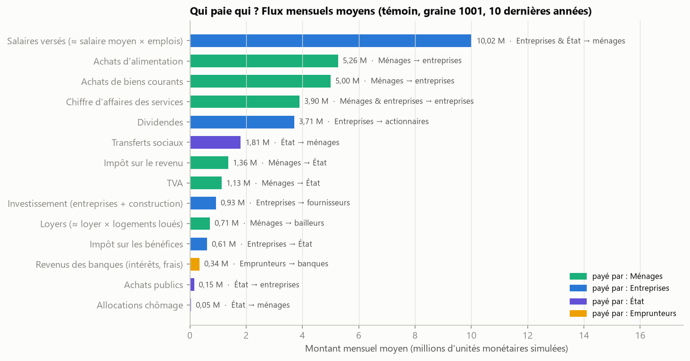
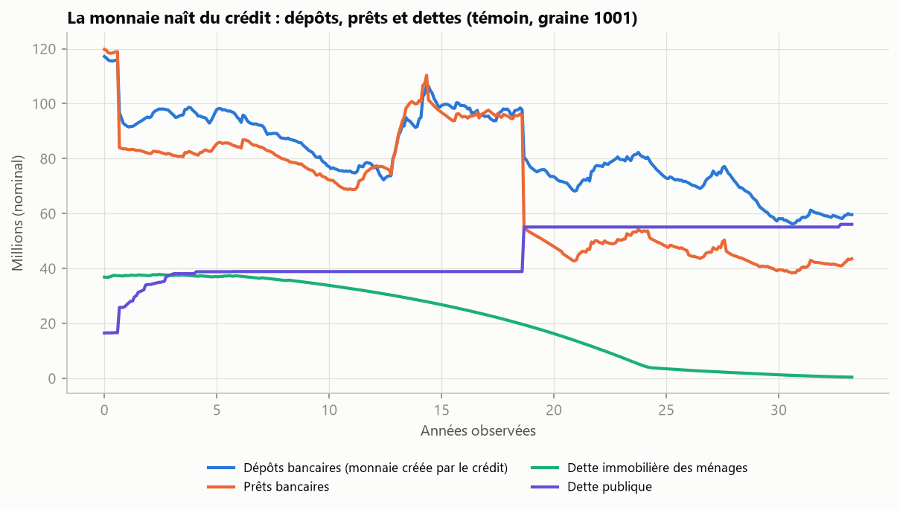
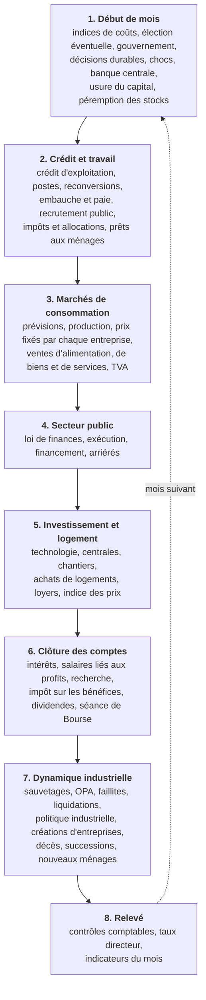
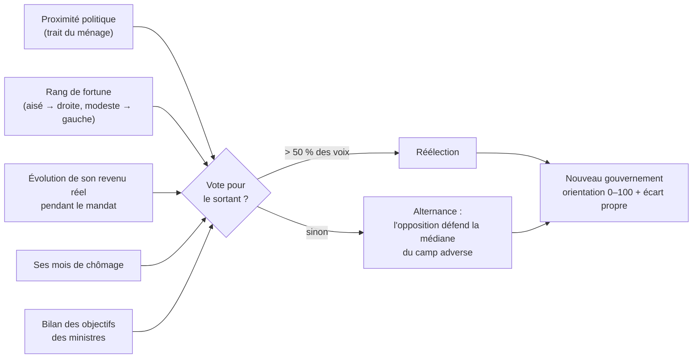

# Économie en mouvement

**Une économie entière simulée mois par mois : des centaines de ménages, des dizaines
d'entreprises, des banques, un État élu et une banque centrale, qui décident chacun selon
leurs propres règles. Personne ne fixe le PIB, le chômage ou l'inflation : ils résultent
des décisions des agents.**

<p align="center">
  
</p>

- **Multi-agents** : chaque ménage, entreprise et banque est un objet avec sa trésorerie, ses dettes,
  ses titres, son emploi ou ses salariés.
- **Mensuel et reproductible** : une graine donne exactement la même histoire, au bit près.
- **Monnaie cohérente** : la monnaie naît du crédit bancaire, chaque paiement a une contrepartie,
  et les bilans sont rapprochés tous les mois.
- **Politique endogène** : les ménages votent tous les cinq ans. Le gouvernement élu nomme
  des ministres parmi eux, vote une loi de finances, fixe le salaire minimum et mène une
  politique industrielle.
- **Démographie** : les chefs de ménage vieillissent et meurent. Un héritier leur succède, et
  l'État prélève des droits de succession.
- **Interface Streamlit** : on peut tout observer et intervenir en cours de route, par exemple
  donner de l'argent à un ménage, imposer un gouvernement ou forcer un taux d'impôt.
- **Moteur en Python pur** (bibliothèque standard), environ 16 000 lignes, et plus de 500 tests.

> Les crises, faillites, pénuries et récessions font partie des résultats possibles : le modèle
> n'est pas recalibré pour les éviter.

---

## Sommaire

1. [Démarrage rapide](#1-démarrage-rapide)
2. [Les agents](#2-les-agents)
3. [Le circuit économique : qui achète quoi à qui](#3-le-circuit-économique--qui-achète-quoi-à-qui)
4. [Un mois de simulation, phase par phase](#4-un-mois-de-simulation-phase-par-phase)
5. [Les mécanismes en détail](#5-les-mécanismes-en-détail)
6. [L'État et la politique](#6-létat-et-la-politique)
7. [Expérience : toujours la gauche, toujours la droite, ou des élections ?](#7-expérience--toujours-la-gauche-toujours-la-droite-ou-des-élections-)
8. [L'interface](#8-linterface)
9. [Utiliser le moteur en Python](#9-utiliser-le-moteur-en-python)
10. [Organisation du code](#10-organisation-du-code)
11. [Tests et reproductibilité](#11-tests-et-reproductibilité)
12. [Limites connues](#12-limites-connues)

---

## 1. Démarrage rapide

Python 3.11 ou plus récent (vérifié avec Python 3.13).

```bash
python -m venv .venv
# Windows (PowerShell) : .\.venv\Scripts\Activate.ps1
# Linux / macOS        : source .venv/bin/activate
python -m pip install -r requirements.txt
python -m streamlit run main.py
```

Dans la barre latérale, réglez les conditions de départ puis cliquez sur
**Réinitialiser la simulation**. **Un mois** fait avancer d'une période ; **Avancer** en
enchaîne plusieurs. Au démarrage, le moteur simule d'abord **120 mois de chauffe** (dix ans)
pour que l'économie trouve son propre régime avant l'observation. Le résultat de la chauffe est
mis en cache dans `.cache/` : le deuxième démarrage est immédiat.

Pour les graphiques et les expériences (Matplotlib) :

```bash
python -m pip install -r requirements-docs.txt
```

---

## 2. Les agents

| Agent | Nombre au départ | Ce qu'il possède | Ce qu'il décide |
|---|---|---|---|
| **Ménages** | 240 (environ 360 après 30 ans) | trésorerie, compétence, métier, âge, logement, actions, obligations, dettes | travailler, consommer, épargner, placer, acheter ou louer un logement, devenir bailleur, se reconvertir, créer une entreprise, voter |
| **Entreprises** | 3 par secteur, 8 secteurs | stocks, capacité de production, centrales, technologie, salariés, dettes, titres | produire, fixer prix et salaires, embaucher, licencier, investir, emprunter, verser des dividendes, racheter un concurrent |
| **Banques** | 3 (secteur « Banque ») | prêts, dépôts, fonds propres, titres publics | prêter selon leurs fonds propres, fixer leurs marges, absorber les pertes ; elles peuvent faire faillite et être résolues |
| **Banque centrale** | 1 | réserves, avances aux banques | taux directeur par une règle de Taylor lissée, avances de réserves |
| **État** | 1 | trésorerie, dette, participations, fonction publique | voir [§ 6](#6-létat-et-la-politique) : élection, ministres, budget, impôts, salaire minimum, politique industrielle |

Les huit secteurs : **Alimentation, Biens courants, Services, Technologie, Énergie,
Matières premières, Immobilier, Banque**, plus la **fonction publique**. Le travail est
organisé en dix métiers : opérateur, technicien, ingénieur, développeur, gestionnaire,
commercial, financier, bâtiment, extracteur et agent. Chaque secteur demande son propre
mélange de métiers, et un ménage au chômage peut se reconvertir.

<p align="center">
  
</p>

L'alimentation, les biens courants et les services emploient la plupart des ménages. L'énergie, la
technologie et l'immobilier réalisent un chiffre d'affaires important avec peu de salariés.

---

## 3. Le circuit économique : qui achète quoi à qui

### Vue d'ensemble



### La chaîne de production entre entreprises

Une entreprise achète à d'autres entreprises une partie de ce qu'elle utilise : énergie, matières,
services numériques, locaux. Ces achats sont de vrais paiements d'agent à agent. Un fournisseur
sans salarié ne livre rien et n'encaisse rien : la commande refusée est mesurée comme une pénurie.

| Secteur | Vend à | Ce qui est échangé |
|---|---|---|
| ⛏️ **Matières premières** | Alimentation, Biens courants | matières tirées d'un stock naturel qui s'épuise, plus le recyclage |
| ⚡ **Énergie** | toutes les entreprises | électricité produite par des centrales qui s'usent, et capacité de production vendue à l'Alimentation et aux Biens courants |
| 💻 **Technologie** | entreprises et ménages | équipements et services numériques, sources de gains de productivité |
| 🧰 **Services** | ménages et entreprises | loisirs, santé, réparation, commerce, transport, formation |
| 🏗️ **Immobilier** | ménages | logements construits par des chantiers, loués ou vendus |
| 🥖 **Alimentation**, 📦 **Biens courants** | ménages | consommation finale, TVA comprise |
| 🏦 **Banque** | tous | crédit, dépôts, frais |

### Les ordres de grandeur

Les flux mesurés dans une simulation témoin (graine 1001, moyenne des dix dernières années, en
unités monétaires simulées par mois) :

<p align="center">
  
</p>

Le PIB nominal mensuel vaut alors environ 18 M. Les salaires (environ 10 M) financent l'essentiel
de la consommation : alimentation, biens et services. Les dividendes, à environ 3,7 M, sont
importants. Ils reviennent aux ménages actionnaires, ce qui fait de la Bourse un canal majeur de
répartition des revenus.

### La monnaie naît du crédit

Aucune monnaie n'est distribuée « d'en haut ». Lorsqu'une banque accorde un prêt, elle crée un
dépôt du même montant ; un remboursement le détruit. La banque centrale fournit seulement les
réserves exigées (10 % des dépôts) sous forme d'avances au taux directeur. Son profit revient
à l'État. Le contrôle mensuel `validate_financial_accounts` vérifie que la trésorerie des agents
correspond aux billets et aux dépôts inscrits dans les bilans bancaires. L'écart mesuré reste de
l'ordre de 10⁻⁶ sur des centaines de millions.

<p align="center">
  
</p>

Les sauts visibles sont de vrais événements. Vers l'année 18, une faillite bancaire est résolue :
le portefeuille de prêts chute et la dette publique augmente avec la recapitalisation. Dans cette
graine, la dette immobilière des ménages s'éteint peu à peu. Le modèle ne force rien : c'est un
comportement observé, pas un objectif.

---

## 4. Un mois de simulation, phase par phase

`EconomySimulation.step()` enchaîne huit phases dans un ordre fixe. Chacune lit et complète les
flux du mois (`MonthFlows`). La dernière produit un relevé (`MarketRecord`) d'une centaine
d'indicateurs.



Plusieurs générateurs aléatoires séparés (marché du travail, prévisions, politique, démographie,
institutions) isolent les mécanismes. Ajouter un tirage dans l'un ne décale pas les autres, et
c'est ce qui permet une reproduction exacte.

---

## 5. Les mécanismes en détail

### Ménages
- **Revenus** : salaire, allocation chômage, transferts sociaux, dividendes, coupons
  d'obligations, intérêts des dépôts et loyers s'ils sont bailleurs.
- **Consommation** : le budget alimentaire et le budget de services suivent la **loi d'Engel**.
  Quand le revenu réel monte, la part de l'alimentation baisse et celle des services augmente.
  Chaque ménage anticipe son revenu et son risque de chômage avant d'acheter.
- **Épargne et placements** : le ménage garde environ trois mois de revenu en trésorerie et place
  le reste en actions et en obligations selon son goût du risque. Les portefeuilles sont
  rééquilibrés progressivement.
- **Logement** : un ménage est propriétaire, locataire ou sans logement. Il peut acheter à crédit
  (prêt hypothécaire, saisie en cas de défaut). Il peut aussi devenir bailleur si le rendement
  locatif attendu, vacance comprise, dépasse celui des obligations plus une prime de risque.
- **Crédit à la consommation** : il a des mensualités et peut tomber en défaut. La banque passe
  alors la perte.
- **Entrepreneuriat** : un ménage au tempérament entrepreneurial peut fonder une entreprise
  lorsqu'il voit des commandes non servies. L'entreprise porte son nom, et le fondateur revend
  ses titres en Bourse au fil du temps.
- **Vie et mort** : la mortalité suit une loi de Gompertz (espérance de vie d'environ 74 ans).
  Un héritier de 20 à 30 ans reprend le patrimoine, les dettes et l'emploi, mais tire sa propre
  compétence. Sa compétence de départ dépend de la qualité de l'**éducation publique**.

### Entreprises
- **Production** : elle dépend des salariés (et de leurs métiers et compétences), de la capacité
  installée, de l'énergie livrée, des matières et du niveau technologique.
- **Prix** : chaque entreprise fixe son prix selon ses commandes non servies, ses stocks, ses coûts
  et la concurrence. Le prix de marché est la moyenne des prix affichés.
- **Économies d'échelle** (désactivées par défaut ; barre latérale, rubrique « Concurrence, dette
  & entreprises ») :
  - **remise sur le volume** (`volume_discount_max`) : dans les achats entre entreprises (énergie,
    services, technologie, immobilier d'entreprise), une commande paie
    `1 − max × v / (v + 5 000)` du prix, où v est la commande au prix de base déflatée. La remise
    ne dépasse jamais la marge observée des fournisseurs : pas de vente sous le coût. Les
    matières premières, payées au prix du marché des ressources, n'ont pas de remise ;
  - **frais de structure** (`fixed_cost_share`) : chez les producteurs d'alimentation et de
    biens, cette part des intrants non matériels devient un forfait mensuel calé sur les ventes
    moyennes du secteur. Le coût total est inchangé à la taille moyenne ; au-delà, le coût par
    unité baisse, et le prix de l'entreprise suit son coût moyen. Une entreprise à l'arrêt ne
    paie rien. **Attention** : dès 10 %, ce mécanisme fait émerger des quasi-monopoles en chaîne
    en alimentation et en biens, et double faillites et chômage (mesures :
    `results/lot_d_echelle/RESUME.md`).
- **Salaires** : l'offre salariale monte quand les postes restent vacants. Elle baisse quand le
  chômage de longue durée est élevé ou quand la recette ne couvre plus la paie. Elle ne descend
  jamais sous le salaire minimum légal.
- **Investissement** : une entreprise achète de la capacité ou des centrales, et investit en
  recherche, en jugeant la rentabilité au taux d'actualisation du moment. La connaissance
  accumulée fait monter la productivité globale (PGF).
- **Finance** : crédit d'exploitation, dividendes, émission d'actions, obligations, offres
  publiques de rachat sur des concurrents moins bien valorisés. Une entreprise ne rachète pas
  ses propres actions (aucun rachat d'actions par l'émetteur dans le moteur).
- **Cours de Bourse** : les ordres font bouger le cours (±15 % par mois au plus), rappelé de 18 %
  par mois vers une valeur fondamentale qui mêle fonds propres et bénéfices capitalisés. Par
  défaut, c'est le bénéfice du mois, extrapolé, qui est capitalisé ; avec
  `stock_earnings_smoothing_months` (0 par défaut, lot F2), c'est la moyenne des derniers mois,
  ce qui stabilise la valeur vers laquelle le cours est rappelé. **Non validé** : à 12 mois, deux
  graines sur cinq s'effondrent après le mois 700 (`results/lot_f_stabilite/RESUME.md`) ; à
  laisser à 0 hors étude.
- **Fin de vie** : une entreprise insolvable fait faillite. Une entreprise restée sans salarié et
  sans perspective est liquidée à l'amiable, et sa trésorerie revient aux actionnaires.

### Groupes, magasins, fonds et expérience (lot G, désactivés par défaut)

Huit mécanismes d'entreprise (`economy/enterprise.py`), chacun derrière sa case de la rubrique
« Groupes, magasins, fonds & expérience » de la barre latérale. Tant qu'aucun n'est coché, la
simulation est identique au bit près. Cochés, ils agissent dès la période de chauffe.

| Réglage | Ce qui se passe |
|---|---|
| `experience_learning` | **Expérience.** Compétence = n / (n + 3). Un fondateur qui a déjà créé des entreprises démarre la suivante avec une productivité et une innovation relevées d'au plus 10 %, et la banque lui reconnaît une expérience de direction. À l'embauche, le salaire se négocie dans une bande de ± 5 % autour de l'offre : le salarié qui a souvent changé d'employeur obtient plus, l'employeur qui a beaucoup recruté concède moins. Un acquéreur expérimenté attend moins entre deux opérations et garde les meilleures pratiques. L'expérience disparaît à la succession. |
| `property_upkeep` | **Gros entretien des logements**, en plus de l'entretien courant (0,12 % du prix par mois, déjà payé par tous les propriétaires). L'état de chaque parc s'use de 0,2 % par mois ; le propriétaire paie les travaux aux services et aux matières s'il en a les moyens ; un logement dégradé se loue moins cher (loyer × état, au moins 30 %). |
| `consumer_preferences` | **Préférences et données.** Chaque ménage a un goût, chaque producteur d'alimentation ou de biens un style ; l'affinité relève jusqu'à 50 % le poids du producteur dans les achats du ménage. Les entreprises technologiques vendent les données des ménages équipés : un producteur bénéficiaire y consacre 1 % de son chiffre d'affaires et rapproche son offre du goût de ses clients (connaissance oubliée de 5 % par mois). |
| `diversification` | **Filiales.** Une entreprise n'a qu'un secteur ; pour vendre plusieurs produits, une entreprise rentable crée une filiale dans le secteur le plus attractif autre que le sien (mêmes signaux que les ménages fondateurs), lui apporte la moitié de sa trésorerie libre et en détient tout le capital. Au plus une création par mois dans l'économie ; les dividendes remontent à la société mère. |
| `conglomerate_takeovers` | **Rachats entre secteurs.** Offre publique aux règles existantes (cours + 30 %, seuil de contrôle), sur une entreprise plus petite d'un autre secteur, qui devient une filiale sans fusion. L'acquéreur n'offre que s'il apporte quelque chose : il est plus productif que la cible (elle rattrape un quart de l'écart une fois rachetée) ou ses magasins lui apportent des ventes. |
| `retail_stores` | **Magasins.** Un producteur d'alimentation ou de biens ouvre un magasin (40 000 € de départ, 600 € de charges par mois, indexés sur les salaires) quand les ventes ajoutées rapportent plus que le coût de ses fonds propres. n magasins multiplient son poids dans les achats par 1 + 0,5 × n / (n + 3). Chaque magasin demande deux vendeurs (un réseau en sous-effectif ne sert qu'au prorata) ; la commodité d'achat relève un peu les quantités voulues par les ménages (au plus 5 %). |
| `group_distribution` | **Distribution de groupe.** Les magasins d'un groupe vendent les produits de toutes ses entreprises, et l'acquéreur compte ce gain dans la valeur d'une cible : une grande entreprise bien distribuée a intérêt à racheter un petit producteur. Demande des magasins et des groupes. |
| `private_startups` | **Non cotées et fonds des banques.** Une entreprise fondée par un ménage n'est plus cotée à sa création. Chaque banque gère un fonds d'investissement où les ménages placent environ 5 % de leur épargne (selon leur goût du risque), contre 1,8 % de frais par an ; le fonds finance les besoins des non cotées, relève leur productivité de 5 % à son premier apport, et leur valeur est estimée sans Bourse. L'introduction en Bourse n'arrive que si le besoin restant dépasse la moitié des fonds propres, ou quand le fonds veut sortir : sa participation vaut deux fois ce qu'elle a coûté, au plus tard après cinq ans. Le fonds place aussi sa trésorerie excédentaire en actions cotées, et ne vend un titre coté que lorsque son cours atteint sa valeur fondamentale ou qu'il manque de trésorerie. |

Mesure (5 graines × 400 mois, chaque mécanisme seul puis les huit ensemble, contre le témoin) :
aucun effondrement, comptes exacts, mais des effets du même ordre que l'écart entre graines ;
tableaux et réserves dans `results/lot_g_entreprises/RESUME.md`.

### Salariés obligatoires et conseil d'actionnaires (lot H, désactivés par défaut)

Deux réglages de la même rubrique de la barre latérale :

- **Salariés obligatoires** (`staffless_closure_months`, 0 = jamais) : une entreprise non bancaire
  restée ce nombre de mois sans aucun salarié est fermée. Sans dette ni actif, sa trésorerie est
  versée aux actionnaires ; sinon ses actifs sont vendus à un concurrent, ses banques remboursées
  et le reste revient aux actionnaires (la dette non remboursée est une perte des banques, comptée
  parmi les faillites). Jamais la dernière entreprise de son secteur, une banque ou une
  participation de l'État. Sans ce réglage, une entreprise peut rester une coquille vide jusqu'à
  24 mois, et indéfiniment si elle a des dettes ou des actifs.
- **Conseil d'actionnaires** (`shareholder_governance`) : les quatre plus gros actionnaires de
  chaque entreprise (ménages, entreprises, État, fonds) votent selon leurs titres. Ils nomment le
  dirigeant parmi les salariés (un actionnaire salarié vote pour lui-même, les autres pour le
  salarié le mieux noté), le révoquent après un an de mandat si l'entreprise perd de l'argent
  depuis plus longtemps que leur patience (6 mois, 3 à 9 pour un ménage selon son goût du risque),
  et orientent la part des bénéfices réinvestie (entre la moitié et une fois et demie de sa
  valeur de départ). Sans ce réglage, le dirigeant est le salarié le mieux noté, à un tirage près,
  et n'est jamais révoqué.

Avant de liquider une entreprise sans salarié, le moteur tente une **reprise** : sa société mère,
si elle en a une et les moyens, souscrit une augmentation de capital de trois mois de paie (une
fois tous les deux ans) ; sinon l'entreprise du même secteur qui a des salariés et le plus de
trésorerie l'absorbe, si les actifs de la cible couvrent ses dettes. La liquidation n'arrive
qu'en dernier recours.

Mesure : `results/lot_g_entreprises/RESUME.md`, sections « Lot H » et « Lot I ».

### Ce que le lot I ajoute aux mécanismes des lots G et H

Sans nouveau réglage : ces règles s'appliquent quand le mécanisme concerné est activé.

- **Groupes** : chaque mois, une société mère recapitalise une filiale qui a un besoin de
  trésorerie (au plus un quart de sa trésorerie libre), ou la met en vente si elle perd de
  l'argent depuis douze mois ou si la mère elle-même manque de trésorerie : la filiale est
  introduite en Bourse et ses titres vendus à la séance, par dixièmes.
- **Magasins** : deux vendeurs par magasin, qui s'ajoutent au besoin en personnel du producteur ;
  commodité d'achat (voir le tableau).
- **Préférences** : le goût de chaque ménage dérive lentement, un héritier a son propre goût, et
  un producteur qui a acheté des données déplace son style vers le goût moyen de ses clients les
  plus proches. Sans données, il ne bouge pas.
- **Données** : payées au prix du marché des services technologiques (cher, le même budget en
  livre moins) ; leur utilité dépend de l'innovation et de la productivité des vendeurs.
- **Fonds** : placements en actions cotées, sortie décidée sur la valeur (voir le tableau).
- **Conseil d'actionnaires** : son goût du risque fixe l'exigence de rendement des ouvertures de
  magasins, des créations de filiales et des offres de rachat (± 20 %).
- **Expérience des dirigeants** : à chaque anniversaire de mandat, l'entreprise gagne un peu de
  productivité (+0,4 % la première année, de moins en moins ensuite) ; un dirigeant remplacé
  repart de zéro.
- **Barre latérale** : boutons « Tout activer » et « Tout désactiver » pour tous les mécanismes
  optionnels, exigence de fonds propres contracyclique, recapitalisation de dernier recours des
  banques, lots J et K compris (fermeture des entreprises sans salarié réglée à 6 mois).

### Obligations d'entreprise, commerce extérieur, syndicats (lot J, désactivés par défaut)

Trois mécanismes (`economy/macro.py`), chacun derrière sa case de la rubrique « Obligations,
commerce extérieur & syndicats » de la barre latérale.

- **Obligations d'entreprise** (`corporate_bonds`). Une entreprise non bancaire, rentable et
  installée depuis deux ans, emprunte aux ménages et aux fonds des banques : pour couvrir un
  besoin de trésorerie, ou pour rembourser sa banque quand l'obligation coûte moins cher. Un
  ménage y vise environ 5 % de son épargne (les prudents davantage) si le taux dépasse celui des
  dépôts. Acheter une obligation déplace un dépôt, sans créer de monnaie, alors qu'un prêt
  bancaire en crée. Coupon mensuel, amortissement en cinq ans, encours limité à la moitié des
  fonds propres. En faillite, les obligataires passent après les banques et avant les
  actionnaires.
- **Commerce extérieur** (`foreign_trade`). Un reste du monde vend aux ménages la moitié de
  l'alimentation et des biens que le marché intérieur n'a pas servis, moins si son prix converti
  est plus élevé. Il redépense chaque mois la moitié de la monnaie gagnée : en stocks des
  producteurs d'abord, en services et en technologie pour le reste. Il ne détient jamais plus de
  2 % du PIB annuel : aucune monnaie n'entre ni ne sort. Le taux de change flotte (un déficit
  renchérit les importations). Les exportations entrent dans le PIB.
- **Syndicats** (`collective_bargaining`). Chaque secteur négocie une fois par an. Le syndicat
  demande le rattrapage de l'inflation que les salaires n'ont pas suivie, plus la moitié de la
  marge au-delà de la référence du secteur, au plus 5 %. Il obtient cette demande × son pouvoir :
  50 % sous un gouvernement du centre, 25 % à l'extrême droite, 75 % à l'extrême gauche, moins
  quand le chômage monte. L'accord relève les offres salariales du secteur et les empêche de
  baisser pendant douze mois. Si l'écart dépasse 2,5 points, le secteur fait grève un mois (la
  moitié du travail perdue, la moitié de l'écart concédée), au plus une fois tous les trois ans.

Mesure : `results/lot_g_entreprises/RESUME.md`, section « Lot J ».

### Banques et banque centrale
- Les banques prêtent dans la limite de leurs **fonds propres** (8 % des prêts et titres). Les
  **réserves** exigées (10 % des dépôts) ne limitent pas le crédit : la banque centrale les fournit
  par des avances au taux directeur, dont les intérêts sont une charge des banques. Leur marge
  dépend du risque de défaut qu'elles observent.
- Une banque peut lever des fonds propres en Bourse. Si elle fait faillite, elle est **résolue** :
  la perte retombe sur les actionnaires, puis sur les créanciers, et l'État paie le reste.
- **Règle de Taylor** : taux annuel visé = 1,8 % + inflation + 0,5 × (inflation − cible)
  − 1,0 × (chômage − 5 %), avec inertie, un plafond à 12 % et une cible d'environ 2,4 % par an.
  La crédibilité de la banque centrale s'apprend : plus l'inflation reste proche de la cible, plus
  les entreprises fondent leurs anticipations sur la cible.
- **Structure des taux** (taux annuels par défaut) : crédit aux entreprises = taux directeur +
  marge de risque (perte attendue + coût des fonds propres immobilisés) ; crédit immobilier =
  directeur + 0,96 point ; crédit à la consommation = directeur + 7,2 points ; dépôts =
  directeur − 1,44 point, ajusté par chaque banque selon sa liquidité.
- **Marge supplémentaire des banques** (`bank_margin_offset`, 0 par défaut, réglable dans la
  barre latérale ou forcée en intervention) : points ajoutés à tous les nouveaux crédits
  (entreprises, immobilier, consommation) et au coût du crédit que les entreprises anticipent ;
  aucune marge ne descend sous zéro. Les prêts aux entreprises à taux variable gardent la marge
  de leur octroi.
- **Stabilité bancaire** (lot F, désactivés par défaut ; barre latérale, rubrique « Concurrence,
  dette & entreprises ») ; diagnostic : `results/lot_f_stabilite/DIAGNOSTIC.md` :
  - **exigence contracyclique** (`countercyclical_capital`) : quand la capacité de crédit du
    système passe sous 2 % de l'encours et que l'activité baisse, l'exigence de fonds propres
    descend de 0,25 point par mois jusqu'à 6 %, puis remonte au même rythme quand la capacité
    dépasse 5 % ;
  - **recapitalisation de dernier recours** (`bank_capital_backstop`) : après trois mois de
    capacité nulle, l'État souscrit des actions nouvelles des banques au cours, pour leur rendre
    une capacité de 5 % de leur encours (titres à l'État, décision au journal, financement par
    trésorerie ou emprunt).
- **Trésorerie propre des banques** (`bank_own_funds`, « cash » par défaut) : ce qu'une banque
  peut payer (salaires, charges, intérêts des dépôts, dividendes) n'est pas de la monnaie et
  n'entre pas dans l'identité du bilan bancaire. Par défaut c'est un compteur indépendant, que
  les pertes sur prêts ne réduisent pas : sur 800 mois il atteint 5 à 10 fois les fonds propres
  nets, et 30 à 50 % des dividendes bancaires sont versés au-delà du bénéfice. Avec « equity »,
  il est recalculé chaque mois comme la part liquide des fonds propres (fonds propres − actifs
  réels − prêts interbancaires accordés + emprunts interbancaires), et le capital distribué est
  celui qui dépasse l'exigence et son coussin. Mesuré sur 10 graines × 800 mois : les dividendes
  versés au-delà du bénéfice baissent de 87 %, mais les banques retiennent davantage, la demande
  baisse et les critères de stabilité tombent de 9 à 6 graines ; le réglage reste donc désactivé
  (`results/refonte_banque/JOURNAL.md`).

---

## 6. L'État et la politique

### L'élection

Tous les **5 ans**, chaque ménage vote :



### L'orientation : de 0 (libéral) à 100 (social)

L'orientation se traduit en **doctrines explicites**. Chaque gouvernement s'écarte un peu de la
doctrine type de son camp : deux gouvernements de même couleur ne mènent pas exactement la même
politique.

| Domaine | Libéral (< 35) | Centre (35–65) | Social (> 65) |
|---|---|---|---|
| **Budget** | équilibre ou excédent, remboursement de la dette | stabilise le ratio de dette hérité | déficit accepté (1 à 5 % du PIB) pour financer le programme |
| **Impôts** | revenu −50 %, tranche supérieure −90 %, bénéfices −50 %, TVA +30 % (amplitudes maximales) | réglages de base | revenu +50 %, tranche supérieure +90 %, bénéfices +50 %, TVA −30 % |
| **Revenus du capital** | prélèvement forfaitaire bas | forfait sous 50, barème au-delà | au barème avec les salaires |
| **Salaire minimum** | 50 % du salaire médian, indexation partielle ou gelée | 50 à 60 % | 68 à 80 % du médian, jamais baissé |
| **Transferts** | universels, faibles | base (5 % du PIB) | jusqu'à +80 %, en partie sous condition de ressources |
| **Services publics** | couverture des besoins à 80 %, point d'indice peu indexé | 95 % | 110 %, point indexé avec rattrapage |
| **Industrie** | laisser faire, privatiser | réguler les monopoles durables | opérateur public dans les secteurs critiques, garder les participations |
| **Droits de succession** | nuls à l'extrême droite | 20 % au-delà d'un abattement | jusqu'à 40 % |

### Le régime de propriété (lot E, désactivé par défaut)

Avec `ownership_regime` (case de la rubrique « État institutionnel » de la barre latérale),
l'orientation agit aussi sur les **règles de propriété des entreprises** (`economy/ownership.py`).
L'État porte un régime `r` de 0 (ultra-capitalisme) à 1 (coopératives), qui suit l'orientation du
gouvernement en place à raison d'un écart complet en 48 mois : une alternance s'applique
progressivement. Les règles sont interpolées, et ne changent rien au centre (`r` = 0,5) :

| Règle | Près de 0 | Centre | Près de 100 |
|---|---|---|---|
| Monopoles | aucune intervention (la durée avant un dossier tend vers l'infini) | 12 mois de problème | inchangé (opérateur public selon la doctrine) |
| Prises de contrôle (OPA) | seuil de contrôle 30 % au lieu de 50 % | 50 % | 70 %, et au moins 3 entreprises par secteur après une fusion |
| Dividendes | 1,5 × le taux de distribution | 12 % des bénéfices | moitié moins (vote des salariés) |
| Salaire de direction | inchangé | 5 × la référence | 3 × (vote des salariés) |
| Parts salariées | aucune | aucune | 30 % du capital des entreprises non bancaires |

Les **parts salariées** sont détenues à parts égales par les salariés de l'entreprise et leur
rapportent les dividendes correspondants. L'entreprise les constitue progressivement, sans
expropriation : elle attribue d'abord ses titres auto-détenus, puis rachète au cours, sur sa
trésorerie libre, des titres aux autres actionnaires (jamais à l'État), au plus 1 % de son
capital par mois. Un nouvel embauché reçoit sa part à mesure qu'elle se reconstitue. Au départ
d'un salarié, l'entreprise rachète sa part au cours ; faute de trésorerie, la part redevient une
détention ordinaire. Ces parts ne sont ni vendues en Bourse ni apportées à une offre publique. La
fiscalité du capital suit déjà la doctrine (forfait bas à droite). Aucun transfert direct de
richesse : l'enrichissement du 1 % et la concentration des marchés doivent émerger des règles.

### Le gouvernement en action

- **Une présidence et quatre ministres** (Finances, Travail, Industrie, Services publics) sont
  nommés **parmi les ménages**, selon leur proximité politique, leur expérience de direction et
  leur métier. Une personne pressentie peut refuser si le salaire proposé est trop bas.
- Chaque ministre reçoit un **objectif** chiffré, avec une échéance et une enveloppe. L'objectif
  oriente ses décisions, mais ne fixe jamais un résultat.
- **Objectifs enrichis** (`enriched_objectives`, désactivé par défaut ; case de la rubrique « État
  institutionnel » de la barre latérale). Chaque ministre a alors deux objectifs, principal et
  secondaire, choisis selon la doctrine. Ils ont la même échéance et se partagent l'enveloppe
  (le secondaire en reçoit un tiers).

  | Ministère | Indicateurs possibles | Levier actionné par un objectif en retard |
  |---|---|---|
  | Finances | dette / PIB, solde public, intérêts / recettes, arriérés / recettes | loi de finances : solde voulu relevé |
  | Travail | chômage, chômage de longue durée, taux d'emploi | recrutement de conseillers (service Emploi et formation) |
  | Travail | salaire minimum / médian, salaire réel médian | coup de pouce annuel du salaire minimum plafonné plus haut |
  | Industrie | monopoles, concentration (Herfindahl), prix de l'énergie | instruction plus rapide des dossiers de concurrence |
  | Industrie | participations non stratégiques ; investissement / PIB | cessions accélérées ; programme d'investissement relevé dans la loi |
  | Services publics | couverture des besoins, postes vacants | primes et point d'indice arbitrés par la présidence |
  | Services publics | qualité de l'éducation ; masse salariale | recrutements dans l'Éducation ; postes ouverts réduits |

  Une cible **dépend de la situation de départ** : si elle est déjà remplie à la fixation, elle
  est relevée d'un pas (un point de chômage, 2 % de salaire réel…), sans dépasser une borne
  atteignable. L'effort sur le levier vaut `objective_effort` (0,25) pour un principal en retard,
  la moitié pour un secondaire (`secondary_objective_weight`). Au vote et au bilan du mandat, un
  objectif secondaire compte pour la moitié d'un principal. Les deux objectifs et leur avancement
  sont affichés dans l'onglet État.
- **Cinq services publics**, dont l'Éducation, recrutent des agents en concurrence avec le privé,
  selon une grille de salaires.
- **Loi de finances** annuelle : elle fixe les impôts, les programmes et le financement. Si
  l'argent manque, l'État accumule des arriérés.
- **Politique industrielle** : régulation des prix d'un monopole, création ou nationalisation
  d'une entreprise publique, recapitalisation, privatisation par la Bourse.
- **Journal des décisions** : chaque décision a un auteur, une date, un motif, un montant et un
  financement.

### Influence, popularité, pouvoir et favoritisme (lot K, désactivés par défaut)

Neuf mécanismes (`economy/power.py`), chacun derrière sa case de la rubrique « Pouvoir, influence &
corruption » de la barre latérale. Tant qu'aucun n'est coché, la simulation est identique au bit
près. Cochés, ils agissent dès la période de chauffe ; leurs tirages viennent d'un générateur dédié.

| Réglage | Ce qui se passe |
|---|---|
| `influence_ranking` | **Influence.** Chaque ménage a un score de 0 à 100 : fortune (au plus 30, atteints à dix fois la fortune moyenne), fonction (présidence 35, ministre 22, dirigeant 6 à 28 selon le poids de son entreprise dans l'emploi et le chiffre d'affaires), capital contrôlé (au plus 20, participations d'au moins 10 %), popularité (au plus 15). Les dix premiers sont relevés chaque mois. Mesure seule : l'économie ne change pas. |
| `personal_popularity` | **Personnalité et popularité.** Trois traits tirés une fois par ménage : charisme, intégrité, ambition. La notoriété vient de la fonction (présidence 1, ministre 0,7, dirigeant selon la taille de l'entreprise) et s'efface lentement. L'opinion rejoint de 8 % par mois une référence fixée par le charisme, déplacée par les résultats : croissance, chômage et objectifs atteints pour la présidence, avancement de son objectif pour un ministre, marge et effectifs pour un dirigeant. Popularité = notoriété × opinion. |
| `candidate_elections` | **Élection à candidats.** Six mois avant le vote, le sortant et le membre le plus fort du camp opposé (ambition × popularité × influence) se déclarent. L'écart de popularité et de campagne décale le vote de chaque ménage (`vote_popularity_weight`) ; le programme de l'opposition reste la médiane de son camp. L'élu devient président. |
| `executive_power_laws` | **Lois de pouvoir.** Une fois par an, un président dont le goût du pouvoir (0,6 × ambition + 0,4 × (1 − intégrité)) dépasse 55 % propose la loi suivante de la liste ; elle passe si son capital politique (part des voix à son élection, plus la moitié de l'écart de son opinion à 50 %) dépasse 52 % plus 2 points par loi déjà votée. Un président d'intégrité supérieure à 60 % abroge la plus récente. Sans la loi « mandats », une même personne fait au plus deux mandats consécutifs, puis son camp présente un dauphin. |
| `business_subsidies` | **Aides aux entreprises.** Programme légal de 0,5 % du PIB par an (`business_aid_gdp_share` ; moitié moins pour une doctrine de laisser-faire, moitié plus pour une doctrine d'opérateur public) : une entreprise privée non bancaire en perte depuis trois mois reçoit chaque mois une aide au prorata de ses salariés, au plus un quart de sa masse salariale. Le budget non employé n'est pas dépensé. |
| `political_favoritism` | **Favoritisme et scandales.** Voir ci-dessous. |
| `corporate_lobbying` | **Lobbying.** Pendant la campagne, une entreprise bénéficiaire de taille au moins moyenne donne 1 % de son bénéfice mensuel au candidat le plus proche de son dirigeant (dépense payée aux entreprises de services). Une entreprise visée par un dossier de monopole dépense 0,5 % de son bénéfice en conseil, ce qui freine l'instruction jusqu'à la moitié selon l'influence de son dirigeant. |
| `revolving_door` | **Pantouflage.** Dans l'année qui suit sa sortie du cabinet, un ancien ministre ou président devient conseiller de la plus grande entreprise bénéficiaire des secteurs de son portefeuille. Elle lui verse la moitié d'un salaire de ministre pendant trois ans, et ce conseiller la relie au président qu'il a servi. |
| `political_dynasties` | **Dynasties.** L'héritier d'une personne connue (notoriété d'au moins 0,2) garde 30 % de sa notoriété ; ses traits et son opinion sont les siens. |

Les cinq lois de pouvoir, dans l'ordre où elles sont proposées :

| Loi | Effet |
|---|---|
| Enveloppe discrétionnaire | la moitié des aides aux entreprises est attribuée par la présidence seule |
| Nominations | un président peu intègre nomme un proche à la tête d'une entreprise publique créée, et gèle le dossier de monopole d'une entreprise liée à lui |
| Contrôle affaibli | un audit découvre quatre fois moins souvent une aide de faveur |
| Médias | l'opinion réagit moitié moins aux mauvais résultats du président et aux scandales ; la presse enquête moitié moins |
| Mandats | plus de limite de mandats consécutifs |

**Le favoritisme n'arrive que si tout est réuni** : la loi « enveloppe » est votée ; l'intégrité du
président est sous 40 % (sous 15 % tant que le contrôle des comptes n'est pas affaibli) ; une
entreprise privée a un patron (dirigeant ou actionnaire d'au moins 10 %) d'influence au moins 25 ;
son lien avec la présidence atteint 50 %. Ce lien additionne des faits : le président y travaillait
avant sa nomination (35 %), il en détient des titres (25 %), proximité politique du patron (au plus
20 %), don à sa campagne (30 %), ancien de son cabinet parmi les patrons ou les conseillers (30 %).
Même alors, le passage à l'acte est un tirage (10 % par mois). L'aide est un vrai paiement de
l'État, inscrit au journal comme « aide discrétionnaire » avec la note de conflit d'intérêts.

Chaque mois, chaque affaire peut être révélée par l'audit (3 %, un quart sous la loi « contrôle »)
ou par la presse (1 %, moitié moins sous la loi « médias »). Le scandale coûte 30 points d'opinion
au président et au patron ; l'entreprise rembourse l'aide plus une amende de moitié, dans la limite
de sa trésorerie ; si le président en cause est encore en place, le ministre de l'Industrie est
remplacé et la loi « contrôle » est abrogée. L'onglet État affiche les scandales révélés et, à part,
une « vue omnisciente » des affaires encore cachées.

Mesure : `results/lot_k_pouvoir/RESUME.md`.

---

## 7. Expérience : toujours la gauche, toujours la droite, ou des élections ?

Que se passe-t-il si une économie est gouvernée **pendant 33 ans** uniquement par la droite la
plus libérale, uniquement par la gauche la plus sociale, ou par les gouvernements que ses
ménages élisent ?

### Protocole

- **10 graines** (1001 à 1010), configuration par défaut, **120 mois de chauffe identiques**,
  puis **400 mois observés**. Les statistiques portent sur les 33 années complètes.
- **Droite** : un gouvernement d'orientation **0** est imposé au premier mois observé, puis à
  chaque élection, via le mode intervention.
- **Gauche** : la même chose avec l'orientation **100**.
- **Témoin** : élections normales. Les orientations élues vont de 21 à 81.
- **Rien d'autre ne change** : chaque gouvernement applique sa propre doctrine (impôts,
  allocations, salaire minimum, budget, politique industrielle).
- La comparaison est **appariée** : même graine et même point de départ pour les trois
  scénarios. Les 30 simulations se terminent sans valeur non finie, avec un écart comptable
  maximal de 10⁻⁶.

Pour reproduire l'expérience (environ 5 minutes sur 8 cœurs) :

```bash
python experiences/gauche_droite_campagne.py 400 1001 1002 1003 1004 1005 1006 1007 1008 1009 1010 --jobs 8
python experiences/gauche_droite_analyse.py
python docs/figures_readme.py
```

### Les trajectoires

<p align="center">
  
</p>

Le témoin oscille autour du centre, au gré des alternances :

<p align="center">
  
</p>

### Les moyennes

<p align="center">
  
</p>

| Indicateur (moyenne de 10 graines sur 33 ans) | Droite (0) | Témoin | Gauche (100) | Gauche > Droite |
|---|---:|---:|---:|---:|
| **Activité** | | | | |
| PIB réel mensuel | 2,21 M | 2,14 M | 2,07 M | 3/10 |
| Croissance réelle annuelle | 1,57 % | 1,37 % | 1,61 % | 5/10 |
| Productivité (PGF en fin de période) | 2,56 | 2,37 | 2,25 | 1/10 |
| Entreprises actives | 68 | 61 | 54 | 0/10 |
| Faillites par an | 1,1 | 1,5 | 2,0 | 10/10 |
| Créations d'entreprises par an | 1,6 | 1,7 | 1,9 | 6/10 |
| **Emploi et prix** | | | | |
| Chômage | 4,9 % | 4,8 % | 4,6 % | 2/10 |
| Inflation annuelle | 3,1 % | 3,6 % | 3,7 % | 9/10 |
| Salaire réel moyen, 10 dernières années | 3 554 | 3 308 | 3 001 | 0/10 |
| Salaire minimum / salaire moyen | 12 % | 36 % | 50 % | 10/10 |
| **Ménages et inégalités** | | | | |
| Revenu réel total des ménages (transferts compris) | 1,53 M | 1,58 M | 1,61 M | 7/10 |
| Taux de pauvreté (< 60 % du revenu médian) | 20,5 % | 10,7 % | 0,2 % | 0/10 |
| Gini du revenu disponible | 0,39 | 0,29 | 0,17 | 0/10 |
| Gini du patrimoine | 0,45 | 0,38 | 0,26 | 0/10 |
| Part des 10 % les plus riches | 35,7 % | 29,5 % | 22,3 % | 0/10 |
| Part du 1 % le plus riche | 9,2 % | 7,0 % | 4,6 % | 0/10 |
| Patrimoine médian réel, 10 dernières années | 259 k | 268 k | 206 k | 0/10 |
| **État** | | | | |
| Dépenses publiques / PIB | 6,7 % | 17,5 % | 24,6 % | 10/10 |
| Recettes publiques / PIB | 7,5 % | 17,8 % | 23,8 % | 10/10 |
| Dette publique / PIB annuel (fin) | 0,1 % | 12 % | 26 % | 10/10 |
| Emplois publics | 13 | 19 | 25 | 10/10 |

La dernière colonne indique le nombre de graines où la valeur obtenue à gauche dépasse celle
obtenue à droite. 10/10 ou 0/10 signifie que l'écart va dans le même sens dans toutes les
histoires simulées.

### Graine par graine

<p align="center">
  
</p>

### Ce qu'on en retient

**La droite produit plus ; la gauche partage plus.** Dans ce modèle, la différence porte
surtout sur le **niveau** de production et sa **répartition**, pas sur le rythme de croissance.

- **Pour la droite, les écarts sont réguliers mais modérés.** Le PIB réel est plus élevé d'environ
  7 %, la productivité de 14 % en fin de période et le salaire réel de 18 % sur la dernière
  décennie (10 graines sur 10). L'inflation est plus basse, les entreprises sont plus nombreuses
  et font moins faillite. L'État est minimal (7 % du PIB) et sans dette.
- **Pour la gauche, les écarts sont très marqués.** La pauvreté disparaît presque (0,2 % contre
  20 %). Les inégalités de revenu disponible sont **divisées par plus de deux** (Gini 0,17 contre
  0,39). Le chômage est un peu plus bas, et le revenu réel total des ménages plus élevé, transferts
  compris.
- **La gauche a des contreparties.** Le salaire minimum atteint la moitié du salaire moyen. Les
  faillites sont presque deux fois plus fréquentes (2,0 contre 1,1 par an) et il y a moins
  d'entreprises, donc plus de concentration.
  La dette publique monte à 26 % du PIB et le patrimoine médian réel est **plus bas**
  (−20 %, 10 graines sur 10).
- **Les deux régimes croissent au même rythme** (environ 1,6 % par an) **et aucun ne
  s'effondre.** Les pires années (−20 % à −25 % de PIB réel) se rencontrent dans les trois
  scénarios avec une fréquence comparable.
- **Le témoin se situe entre les deux** sur presque tous les indicateurs. Il obtient le meilleur
  patrimoine médian, mais la croissance la plus faible.
- Fait notable visible sur les trajectoires : le chômage remonte en fin de période sous la droite
  (vers 6–7 % après l'année 25), alors qu'il reste vers 4 % sous la gauche.

> ⚠️ **Ce sont les conséquences des règles de ce modèle, pas une mesure du monde réel.** Les
> doctrines sont des hypothèses codées dans `economy/institutions.py`. Les gouvernements imposés
> sont extrêmes et durables (33 ans sans alternance), ce qu'aucune élection ne produit. Dix
> graines donnent des comparaisons reproductibles, pas une validation statistique.

---

## 8. L'interface

`python -m streamlit run main.py` ouvre cinq onglets :

| Onglet | Contenu |
|---|---|
| **Vue d'ensemble** | PIB, chômage, inflation, salaires, prix, inégalités, logement, monnaie, événements du mois |
| **État** | gouvernement et cabinet, budget, fonction publique, salaire minimum, industrie, journal des décisions, et **Pouvoir & influence** (lot K) en cinq sous-onglets : **Influence** (les dix personnes les plus influentes et ce qui compose leur score ; affiché même sans réglage), **Popularité & élections** (traits, notoriété et opinion du cabinet, candidats, élections passées), **Lois de pouvoir** (lois en vigueur, capital politique), **Aides & favoritisme** (aides versées, scandales révélés, vue omnisciente), **Réseaux** (dons, lobbying, conseillers, dynasties, événements) |
| **Entreprises & bourse** | cinq sous-onglets : **Toutes les entreprises** (résumé par secteur, une ligne par entreprise en activité), **Fiche d'une entreprise** (indicateurs, bilan, principaux actionnaires ou conseil, groupe : société mère, filiales, entreprises absorbées, équipe, historiques), **Groupes & filiales** (ce que chaque filiale a coûté et rapporté, poids des groupes dans l'emploi, filiales sorties, fusions, magasins), **Fonds d'investissement** (actif, valeur de la part, épargne confiée, apports, frais, participations en portefeuille et soldées), **Bourse** (cours des entreprises cotées), **Obligations** (encours, émetteurs, taux, flux), **Commerce extérieur** (importations, exportations, taux de change), **Syndicats** (accords par secteur, grèves, pouvoir de négociation) |
| **Ménages** | trois sous-onglets : **Vue d'ensemble** (indicateurs, répartition des fortunes), **Fiche d'un ménage** (revenus, patrimoine, actions, parts de fonds, expérience, état de ses logements, historiques), **Tous les ménages** (une ligne par ménage, triable) |

Les entreprises fermées ou absorbées ne sont plus listées ; une entreprise absorbée par fusion
apparaît dans la fiche de son acquéreur et dans « Groupes & filiales », qui dessine aussi
l'**arbre des groupes** (société mère, filiales, part détenue). L'interface affiche des
**noms courts** (`company_labels`, sans toucher aux noms du moteur) : « Tech 2 » pour une entreprise
de départ, « Biens Martin » pour une entreprise fondée par le ménage Martin, « Alimentation 2 ·
Tech » pour une filiale créée par Alimentation 2, « Énergie 1 (groupe Matières 3) » pour une
entreprise rachetée, « Fonds Banque 1 » pour un fonds.

La **répartition des fortunes** (onglet Ménages) recalcule ses classes chaque mois à partir des
montants observés : une classe pour les patrimoines négatifs, une pour les patrimoines nuls,
puis des bornes rondes calculées sur le cœur des fortunes positives (quantiles 5 % et 95 %) —
échelle logarithmique (1-1,5-2-3-5-7 par décade, ou plus grossière) s'il couvre plus d'une
décade, régulière sinon — et deux classes ouvertes pour les queues. La légende donne la
médiane, l'étendue et le nombre de ménages en patrimoine négatif.
| **Modèle & réglages** | paramètres, description des mécanismes |

**Mode intervention 🛠** : sans réinitialiser la simulation, vous pouvez :

- ajouter ou retirer de l'argent à un ménage ou à une entreprise ;
- fixer la compétence d'un ménage ;
- **imposer un gouvernement** d'orientation 0 à 100 jusqu'à la prochaine élection ;
- **forcer** la TVA, l'impôt sur le revenu, la tranche supérieure, l'impôt sur les bénéfices,
  l'allocation chômage ou le salaire minimum ;
- **forcer les taux d'intérêt** (onglet État, panneau « Intervenir sur les taux d'intérêt ») :
  le taux directeur, à la place de la règle de Taylor (0 à 20 % par an) ; la marge
  supplémentaire des banques commerciales (−2 à +10 points) ; l'écart entre taux directeur et
  taux des dépôts. Contrairement aux leviers fiscaux, ces forçages ne s'arrêtent pas à
  l'élection : ils durent jusqu'à ce qu'on les relâche. Relâché, le taux directeur repart du
  taux forcé selon la règle et son lissage.

Les valeurs de base des taux (taux réel neutre, plafond et lissage du taux directeur, écarts
du crédit immobilier, de la consommation et des dépôts, marge supplémentaire) sont réglables
dans la barre latérale (rubrique « Politique publique & hasard », avec la règle de Taylor) et
s'appliquent à la réinitialisation.

L'argent ajouté est émis comme de la monnaie fiduciaire, ce qui garde la comptabilité exacte.
Toutes les actions sont inscrites au journal des interventions. Tant qu'on n'intervient pas, la
simulation reste identique au bit près.

---

## 9. Utiliser le moteur en Python

```python
from economy.models import SimulationConfig
from economy.simulation import EconomySimulation
from economy.interventions import request_orientation

sim = EconomySimulation(SimulationConfig(seed=1001))   # 120 mois de chauffe compris

for month in range(120):
    record = sim.step()                                 # un mois → un MarketRecord
    print(month, round(record.real_gdp), f"{record.unemployment:.1%}",
          f"{record.inflation_rate:+.2%}", round(record.government_orientation))

request_orientation(sim, 100.0)   # impose un gouvernement social au mois suivant
```

Tous les paramètres sont des champs de `SimulationConfig` (`economy/models.py`), par exemple
`population_size`, `companies_per_sector`, `warmup_months`, `election_period_months`,
`vat_rate`, `income_tax_rate`, `reserve_requirement`, `capital_requirement`, `inflation_target`,
`mortality_level` ou `policy_strength`.

Outils en ligne de commande :

```bash
python evaluate.py 800 1001 1002 1003                 # trajectoires longues, plusieurs graines
python evaluate.py 800 1001 --set credit_return_gain=10
python experiments.py 300 --seeds 1001 1002 1003 --jobs 4   # chocs (taux, énergie, TVA…) contre témoin
python docs/make_charts.py 7                          # cinq graphiques d'une simulation (results/figures/)
python realism_probe.py 400 1001 1002                 # critères de réalisme mesurés sur les agents
```

`experiments.py` applique des chocs (hausse des taux, panne d'énergie, hausse de TVA, baisse des
dépenses, durcissement du crédit) et les compare à la même graine sans choc.

---

## 10. Organisation du code

```
main.py                    Interface Streamlit
economy/                   Moteur, sans dépendance à Streamlit
├── simulation.py          Orchestration : les 8 phases du mois
├── models.py              SimulationConfig (paramètres), Person, Company, MarketRecord
├── records.py             Relevé mensuel, PIB, contrôles financiers
├── labor.py, trades.py, wages.py         Travail, métiers, salaires
├── business.py, goods.py, pricing.py,    Production, consommation, prix
│   firm_pricing.py, expectations.py
├── intersector.py, deliveries.py, energy.py   Achats entre entreprises, énergie
├── housing.py, real_estate.py            Logement, loyers, chantiers
├── finance.py, banking.py, credit_risk.py,     Crédit, banques, résolutions
│   household_credit.py, central_bank.py
├── stock_market.py, treasury.py,         Bourse, trésorerie, OPA, patrimoine
│   consolidation.py, wealth.py, innovation.py
├── institutions.py        Doctrines, objectifs (principal, secondaire, cibles, leviers), élection (règles pures)
├── ownership.py           Régime de propriété selon l'orientation, parts salariées (lot E)
├── enterprise.py          Expérience, gros entretien, préférences et données, filiales, rachats entre
│                          secteurs, magasins, non cotées et fonds des banques (lots G à I)
├── macro.py               Obligations d'entreprise, commerce extérieur, négociation collective (lot J)
├── power.py               Influence, popularité, élection à candidats, lois de pouvoir, aides aux
│                          entreprises, favoritisme, lobbying, pantouflage, dynasties (lot K)
├── state_government.py    Gouvernement, cabinet, journal
├── state_budget.py        Loi de finances, exécution, dette
├── state_services.py      Fonction publique, éducation
├── state_labor.py         Salaire minimum légal
├── state_industry.py      Politique industrielle, participations
├── demography.py          Âge, décès, successions
├── interventions.py       Mode intervention
├── ledger.py, payments.py Bilans consolidés, transferts sécurisés
└── warmup_cache.py        Cache de la chauffe
experiences/               Campagne gauche / droite / témoin
docs/figures_readme.py     Graphiques de ce README (docs/images/)
docs/make_charts.py        Cinq graphiques d'une simulation
evaluate.py, experiments.py, realism_probe.py, diagnose.py, autonomy_probe.py
diagnostic/                Sondes réutilisables (lots de variantes, tableaux de bord)
tests/, run_tests.py       Suite de tests
identity_check.py, identity_reference.json, performance_probe.py   Non-régression
AUTONOMIE.md               Registre des bornes du modèle, lu par les tests
```

---

## 11. Tests et reproductibilité

```bash
python run_tests.py -j 4      # toute la suite, en parallèle
python identity_check.py      # 5 trajectoires de référence, comparées au bit près
python performance_probe.py identity --output results/identity_before
python performance_probe.py ui --repeats 1 --output results/ui   # parcours de l'interface
python experiences/gauche_droite_campagne.py 400 1001 1002 1003 1004 1005 --output lot_e_propriete/active --set ownership_regime=1
python experiences/gauche_droite_analyse.py lot_e_propriete/active
```

Les nouveaux attributs ajoutés par les lots C à H sont neutres à leur valeur par défaut pour
l'empreinte d'identité ; la variante d'empreinte du parcours UI les compte tous, d'où
`--exclusions results/lot_g_entreprises/exclusions_ui.json` (lots C à H) pour comparer à une
référence plus ancienne. Une exception depuis le lot H : `Company.acquired_by` (l'acquéreur d'une
entreprise absorbée, pour l'affichage) est renseigné à chaque fusion, réglages désactivés
compris. `identity_check.py` et les trajectoires restent identiques, mais la comparaison d'états
exacte de `performance_probe.py identity` diffère d'une référence antérieure dès la première
fusion ; le parcours UI, comparé avec les exclusions, reste identique. `python results/lot_g_entreprises/parcours_interface.py` parcourt
l'interface avec les huit mécanismes du lot G activés ;
`python results/lot_g_entreprises/comparaison.py 400 1001 1002 1003 1004 1005` refait la mesure.

- La suite contient plus de 500 tests : mécanismes, cohérence comptable, stabilité, État,
  interventions et régression.
- `identity_check.py` recalcule cinq simulations et compare leur empreinte à
  `identity_reference.json`. Le moindre changement dans l'ordre d'un calcul flottant ou d'un
  tirage est détecté.
- `AUTONOMIE.md` recense chaque borne et chaque paramètre du modèle avec sa justification. Un
  test vérifie qu'aucun paramètre n'est ajouté sans y figurer.
- **Anomalie connue et conservée (OPT-BANK-001)** : après la résolution d'une banque, l'État
  garde parfois des titres de la banque fermée. Le test correspondant est marqué « échec
  attendu » et le lanceur l'affiche explicitement.

---

## 12. Limites connues

- **Pas de calibration sur des données réelles.** Les ordres de grandeur sont cohérents entre
  eux, mais l'unité monétaire est fictive et la population très petite (240 à 360 ménages).
- **Monnaie en flottants.** Les bilans sont rapprochés au niveau consolidé, sans comptes de dépôt
  individuels par banque. Une version en centimes existe à l'état de prototype
  (`bank_ledger.py`, `bank_opening.py`), mais elle n'est pas branchée.
- **Stabilité non garantie.** Les récessions longues, la concentration bancaire et les booms de
  crédit qui finissent en faillites restent possibles. Le modèle est sensible à certaines
  élasticités, notamment l'élasticité-prix des achats entre entreprises.
- **Régime coopératif coûteux pour les entreprises.** Avec `ownership_regime`, les rachats de
  titres pour les salariés puisent dans la trésorerie libre : sous un gouvernement social durable,
  il reste moins d'entreprises, les marchés se concentrent et le chômage monte, alors que les
  inégalités de patrimoine baissent nettement (`results/lot_e_propriete/RESUME.md`). Les parts
  salariées n'atteignent que 10 % du capital en 400 mois, pour 30 % visés.
- **Économies d'échelle sans contrepoids.** Les frais de structure (`fixed_cost_share`) créent
  une boucle « plus gros, moins cher, plus gros » que rien ne freine rapidement : quasi-monopoles
  et récessions dès 10 %. La remise sur le volume ne s'applique pas aux matières premières.
- **Lots G à I : mécanismes simplifiés et non validés à long terme.** Une entreprise garde un
  seul secteur : la diversification passe par des filiales, pas par plusieurs produits dans la
  même entreprise. Une société mère ne prête pas à sa filiale (elle la recapitalise). Un fonds
  n'achète pas d'obligations d'État, et le conseil d'actionnaires ne vote pas les licenciements.
  Les préférences déplacent les ventes entre producteurs sans créer de demande. Le gros entretien retire du pouvoir d'achat aux ménages propriétaires : sur 5 graines,
  chômage moyen de 6,1 % contre 4,9 % et récessions plus profondes dans trois graines. Les
  rachats entre secteurs transmettent de la productivité sans autre coût que la prime payée, et
  regroupent en 33 ans un tiers des entreprises dans des groupes. Les distributions d'un fonds
  sont imposées comme des dividendes, remboursement de capital compris. Mesures sur 400 mois et
  5 graines seulement (`results/lot_g_entreprises/RESUME.md`), sans évaluation à 800 mois.
- **Lot J : simplifications.** Le commerce extérieur ne porte que sur l'alimentation, les biens
  et, à l'exportation, les services et la technologie ; pas d'énergie ni de matières importées,
  pas de mouvements de capitaux. Une grève ne réduit la production que dans l'alimentation, les
  biens et les matières (les autres secteurs ne mesurent pas le travail heure par heure). Les
  obligations sont détenues au pair, sans marché secondaire ni cours.
- **Démographie simplifiée.** Il n'y a ni retraites, ni enfants à charge, ni partage d'héritage.
  Un ménage est une lignée, et l'héritier garde l'emploi.
- **Politique sur un seul axe.** Il n'y a ni partis ni coalitions ; les candidats et les campagnes
  n'existent qu'avec le lot K. Les services reçus (éducation) n'influencent pas encore le vote.
- **Lot K : simplifications.** Deux candidats seulement, sans primaire ni second tour. La popularité
  n'entre dans le vote qu'avec l'élection à candidats : sans elle, un scandale ne coûte rien dans
  les urnes. Les lois de pouvoir passent sur un seuil de capital politique, sans parlement ni vote
  des ménages. Les aides sont hors loi de finances : elles s'ajoutent aux dépenses votées et peuvent
  maintenir en vie des entreprises durablement déficitaires. Une aide de faveur est un simple
  transfert : elle ne fausse ni les prix ni les marchés publics. Le pantouflage est un mandat de
  conseiller, pas un poste de dirigeant. Un héritier garde l'emploi du défunt, présidence comprise.
  Mesures sur 400 mois et 5 graines seulement (`results/lot_k_pouvoir/RESUME.md`).
- **Fonction publique perfectible.** Les recrues sont parfois débauchées aussitôt par le privé.
  Par défaut, certains objectifs ministériels sont trop faciles (déjà remplis à leur fixation) ;
  les objectifs enrichis (`enriched_objectives`) relèvent ces cibles, mais un objectif de maintien
  déjà à sa borne (aucun monopole, aucun arriéré) reste facile.
- **Bourse nerveuse.** Les cours varient d'environ 8 % par mois et un sur quatre bute sur la
  limite de ±15 %, pendant toute la simulation (pas seulement au début) : le marché est mince et
  la valeur fondamentale capitalise un bénéfice mensuel très variable. Le lissage du bénéfice
  (`stock_earnings_smoothing_months`) calme les cours mais dégrade le long terme : non retenu.
- **Banque unique.** Dans toutes les graines mesurées, le système finit avec une seule banque ;
  l'exigence contracyclique et la recapitalisation de dernier recours (lot F1) réduisent les gels
  du crédit de 79 %, mais pas le nombre de crises, et augmentent les faillites d'entreprises. Les fiches des entreprises et des ménages n'affichent que
  les mois observés ; leur historique interne garde aussi les mois de chauffe.
- **Calendrier des comptes.** Certaines recettes tardives (ventes de capacité des centrales) ne
  sont pas comptées dans le bénéfice du mois.

---

## Licence

Distribué sous licence [MIT](LICENSE) : vous pouvez utiliser, modifier et redistribuer ce code
librement, à condition de conserver l'avis de copyright et de licence.
