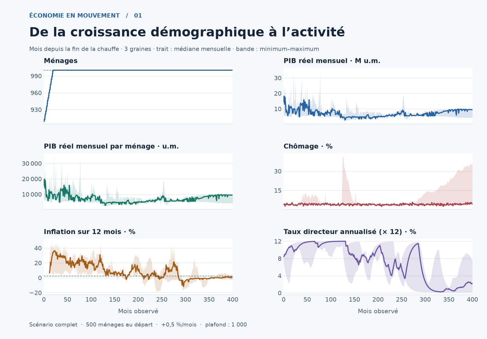
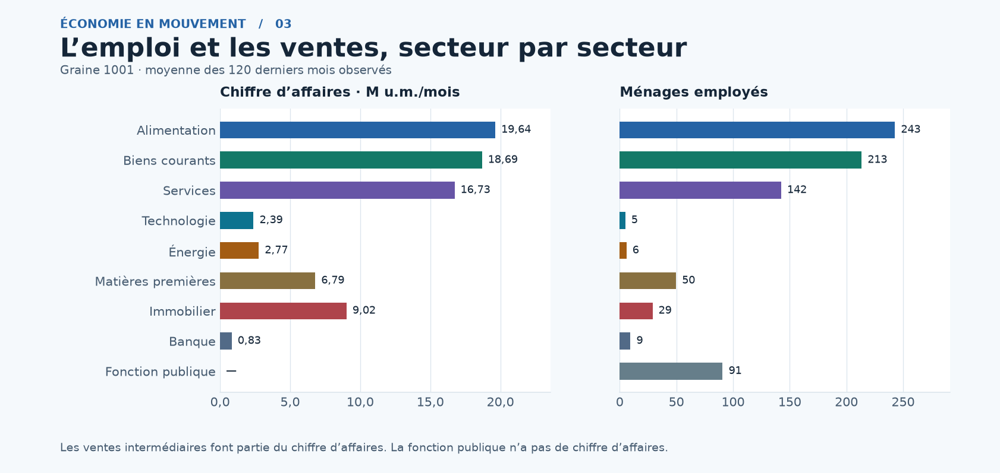
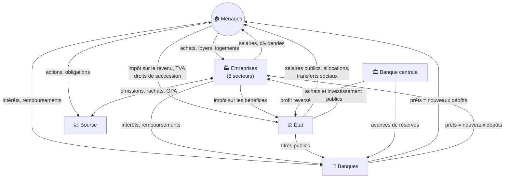
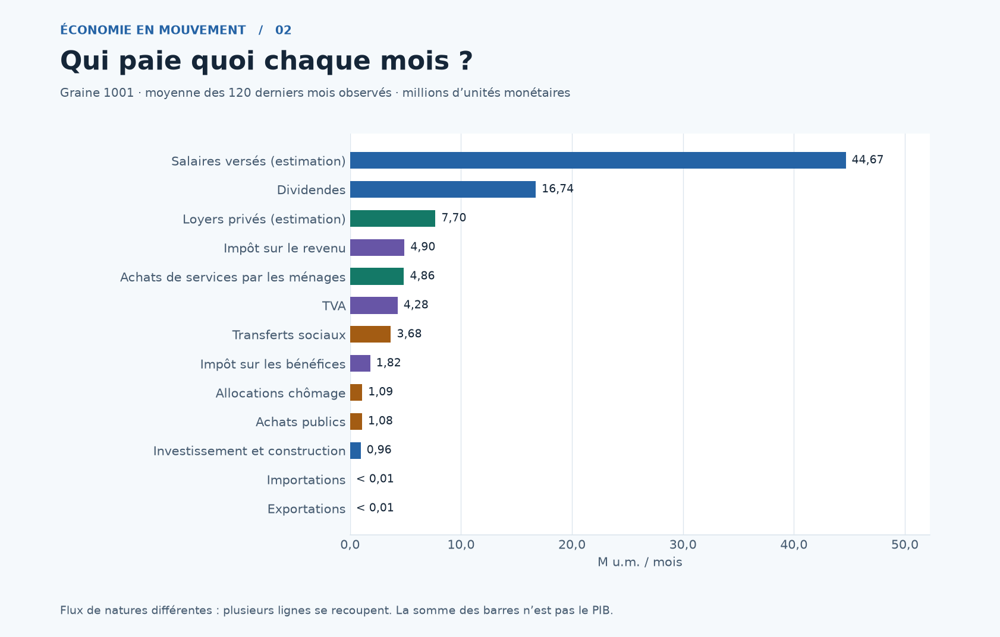
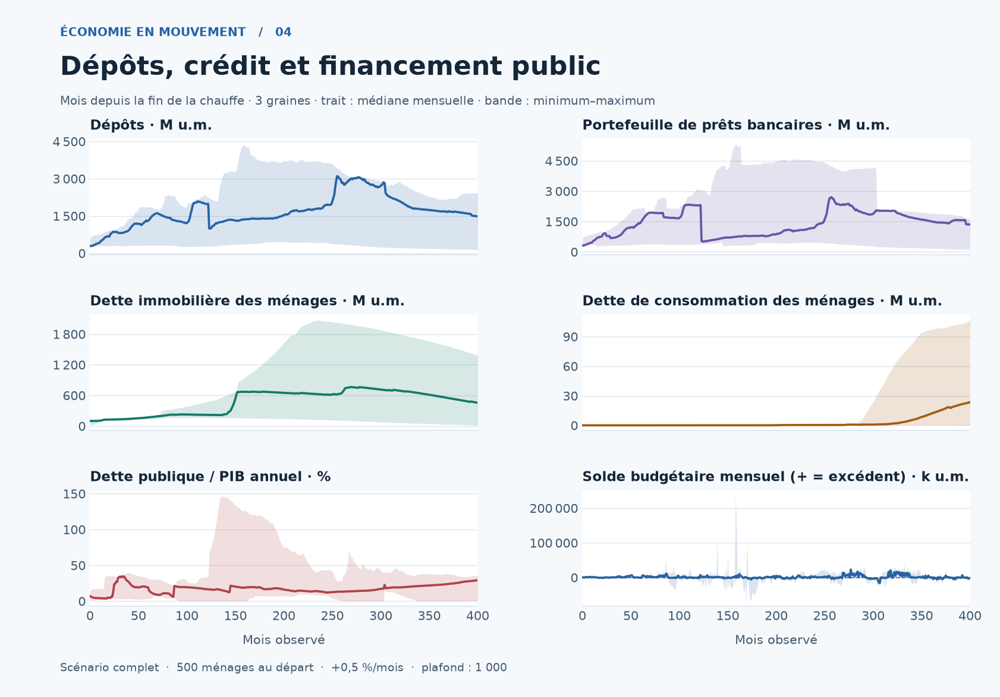
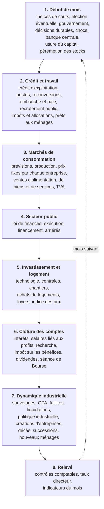
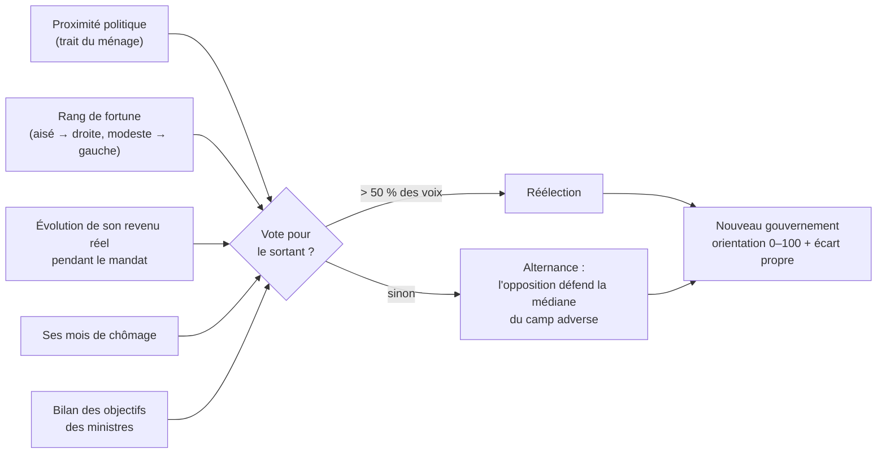
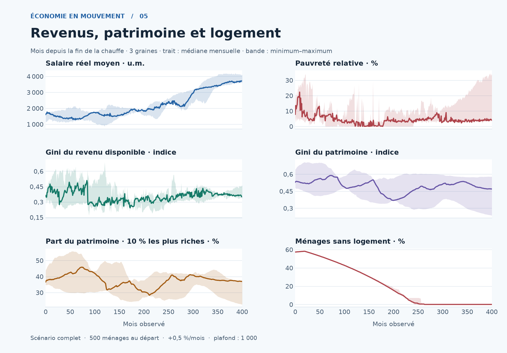
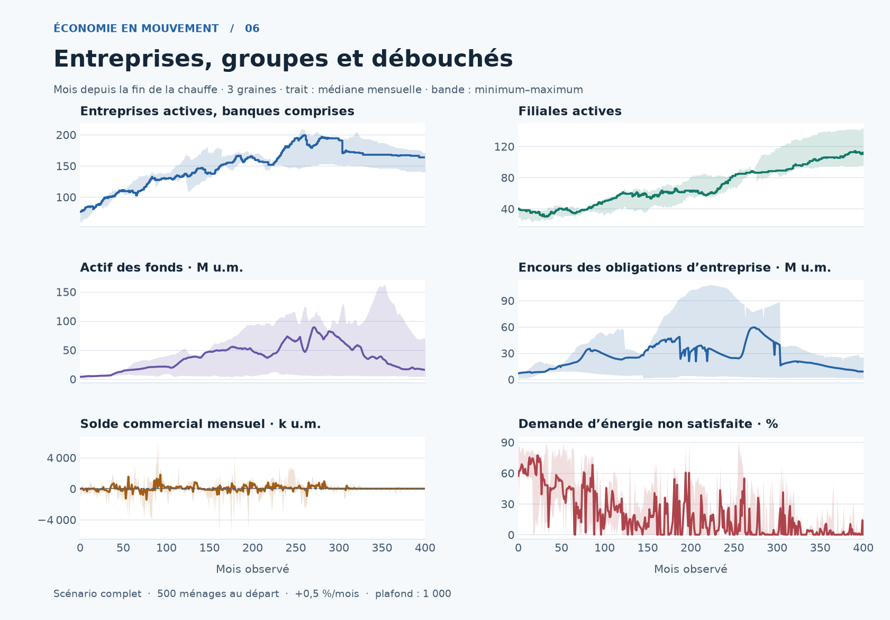
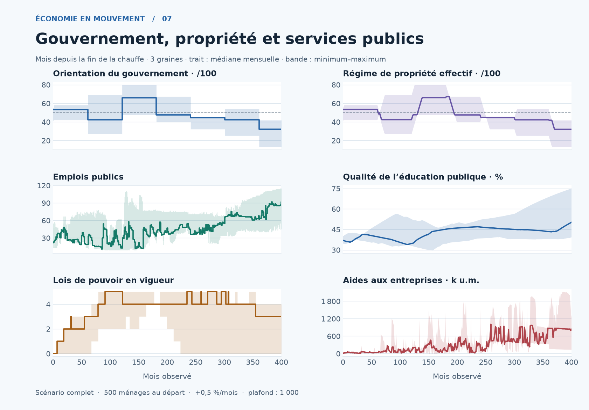

# Économie en mouvement

**Une économie simulée mois par mois : des ménages, des entreprises, des banques,
un gouvernement élu et une banque centrale prennent leurs propres décisions. Le PIB,
le chômage et l’inflation émergent de leurs interactions.**

Le scénario historique documenté ici part de **500 ménages et 24 entreprises**, active les
**mécanismes des lots C à K**, dont les **objectifs ministériels enrichis** et le **régime de propriété**, et applique
une **croissance démographique de 0,5 % par mois**, plafonnée à **+100 %**. Après la chauffe,
il reste 20 mois avant d’atteindre **1 000 ménages**. Les graphiques suivent trois graines
pendant **400 mois**. [Réglages et résultats](#7-le-scénario-complet-en-chiffres) ·
[Statistiques détaillées](docs/statistiques_scenario_complet.md).

Les **lots L à S** ajoutent un monde de quatre régions au plus, les médias, les travailleurs
frontaliers et déménagements, les rachats multirégionaux, la concurrence fiscale, l'apprentissage
et les relations bancaires individuelles. Ils sont **désactivés au démarrage**. Leur protocole
et leurs mesures sont séparés du scénario historique : [rapport de livraison](results/lot_l_monde/RESUME.md).

<p align="center">
  
</p>

- **Multi-agents** : chaque ménage, entreprise et banque est un objet avec sa trésorerie, ses dettes,
  ses titres, son emploi ou ses salariés.
- **Mensuel et reproductible** : les réglages, la graine, la version du moteur et
  l’environnement d’exécution définissent la trajectoire.
- **Monnaie cohérente** : la monnaie naît du crédit bancaire, chaque paiement a une contrepartie,
  et les bilans sont rapprochés tous les mois.
- **Politique endogène** : les ménages votent tous les cinq ans. Le gouvernement élu nomme
  des ministres parmi eux, vote une loi de finances, fixe le salaire minimum et mène une
  politique industrielle.
- **Démographie** : les chefs de ménage vieillissent et meurent. Un héritier leur succède, et
  l'État prélève des droits de succession.
- **Interface Streamlit** : on peut tout observer et intervenir en cours de route, par exemple
  donner de l'argent à un ménage, imposer un gouvernement ou forcer un taux d'impôt.
- **Moteur en Python pur** (bibliothèque standard) et une suite de plus de 600 tests.

> Les crises, faillites, pénuries et récessions font partie des résultats possibles : le modèle
> n'est pas recalibré pour les éviter.

L'[audit économique du 12 novembre 2026](docs/audit_economique_20261112.md) corrige la
comptabilisation des stocks dans le PIB, les matières disponibles sans extracteur,
l'exploration non financée, la cohérence du capital bancaire et les saisies sans paiement.
Il fiabilise aussi les outils d'évaluation. Les graphiques historiques ci-dessous précèdent
ces corrections ; le rapport décrit leur validation et les limites qui restent à traiter.

---

## Sommaire

1. [Démarrage rapide](#1-démarrage-rapide)
2. [Les agents](#2-les-agents)
3. [Le circuit économique : qui achète quoi à qui](#3-le-circuit-économique--qui-achète-quoi-à-qui)
4. [Un mois de simulation, phase par phase](#4-un-mois-de-simulation-phase-par-phase)
5. [Les mécanismes en détail](#5-les-mécanismes-en-détail)
6. [L'État et la politique](#6-létat-et-la-politique)
7. [Le scénario complet en chiffres](#7-le-scénario-complet-en-chiffres)
8. [L'interface](#8-linterface)
9. [Utiliser le moteur en Python](#9-utiliser-le-moteur-en-python)
10. [Organisation du code](#10-organisation-du-code)
11. [Tests et reproductibilité](#11-tests-et-reproductibilité)
12. [Limites connues](#12-limites-connues)

---

## 1. Démarrage rapide

Python 3.11 ou plus récent (vérifié avec Python 3.13).

```bash
python -m venv .venv
# Windows (PowerShell) : .\.venv\Scripts\Activate.ps1
# Linux / macOS        : source .venv/bin/activate
python -m pip install -r requirements.txt
python -m streamlit run main.py
```

Dans la barre latérale, réglez les conditions de départ puis cliquez sur
**Réinitialiser la simulation**. **Un mois** fait avancer d'une période ; **Avancer** en
enchaîne plusieurs. Au démarrage, le moteur simule d'abord **120 mois de chauffe** (dix ans)
pour que l'économie trouve son propre régime avant l'observation. Le résultat de la chauffe est
mis en cache dans `.cache/` : une réinitialisation avec le même code et les mêmes réglages
réutilise cet état.

Pour rejouer les mesures de ce README dans l’interface, appliquez les
[réglages du scénario complet](#réglages-et-protocole) avant la réinitialisation.
Gardez le monde, les médias, les relations bancaires individuelles, les agents apprenants et le
lot T (offres publiques réalistes, croissance proportionnelle des effectifs) et la rareté des
matières premières désactivés, et l'efficacité de la recherche à 0,25, pour reproduire ces anciens
graphiques. Pour explorer les nouveautés, **Tout activer**
puis **Réinitialiser** ouvre le monde ; choisissez la **Région observée** et consultez **Monde**.
Les commandes d'avance font progresser toutes les régions simultanément.

Pour les graphiques et les expériences (Matplotlib) :

```bash
python -m pip install -r requirements-docs.txt
```

---

## 2. Les agents

| Agent | Avant la chauffe du scénario complet | Ce qu'il possède | Ce qu'il décide |
|---|---|---|---|
| **Ménages** | 500 ; plafond de 1 000 | trésorerie, compétence, métier, âge, logement, actions, obligations, dettes | travailler, consommer, épargner, placer, acheter ou louer un logement, devenir bailleur, se reconvertir, créer une entreprise, voter |
| **Entreprises** | 24, soit 3 dans chacun des 8 secteurs, banques comprises | stocks, capacité de production, centrales, technologie, salariés, dettes, titres | produire, fixer prix et salaires, embaucher, licencier, investir, emprunter, verser des dividendes, racheter un concurrent |
| **Banques** | 3 des 24 entreprises | prêts, dépôts, fonds propres, titres publics | prêter selon leurs fonds propres, fixer leurs marges, absorber les pertes ; elles peuvent faire faillite et être résolues |
| **Banque centrale** | 1 | réserves, avances aux banques | taux directeur par une règle de Taylor lissée, avances de réserves |
| **État** | 1 | trésorerie, dette, participations, fonction publique | voir [§ 6](#6-létat-et-la-politique) : élection, ministres, budget, impôts, salaire minimum, politique industrielle |

Les huit secteurs : **Alimentation, Biens courants, Services, Technologie, Énergie,
Matières premières, Immobilier, Banque**, plus la **fonction publique**. Le travail est
organisé en dix métiers : opérateur, technicien, ingénieur, développeur, gestionnaire,
commercial, financier, bâtiment, extracteur et agent. Chaque secteur demande son propre
mélange de métiers, et un ménage au chômage peut se reconvertir.

<p align="center">
  
</p>

Sur les 120 derniers mois de la graine 1001, l’alimentation, les biens courants et les services
rassemblent environ **599 emplois** en moyenne ; la fonction publique en compte **91**.
La technologie et l’énergie ont des chiffres d’affaires de **2,39 M** et **2,77 M u.m. par
mois**, avec environ **5 et 6 emplois**. Le chiffre d’affaires comprend les ventes intermédiaires.

---

## 3. Le circuit économique : qui achète quoi à qui

### Vue d'ensemble



### La chaîne de production entre entreprises

Une entreprise achète à d'autres entreprises une partie de ce qu'elle utilise : énergie, matières,
services numériques, locaux. Ces achats sont de vrais paiements d'agent à agent. Un fournisseur
sans salarié ne livre rien et n'encaisse rien : la commande refusée est mesurée comme une pénurie.

| Secteur | Vend à | Ce qui est échangé |
|---|---|---|
| ⛏️ **Matières premières** | Alimentation, Biens courants | matières tirées d'un stock naturel qui s'épuise, plus le recyclage |
| ⚡ **Énergie** | toutes les entreprises | électricité produite par des centrales qui s'usent, et capacité de production vendue à l'Alimentation et aux Biens courants |
| 💻 **Technologie** | entreprises et ménages | équipements et services numériques, sources de gains de productivité |
| 🧰 **Services** | ménages et entreprises | loisirs, santé, réparation, commerce, transport, formation |
| 🏗️ **Immobilier** | ménages | logements construits par des chantiers, loués ou vendus |
| 🥖 **Alimentation**, 📦 **Biens courants** | ménages | consommation finale, TVA comprise |
| 🏦 **Banque** | tous | crédit, dépôts, frais |

### Les ordres de grandeur

Quelques flux du scénario complet, en moyenne sur les mois **281 à 400** de la graine **1001**.
Les montants sont nominaux ; **u.m.** désigne une unité monétaire simulée.

<p align="center">
  
</p>

La masse salariale estimée est de **44,67 M u.m. par mois** (salaire moyen × emplois),
les dividendes de **16,74 M** et les loyers privés estimés de **7,70 M** (loyer de référence
× baux occupés). Le graphique juxtapose des flux de différentes natures : une vente peut financer
des salaires, des impôts et des dividendes, donc les barres ne s’additionnent pas.

### La monnaie naît du crédit

Lorsqu’une banque accorde un prêt, elle crée un dépôt du même montant ; le remboursement
du principal détruit ce dépôt. La banque centrale peut fournir aux banques les réserves
exigées (10 % des dépôts au réglage de départ), au taux directeur. Son profit revient à l’État.
`validate_financial_accounts` rapproche les dettes des emprunteurs avec les créances bancaires
et la dette publique avec les titres détenus. Le résidu monétaire est un contrôle distinct
des billets et dépôts : son maximum absolu est de **0,000314 u.m.** sur les trois graines.

<p align="center">
  
</p>

Les trajectoires de crédit divergent fortement. Au mois 400, l’encours des prêts bancaires
va de **114,52 M** à **1 641,56 M u.m.**, selon la graine. Le registre des résolutions
distingue les reprises de banques, les interventions sur la dernière banque et les
recapitalisations de dernier recours. Le [détail comptable](docs/statistiques_scenario_complet.md#5-rapprochements-comptables)
signale aussi un écart ponctuel dans le livre de trésorerie de l’État, à la graine 1001.

---

## 4. Un mois de simulation, phase par phase

`EconomySimulation.step()` enchaîne huit phases dans un ordre fixe. Chacune lit et complète les
flux du mois (`MonthFlows`). La dernière produit un relevé (`MarketRecord`) d'une centaine
d'indicateurs.



Plusieurs générateurs aléatoires séparés (marché du travail, prévisions, politique, démographie,
institutions) isolent les mécanismes. Ajouter un tirage dans l'un ne décale pas les autres, et
c'est ce qui permet une reproduction exacte.

---

## 5. Les mécanismes en détail

### Ménages
- **Revenus** : salaire, allocation chômage, transferts sociaux, dividendes, coupons
  d'obligations, intérêts des dépôts et loyers s'ils sont bailleurs.
- **Consommation** : le budget alimentaire et le budget de services suivent la **loi d'Engel**.
  Quand le revenu réel monte, la part de l'alimentation baisse et celle des services augmente.
  Chaque ménage anticipe son revenu et son risque de chômage avant d'acheter.
- **Épargne et placements** : le ménage garde environ trois mois de revenu en trésorerie et place
  le reste en actions et en obligations selon son goût du risque. Les portefeuilles sont
  rééquilibrés progressivement.
- **Logement** : un ménage est propriétaire, locataire ou sans logement. Il peut acheter à crédit
  (prêt hypothécaire, saisie en cas de défaut). Il peut aussi devenir bailleur si le rendement
  locatif attendu, vacance comprise, dépasse celui des obligations plus une prime de risque.
- **Crédit à la consommation** : il a des mensualités et peut tomber en défaut. La banque passe
  alors la perte.
- **Entrepreneuriat** : un ménage au tempérament entrepreneurial peut fonder une entreprise
  lorsqu'il voit des commandes non servies. L'entreprise porte son nom, et le fondateur revend
  ses titres en Bourse au fil du temps.
- **Vie et mort** : la mortalité suit une loi de Gompertz (espérance de vie d'environ 74 ans).
  Un héritier de 20 à 30 ans reprend le patrimoine, les dettes et l'emploi, mais tire sa propre
  compétence. Sa compétence de départ dépend de la qualité de l'**éducation publique**.

### Entreprises
- **Production** : elle dépend des salariés (et de leurs métiers et compétences), de la capacité
  installée, de l'énergie livrée, des matières et du niveau technologique.
- **Prix** : chaque entreprise fixe son prix selon ses commandes non servies, ses stocks, ses coûts
  et la concurrence. Le prix de marché est la moyenne des prix affichés.
- **Économies d'échelle** (désactivées par défaut ; barre latérale, rubrique « Concurrence, dette
  & entreprises ») :
  - **remise sur le volume** (`volume_discount_max`) : dans les achats entre entreprises (énergie,
    services, technologie, immobilier d'entreprise), une commande paie
    `1 − max × v / (v + 5 000)` du prix, où v est la commande au prix de base déflatée. La remise
    ne dépasse jamais la marge observée des fournisseurs : pas de vente sous le coût. Les
    matières premières, payées au prix du marché des ressources, n'ont pas de remise ;
  - **frais de structure** (`fixed_cost_share`) : chez les producteurs d'alimentation et de
    biens, cette part des intrants non matériels devient un forfait mensuel calé sur les ventes
    moyennes du secteur. Le coût total est inchangé à la taille moyenne ; au-delà, le coût par
    unité baisse, et le prix de l'entreprise suit son coût moyen. Une entreprise à l'arrêt ne
    paie rien. **Attention** : dès 10 %, ce mécanisme fait émerger des quasi-monopoles en chaîne
    en alimentation et en biens, et double faillites et chômage (mesures :
    `results/lot_d_echelle/RESUME.md`).
- **Salaires** : l'offre salariale monte quand les postes restent vacants. Elle baisse quand le
  chômage de longue durée est élevé ou quand la recette ne couvre plus la paie. Elle ne descend
  jamais sous le salaire minimum légal.
- **Investissement** : une entreprise achète de la capacité ou des centrales, et investit en
  recherche, en jugeant la rentabilité au taux d'actualisation du moment. La connaissance
  accumulée fait monter la productivité globale (PGF) : chaque mois, le stock croît de
  `knowledge_growth_per_intensity` × intensité de recherche (en part du PIB) et perd 0,2 %
  d'obsolescence. Le curseur « Efficacité de la recherche » (barre latérale, rubrique
  « Politique publique & hasard ») règle ce coefficient : 0,25 par défaut, trajectoire inchangée.
  À 0,5 avec les réglages de base, le PIB réel par ménage croît d'environ 2 % par an au lieu de
  reculer. Dans le scénario complet, 0,5 épuise les matières premières vierges, sauf avec la
  rareté des matières premières ci-dessous ou une exploration qui reconstitue 100 % des réserves
  (voir [§ 12](#12-limites-connues)). « Tout activer » porte ce coefficient à 0,5.
- **Rareté des matières premières** (`raw_material_scarcity`, désactivée par défaut, incluse dans
  « Tout activer ») : quand le stock vierge passe sous son niveau de départ, le prix plancher des
  matières reçoit une rente de rareté (× 1 + 0,5 × rareté / (1 − rareté)) et l'exploration
  remplace une part croissante des volumes extraits (0,95 + 0,5 × rareté), pour la production
  comme pour les chantiers. Le stock se stabilise près de son niveau de départ au lieu de
  s'épuiser d'un coup.
- **Finance** : crédit d'exploitation, dividendes, émission d'actions, obligations, offres
  publiques de rachat sur des concurrents moins bien valorisés. Le régime de propriété permet
  aussi un rachat ciblé de titres pour constituer les parts salariées (voir [§ 6](#6-létat-et-la-politique)).
- **Cours de Bourse** : les ordres font bouger le cours (±15 % par mois au plus), rappelé de 18 %
  par mois vers une valeur fondamentale qui mêle fonds propres et bénéfices capitalisés. Par
  défaut, c'est le bénéfice du mois, extrapolé, qui est capitalisé ; avec
  `stock_earnings_smoothing_months` (0 par défaut, lot F2), c'est la moyenne des derniers mois,
  ce qui stabilise la valeur vers laquelle le cours est rappelé. **Non validé** : à 12 mois, deux
  graines sur cinq s'effondrent après le mois 700 (`results/lot_f_stabilite/RESUME.md`) ; à
  laisser à 0 hors étude.
- **Fin de vie** : une entreprise insolvable fait faillite. Une entreprise restée sans salarié et
  sans perspective est liquidée à l'amiable, et sa trésorerie revient aux actionnaires.

### Groupes, magasins, fonds et expérience (lot G, désactivés par défaut)

Huit mécanismes d'entreprise (`economy/enterprise.py`), chacun derrière sa case de la rubrique
« Groupes, magasins, fonds & expérience » de la barre latérale. Tant qu'aucun n'est coché, la
simulation est identique au bit près. Cochés, ils agissent dès la période de chauffe.

| Réglage | Ce qui se passe |
|---|---|
| `experience_learning` | **Expérience.** Compétence = n / (n + 3). Un fondateur qui a déjà créé des entreprises démarre la suivante avec une productivité et une innovation relevées d'au plus 10 %, et la banque lui reconnaît une expérience de direction. À l'embauche, le salaire se négocie dans une bande de ± 5 % autour de l'offre : le salarié qui a souvent changé d'employeur obtient plus, l'employeur qui a beaucoup recruté concède moins. Un acquéreur expérimenté attend moins entre deux opérations et garde les meilleures pratiques. L'expérience disparaît à la succession. |
| `property_upkeep` | **Gros entretien des logements**, en plus de l'entretien courant (0,12 % du prix par mois, déjà payé par tous les propriétaires). L'état de chaque parc s'use de 0,2 % par mois ; le propriétaire paie les travaux aux services et aux matières s'il en a les moyens ; un logement dégradé se loue moins cher (loyer × état, au moins 30 %). |
| `consumer_preferences` | **Préférences et données.** Chaque ménage a un goût, chaque producteur d'alimentation ou de biens un style ; l'affinité relève jusqu'à 50 % le poids du producteur dans les achats du ménage. Les entreprises technologiques vendent les données des ménages équipés : un producteur bénéficiaire y consacre 1 % de son chiffre d'affaires et rapproche son offre du goût de ses clients (connaissance oubliée de 5 % par mois). |
| `diversification` | **Filiales.** Une entreprise n'a qu'un secteur ; pour vendre plusieurs produits, une entreprise rentable crée une filiale dans le secteur le plus attractif autre que le sien (mêmes signaux que les ménages fondateurs), lui apporte la moitié de sa trésorerie libre et en détient tout le capital. Au plus une création par mois dans l'économie ; les dividendes remontent à la société mère. |
| `conglomerate_takeovers` | **Rachats entre secteurs.** Offre publique aux règles existantes (cours + 30 %, seuil de contrôle), sur une entreprise plus petite d'un autre secteur, qui devient une filiale sans fusion. L'acquéreur n'offre que s'il apporte quelque chose : il est plus productif que la cible (elle rattrape un quart de l'écart une fois rachetée) ou ses magasins lui apportent des ventes. |
| `retail_stores` | **Magasins.** Un producteur d'alimentation ou de biens ouvre un magasin (40 000 € de départ, 600 € de charges par mois, indexés sur les salaires) quand les ventes ajoutées rapportent plus que le coût de ses fonds propres. n magasins multiplient son poids dans les achats par 1 + 0,5 × n / (n + 3). Chaque magasin demande deux vendeurs (un réseau en sous-effectif ne sert qu'au prorata) ; la commodité d'achat relève un peu les quantités voulues par les ménages (au plus 5 %). |
| `group_distribution` | **Distribution de groupe.** Les magasins d'un groupe vendent les produits de toutes ses entreprises, et l'acquéreur compte ce gain dans la valeur d'une cible : une grande entreprise bien distribuée a intérêt à racheter un petit producteur. Demande des magasins et des groupes. |
| `private_startups` | **Non cotées et fonds des banques.** Une entreprise fondée par un ménage n'est plus cotée à sa création. Chaque banque gère un fonds d'investissement où les ménages placent environ 5 % de leur épargne (selon leur goût du risque), contre 1,8 % de frais par an ; le fonds finance les besoins des non cotées, relève leur productivité de 5 % à son premier apport, et leur valeur est estimée sans Bourse. L'introduction en Bourse n'arrive que si le besoin restant dépasse la moitié des fonds propres, ou quand le fonds veut sortir : sa participation vaut deux fois ce qu'elle a coûté, au plus tard après cinq ans. Le fonds place aussi sa trésorerie excédentaire en actions cotées, et ne vend un titre coté que lorsque son cours atteint sa valeur fondamentale ou qu'il manque de trésorerie. |

Mesure (5 graines × 400 mois, chaque mécanisme seul puis les huit ensemble, contre le témoin) :
aucun effondrement, comptes exacts, mais des effets du même ordre que l'écart entre graines ;
tableaux et réserves dans `results/lot_g_entreprises/RESUME.md`.

### Salariés obligatoires et conseil d'actionnaires (lot H, désactivés par défaut)

Deux réglages de la même rubrique de la barre latérale :

- **Salariés obligatoires** (`staffless_closure_months`, 0 = jamais) : une entreprise non bancaire
  restée ce nombre de mois sans aucun salarié est fermée. Sans dette ni actif, sa trésorerie est
  versée aux actionnaires ; sinon ses actifs sont vendus à un concurrent, ses banques remboursées
  et le reste revient aux actionnaires (la dette non remboursée est une perte des banques, comptée
  parmi les faillites). Jamais la dernière entreprise de son secteur, une banque ou une
  participation de l'État. Sans ce réglage, une entreprise peut rester une coquille vide jusqu'à
  24 mois, et indéfiniment si elle a des dettes ou des actifs.
- **Conseil d'actionnaires** (`shareholder_governance`) : les quatre plus gros actionnaires de
  chaque entreprise (ménages, entreprises, État, fonds) votent selon leurs titres. Ils nomment le
  dirigeant parmi les salariés (un actionnaire salarié vote pour lui-même, les autres pour le
  salarié le mieux noté), le révoquent après un an de mandat si l'entreprise perd de l'argent
  depuis plus longtemps que leur patience (6 mois, 3 à 9 pour un ménage selon son goût du risque),
  et orientent la part des bénéfices réinvestie (entre la moitié et une fois et demie de sa
  valeur de départ). Sans ce réglage, le dirigeant est le salarié le mieux noté, à un tirage près,
  et n'est jamais révoqué.

Avant de liquider une entreprise sans salarié, le moteur tente une **reprise** : sa société mère,
si elle en a une et les moyens, souscrit une augmentation de capital de trois mois de paie (une
fois tous les deux ans) ; sinon l'entreprise du même secteur qui a des salariés et le plus de
trésorerie l'absorbe, si les actifs de la cible couvrent ses dettes. La liquidation n'arrive
qu'en dernier recours.

Mesure : `results/lot_g_entreprises/RESUME.md`, sections « Lot H » et « Lot I ».

### Ce que le lot I ajoute aux mécanismes des lots G et H

Sans nouveau réglage : ces règles s'appliquent quand le mécanisme concerné est activé.

- **Groupes** : chaque mois, une société mère recapitalise une filiale qui a un besoin de
  trésorerie (au plus un quart de sa trésorerie libre), ou la met en vente si elle perd de
  l'argent depuis douze mois ou si la mère elle-même manque de trésorerie : la filiale est
  introduite en Bourse et ses titres vendus à la séance, par dixièmes.
- **Magasins** : deux vendeurs par magasin, qui s'ajoutent au besoin en personnel du producteur ;
  commodité d'achat (voir le tableau).
- **Préférences** : le goût de chaque ménage dérive lentement, un héritier a son propre goût, et
  un producteur qui a acheté des données déplace son style vers le goût moyen de ses clients les
  plus proches. Sans données, il ne bouge pas.
- **Données** : payées au prix du marché des services technologiques (cher, le même budget en
  livre moins) ; leur utilité dépend de l'innovation et de la productivité des vendeurs.
- **Fonds** : placements en actions cotées, sortie décidée sur la valeur (voir le tableau).
- **Conseil d'actionnaires** : son goût du risque fixe l'exigence de rendement des ouvertures de
  magasins, des créations de filiales et des offres de rachat (± 20 %).
- **Expérience des dirigeants** : à chaque anniversaire de mandat, l'entreprise gagne un peu de
  productivité (+0,4 % la première année, de moins en moins ensuite) ; un dirigeant remplacé
  repart de zéro.
- **Barre latérale** : boutons « Tout activer » et « Tout désactiver » pour tous les mécanismes
  optionnels, exigence de fonds propres contracyclique, recapitalisation de dernier recours des
  banques, lots J et K compris (fermeture des entreprises sans salarié réglée à 6 mois), et la
  rareté des matières premières ; « Tout activer » porte aussi l'efficacité de la recherche à 0,5
  et « Tout désactiver » la remet à 0,25.

### Obligations d'entreprise, commerce extérieur, syndicats (lot J, désactivés par défaut)

Trois mécanismes (`economy/macro.py`), chacun derrière sa case de la rubrique « Obligations,
commerce extérieur & syndicats » de la barre latérale.

- **Obligations d'entreprise** (`corporate_bonds`). Une entreprise non bancaire, rentable et
  installée depuis deux ans, emprunte aux ménages et aux fonds des banques : pour couvrir un
  besoin de trésorerie, ou pour rembourser sa banque quand l'obligation coûte moins cher. Un
  ménage y vise environ 5 % de son épargne (les prudents davantage) si le taux dépasse celui des
  dépôts. Acheter une obligation déplace un dépôt, sans créer de monnaie, alors qu'un prêt
  bancaire en crée. Coupon mensuel, amortissement en cinq ans, encours limité à la moitié des
  fonds propres. En faillite, les obligataires passent après les banques et avant les
  actionnaires.
- **Commerce extérieur** (`foreign_trade`). Un reste du monde vend aux ménages la moitié de
  l'alimentation et des biens que le marché intérieur n'a pas servis, moins si son prix converti
  est plus élevé. Il redépense chaque mois la moitié de la monnaie gagnée : en stocks des
  producteurs d'abord, en services et en technologie pour le reste. Il ne détient jamais plus de
  2 % du PIB annuel : aucune monnaie n'entre ni ne sort. Le taux de change flotte (un déficit
  renchérit les importations). Les exportations entrent dans le PIB.
- **Syndicats** (`collective_bargaining`). Chaque secteur négocie une fois par an. Le syndicat
  demande le rattrapage de l'inflation que les salaires n'ont pas suivie, plus la moitié de la
  marge au-delà de la référence du secteur, au plus 5 %. Il obtient cette demande × son pouvoir :
  50 % sous un gouvernement du centre, 25 % à l'extrême droite, 75 % à l'extrême gauche, moins
  quand le chômage monte. L'accord relève les offres salariales du secteur et les empêche de
  baisser pendant douze mois. Si l'écart dépasse 2,5 points, le secteur fait grève un mois (la
  moitié du travail perdue, la moitié de l'écart concédée), au plus une fois tous les trois ans.

Mesure : `results/lot_g_entreprises/RESUME.md`, section « Lot J ».

### Offres publiques réalistes et croissance des effectifs (lot T, désactivés par défaut)

Sans ce lot, une offre publique dans un même secteur n'est lancée que si l'acquéreur juge la
cible **sous-évaluée** (valeur fondamentale au-dessus du cours + 30 %), alors que les
actionnaires de la cible connaissent **la même valeur** et ne vendent pas en dessous : les
entreprises, les fonds et l'État refusent toujours, seuls quelques ménages prudents apportent leurs
titres. Dans le scénario complet, moins de 0,4 % des offres aboutissent (2 589 offres pour
4 absorptions, graine 1001). Deux cases de la rubrique « Concurrence, dette & entreprises » :

- **Offres publiques réalistes** (`synergy_takeovers`, economy/consolidation.py). L'offre vaut le
  cours + 30 %, relevée à la valeur fondamentale si le cours est trop bas. L'acquéreur ne la lance
  que si ce qu'il apporte justifie le prix : ses méthodes (la cible rattrape un quart de son écart
  de productivité, comme pour les rachats entre secteurs), ses magasins (distribution de groupe) et,
  avec les frais de structure, le forfait mensuel de la cible que la fusion évite. Son conseil
  d'actionnaires garde son exigence. Jusqu'à `takeover_share_payment` (50 %) du prix est payé en
  **actions nouvelles** de l'acquéreur coté : la trésorerie libre ne finance que le reste. La
  productivité fusionnée est la moyenne pondérée par les effectifs, au lieu d'une moyenne simple
  qui coûtait à un grand acquéreur la moitié de son avance. Le seuil de contrôle, l'acceptation par
  chaque actionnaire, le nombre minimal d'entreprises par secteur et la politique de concurrence
  de l'État restent inchangés.
- **Croissance des effectifs proportionnelle** (`proportional_hiring`, economy/labor.py). Une
  entreprise embauche ou licencie chaque mois jusqu'à `staff_change_share` (10 %) de son effectif,
  jamais moins que les bornes fixes de 3 embauches et 2 licenciements, qui s'appliquent sinon à
  toutes les tailles.

- **Procédure de sauvegarde** (`safeguard_procedure`, economy/safeguard.py). Une entreprise d'au
  moins dix salariés, en pertes depuis trois mois, avec moins de trois mois de paie en trésorerie,
  à qui les banques refusent le crédit de sa paie mais dont les recettes paient au moins un quart
  de ses salariés, obtient un plan : effectif ramené en un mois à ce noyau viable, dette bancaire
  abandonnée au-delà de la moitié de ce que ses recettes permettent de servir (perte des banques),
  prêt de sauvegarde de trois mois de paie. Le plan est noté sur la fiche de l'entreprise.

Les rachats d'une région à l'autre (lot P) gardent leurs propres règles : prise de contrôle sans
fusion, une seule nouvelle offre par mois dans le monde.

Mesure (scénario complet, 5 graines × 400 mois, contre le témoin) : avec les offres réalistes,
30 % des offres aboutissent (0,2 % sans), environ 600 absorptions par trajectoire, et la première
entreprise de l'alimentation fait 87 % du chiffre d'affaires du secteur sur les dix dernières
années (20 % sans). Mais le chômage moyen passe de 5,3 à 7,6 % (pic moyen de 21 à 32 %), et de
13,8 % avec les deux premières cases. La cause, tracée mois par mois : un géant qui a additionné
les dettes de ses rachats perd sa trésorerie, licencie tout son personnel en quelques mois et
survit en coquille. La procédure de sauvegarde ramène T1 + T2 à 7,8 % de chômage, mais elle porte
le témoin de 5,3 à 7,9 % et T1 seul de 7,6 à 10,5 % : elle ne corrige pas le problème. Aucune des
trois cases ne fait partie de « Tout activer ». Détail : `results/lot_t_rachats/RESUME.md` et
`DIAGNOSTIC.md`.

### Impôt, crédit, prix et embauche (lot U, désactivés par défaut)

Quatre réglages de la rubrique « Concurrence, dette & entreprises », issus d'un diagnostic du monde
« Tout activer » (12 mondes de trois régions, 400 mois) :

- **Impôt borné par la trésorerie** (`tax_capped_by_cash`) : l'impôt sur le revenu recouvré,
  arriérés compris, ne dépasse pas ce que le ménage possède ; le solde reste dû. Sans lui, des
  ménages passent en trésorerie négative et leur demande devient négative.
- **Poids des titres publics** (`sovereign_risk_weight`, 1 par défaut) : part des titres publics
  comptée dans l'exposition qui consomme les fonds propres des banques. À 0, la dette publique ne
  gèle plus le crédit privé.
- **Encadrement des prix levé en cas de pénurie** (`shortage_price_release`) : l'encadrement ne
  s'applique pas à un produit dont plus de 20 % de la demande n'a pas été servie le mois précédent.
- **Embauche tirée par la demande** (`demand_led_hiring`) : plafond d'embauche relevé et offre
  salariale alignée pour l'alimentation et les biens. **Mesuré nuisible** : le chômage moyen passe
  de 7,0 à 15,5 %. Hors de « Tout activer ».

Avec les trois premiers (inclus dans « Tout activer »), médiane de 36 régions : chômage moyen de
7,0 à 5,0 %, régions encore à plus de 25 % de chômage au mois 400 de 12 à 3, mois à crédit nul de
62 à 9,5, biens non servis de 49 à 28 %. L'inflation devient plus volatile (écart-type de 9,5 à
11,2 points) et 18 régions sur 36 connaissent encore une crise. Détail et réserves :
`results/chantiers_20261112/RAPPORT.md`.

### Société : dettes, jeux, marques, finance et contestation (lot V, désactivés par défaut)

Douze mécanismes (`economy/society.py`, `economy/ventures.py`), chacun derrière sa case de la
rubrique « Société : dettes, jeux, marques & finance » de la barre latérale. Tant qu'aucun n'est
coché, la simulation est identique au bit près. Résultats dans l'onglet **Société**.

| Réglage | Ce qui se passe |
|---|---|
| `personal_bankruptcy` | **Surendettement.** Une commission examine les ménages en impayé de crédit à la consommation dont la charge de dette dépasse la moitié du revenu : elle saisit leur trésorerie au-delà d'un mois de salaire minimum, efface le reste (perte de la banque) et les interdit de crédit pendant cinq ans. Un ménage en défaut ordinaire est interdit aussi. |
| `philanthropy` | **Dons et fondations.** Un ménage dont la fortune nette dépasse dix fois la moyenne donne chaque mois une part de l'excédent à une fondation (école, hôpital ou presse), qui dépense auprès des entreprises. L'école relève la compétence des nouveaux ménages, l'hôpital baisse la mortalité, la presse finance les médias. Le donateur gagne de la renommée, et de la notoriété avec le lot K. |
| `state_lottery` | **Loterie d'État.** La mise ne dépend pas du revenu, et les ménages modestes jouent jusqu'à trois fois plus que les plus riches. La moitié des mises va à l'État ; le reste nourrit une cagnotte qu'un seul joueur emporte, une fois sur quatre chaque mois. |
| `addictive_goods` | **Tabac et alcool.** Des ménages fondent deux entreprises d'un nouveau secteur. Un ménage dépendant veut la même quantité quel que soit le prix ; il paie une accise de 50 % et la TVA. Sa dépendance suit son penchant et son chômage ; les dégâts de santé s'accumulent, coûtent des soins (partagés entre l'État et le ménage selon l'orientation du gouvernement) et relèvent la mortalité. |
| `franchising` | **Franchises.** Un producteur rentable qui refuse des commandes loue sa marque et ses méthodes à un petit entrepreneur : droit d'entrée, puis redevance de 5 % du chiffre d'affaires. Le franchisé est une entreprise à part entière. |
| `brand_marketing` | **Marques.** Des ménages fondent des agences de marketing. Un producteur bénéficiaire y consacre 2 % de son chiffre d'affaires ; sa notoriété s'efface de 3 % par mois et relève jusqu'à 50 % son poids dans les achats des ménages. |
| `worker_buyouts` | **Coopératives de chômeurs.** Les salariés d'une entreprise liquidée la relancent avec leur épargne et six mois d'allocation chômage versés d'avance par l'État ; parts égales et incessibles. |
| `short_selling` | **Vente à découvert.** Des fonds spéculatifs financés par des ménages empruntent les titres d'une entreprise en pertes et endettée, les vendent à la séance de Bourse, et gagnent si le cours baisse ou si elle fait faillite. |
| `mortgage_securitization` | **Titrisation.** Une banque émet des titres adossés à la moitié au plus de ses prêts immobiliers. Intérêts, remboursements et pertes passent aux ménages porteurs ; les fonds propres de la banque sont libérés, elle peut prêter davantage. |
| `crowdfunding` | **Financement participatif.** Les ménages prêtent directement aux entreprises de moins de trois ans, sans banque ni création de monnaie ; en faillite ils passent après les banques. |
| `social_unrest` | **Manifestations et émeutes.** La tension suit le chômage au-delà de 10 %, la part du patrimoine des 10 % les plus riches au-delà de 60 % et la baisse du salaire réel. Une manifestation fait perdre 30 % du travail du mois ; une émeute détruit 2 % des stocks ; le gouvernement concède 10 % de transferts et d'allocation en plus, trois fois au plus. |
| `public_works` | **Grands travaux.** Route, réseau, port : chantiers de 18 à 36 mois payés aux entreprises, hors loi de finances. Un ouvrage achevé relève la productivité de tous de 2 % × son état ; l'entretien dépend de la doctrine et des fonds de l'État, et l'état se dégrade sans lui. |

Mesure (configuration de base, 3 graines × 240 mois, chaque mécanisme seul puis les douze
ensemble, contre le témoin) : comptes exacts, aucun effondrement, et des effets du même ordre que
l'écart entre graines (chômage moyen de 4,3 à 5,5 % selon la variante, 4,7 % pour le témoin, 4,4 %
pour les douze). Le surendettement ne se déclenche jamais dans cette configuration, faute de crédit
à la consommation en impayé. Les douze mécanismes font partie de « Tout activer ». Tableaux, ce
que chaque mécanisme a produit et limites : `results/lot_v_societe/RESUME.md`.

### Banques et banque centrale
- Les banques prêtent dans la limite de leurs **fonds propres** (8 % des prêts et titres). Les
  **réserves** exigées (10 % des dépôts) ne limitent pas le crédit : la banque centrale les fournit
  par des avances au taux directeur, dont les intérêts sont une charge des banques. Leur marge
  dépend du risque de défaut qu'elles observent.
- Une banque peut lever des fonds propres en Bourse. Si elle fait faillite, elle est **résolue** :
  la perte retombe sur les actionnaires, puis sur les créanciers, et l'État paie le reste.
- **Règle de Taylor** : taux annuel visé = 1,8 % + inflation + 0,5 × (inflation − cible)
  − 1,0 × (chômage − 5 %), avec inertie, un plafond à 12 % et une cible d'environ 2,4 % par an.
  La crédibilité de la banque centrale s'apprend : plus l'inflation reste proche de la cible, plus
  les entreprises fondent leurs anticipations sur la cible.
- **Structure des taux** (taux annuels par défaut) : crédit aux entreprises = taux directeur +
  marge de risque (perte attendue + coût des fonds propres immobilisés) ; crédit immobilier =
  directeur + 0,96 point ; crédit à la consommation = directeur + 7,2 points ; dépôts =
  directeur − 1,44 point, ajusté par chaque banque selon sa liquidité.
- **Marge supplémentaire des banques** (`bank_margin_offset`, 0 par défaut, réglable dans la
  barre latérale ou forcée en intervention) : points ajoutés à tous les nouveaux crédits
  (entreprises, immobilier, consommation) et au coût du crédit que les entreprises anticipent ;
  aucune marge ne descend sous zéro. Les prêts aux entreprises à taux variable gardent la marge
  de leur octroi.
- **Stabilité bancaire** (lot F, désactivés par défaut ; barre latérale, rubrique « Concurrence,
  dette & entreprises ») ; diagnostic : `results/lot_f_stabilite/DIAGNOSTIC.md` :
  - **exigence contracyclique** (`countercyclical_capital`) : quand la capacité de crédit du
    système passe sous 2 % de l'encours et que l'activité baisse, l'exigence de fonds propres
    descend de 0,25 point par mois jusqu'à 6 %, puis remonte au même rythme quand la capacité
    dépasse 5 % ;
  - **recapitalisation de dernier recours** (`bank_capital_backstop`) : après trois mois de
    capacité nulle, l'État souscrit des actions nouvelles des banques au cours, pour leur rendre
    une capacité de 5 % de leur encours (titres à l'État, décision au journal, financement par
    trésorerie ou emprunt).
- **Trésorerie propre des banques** (`bank_own_funds`, « cash » par défaut) : ce qu'une banque
  peut payer (salaires, charges, intérêts des dépôts, dividendes) n'est pas de la monnaie et
  n'entre pas dans l'identité du bilan bancaire. Par défaut c'est un compteur indépendant, que
  les pertes sur prêts ne réduisent pas : sur 800 mois il atteint 5 à 10 fois les fonds propres
  nets, et 30 à 50 % des dividendes bancaires sont versés au-delà du bénéfice. Avec « equity »,
  il est recalculé chaque mois comme la part liquide des fonds propres (fonds propres − actifs
  réels − prêts interbancaires accordés + emprunts interbancaires), et le capital distribué est
  celui qui dépasse l'exigence et son coussin. Mesuré sur 10 graines × 800 mois : les dividendes
  versés au-delà du bénéfice baissent de 87 %, mais les banques retiennent davantage, la demande
  baisse et les critères de stabilité tombent de 9 à 6 graines ; le réglage reste donc désactivé
  (`results/refonte_banque/JOURNAL.md`).

---

### Régions, médias, apprentissage et banques individuelles (lots L à S)

| Lot | Mécanisme | Où l'observer |
|---|---|---|
| L | Une à quatre économies avec gouvernements, banques centrales, monnaies et entreprises indépendants. Profils Nord industriel, Sud agricole, Littoral technologique et Bassin minier. Chauffe indépendante, puis isolement réglable avant intégration. | Monde ; sélecteur Région observée |
| M | Entreprises de médias fondées avec l'argent des ménages : journalistes, abonnements, publicité, propriétaires, ligne éditoriale, biais de perception et enquêtes soumises aux conflits d'intérêts. | Entreprises & bourse → Médias |
| N | Commandes d'alimentation et de biens sur la production du mois suivant, avantage de prix après transport et change, compensation sans création de monnaie régionale. | Monde : importations, exportations, change et chambres |
| O | Frontaliers conservant résidence, logement, crédits, consommation et vote ; mandataires salariés dans la région d'emploi. Déménagement après solde du logement et des crédits, avec maintien des actions à l'étranger. | Monde : frontaliers, arrivées et départs ; fiches des ménages |
| P | Ramassage de titres d'un concurrent étranger, prise de contrôle sans fusion, transmission de productivité et rapatriement des dividendes. | Monde → Groupes & filiales |
| Q | Filtrage des rachats de secteurs critiques selon la doctrine, vote comparatif et objectif d'impôt sur les sociétés tenant compte des voisins moins imposés. La contrainte budgétaire peut empêcher la baisse. | Monde : orientation, impôts ; État : budget et journal |
| R | Essais de prix et réinvestissement, imitation des pairs, style transportable des dirigeants ; précaution et goût du risque des ménages ; essais de coussin prudentiel des banques et d'effort des ministres. | Entreprises & bourse → Apprentissage |
| S | Banque principale par agent, dépôts et encours par clientèle, choix du prêteur, spécialisation, changements de banque, fuite des déposants et décotes localisées. | Entreprises & bourse → Relations bancaires |

L'onglet **Monde** a quatre sous-onglets (`economy/world_views.py`, lectures seules, montants en
unité commune : monnaie de la région × son taux de change) : **Régions** (totaux du monde, poids
de chaque région, comparaison dans le temps), **Entreprises du monde** (classement mondial par
capitalisation, chiffre d'affaires, salariés ou bénéfice ; leader de chaque secteur),
**Groupes & filiales** (filiales de chaque groupe par région, société mère et part détenue,
prises de contrôle, titres détenus d'une région à l'autre) et **Fortunes** (ménages les plus
riches du monde, titres gardés dans une autre région compris).

Tous les réglages sont dans les rubriques **Monde & régions** et **Médias, banques & apprentissage**
de la barre latérale ; ils s'appliquent à la réinitialisation. **Tout désactiver** retrouve une
simulation nationale sans ces mécanismes. Le registre exhaustif et les constantes se trouvent dans
[AUTONOMIE.md](AUTONOMIE.md). Les trois modules internes possèdent leur propre générateur aléatoire.

La compensation réserve les fonds disponibles de chaque payeur avant de résoudre les flux entre
régions. Une facture non financée ne finance pas une autre facture ; les produits non réglés
reviennent au stock. L'épargne d'un migrant déjà versée dans une chambre reste une créance jusqu'à
conversion, sans être comptée une seconde fois comme un apport de liquidité.
La TVA des importations et les recettes publiques tardives entrent dans le livre de l'État
du même mois ; la TVA entre également dans les impôts et le PIB publiés.

Les mandataires frontaliers restent hors de la population résidente. Ils occupent des postes
vacants après le recrutement local et reçoivent salaire et primes, conservés dans un compte de la
région d'emploi jusqu'à compensation. Le salaire effectivement rapatrié est déclaré et imposé à
résidence le mois suivant, avant consommation ; aucun salaire bloqué n'est imposé par anticipation.
Les ministres apprennent seulement avec les **objectifs enrichis** activés. Les banques apprennent
un coussin supplémentaire, sans pouvoir abaisser l'exigence réglementaire.

## 6. L'État et la politique

### L'élection

Tous les **5 ans**, chaque ménage vote :



### L'orientation : de 0 (libéral) à 100 (social)

L'orientation se traduit en **doctrines explicites**. Chaque gouvernement s'écarte un peu de la
doctrine type de son camp : deux gouvernements de même couleur ne mènent pas exactement la même
politique.

| Domaine | Libéral (< 35) | Centre (35–65) | Social (> 65) |
|---|---|---|---|
| **Budget** | équilibre ou excédent, remboursement de la dette | stabilise le ratio de dette hérité | déficit accepté (1 à 5 % du PIB) pour financer le programme |
| **Impôts** | revenu −50 %, tranche supérieure −90 %, bénéfices −50 %, TVA +30 % (amplitudes maximales) | réglages de base | revenu +50 %, tranche supérieure +90 %, bénéfices +50 %, TVA −30 % |
| **Revenus du capital** | prélèvement forfaitaire bas | forfait sous 50, barème au-delà | au barème avec les salaires |
| **Salaire minimum** | 50 % du salaire médian, indexation partielle ou gelée | 50 à 60 % | 68 à 80 % du médian, jamais baissé |
| **Transferts** | universels, faibles | base (5 % du PIB) | jusqu'à +80 %, en partie sous condition de ressources |
| **Services publics** | couverture des besoins à 80 %, point d'indice peu indexé | 95 % | 110 %, point indexé avec rattrapage |
| **Industrie** | laisser faire, privatiser | réguler les monopoles durables | opérateur public dans les secteurs critiques, garder les participations |
| **Droits de succession** | nuls à l'extrême droite | 20 % au-delà d'un abattement | jusqu'à 40 % |

### Le régime de propriété (lot E, désactivé par défaut)

Avec `ownership_regime` (case de la rubrique « État institutionnel » de la barre latérale),
l'orientation agit aussi sur les **règles de propriété des entreprises** (`economy/ownership.py`).
L'État porte un régime `r` de 0 (ultra-capitalisme) à 1 (coopératives), qui suit l'orientation du
gouvernement en place à raison d'un écart complet en 48 mois : une alternance s'applique
progressivement. Les règles sont interpolées, et ne changent rien au centre (`r` = 0,5) :

| Règle | Près de 0 | Centre | Près de 100 |
|---|---|---|---|
| Monopoles | aucune intervention (la durée avant un dossier tend vers l'infini) | 12 mois de problème | inchangé (opérateur public selon la doctrine) |
| Prises de contrôle (OPA) | seuil de contrôle 30 % au lieu de 50 % | 50 % | 70 %, et au moins 3 entreprises par secteur après une fusion |
| Dividendes | 1,5 × le taux de distribution | 12 % des bénéfices | moitié moins (vote des salariés) |
| Salaire de direction | inchangé | 5 × la référence | 3 × (vote des salariés) |
| Parts salariées | aucune | aucune | 30 % du capital des entreprises non bancaires |

Les **parts salariées** sont détenues à parts égales par les salariés de l'entreprise et leur
rapportent les dividendes correspondants. L'entreprise les constitue progressivement, sans
expropriation : elle attribue d'abord ses titres auto-détenus, puis rachète au cours, sur sa
trésorerie libre, des titres aux autres actionnaires (jamais à l'État), au plus 1 % de son
capital par mois. Un nouvel embauché reçoit sa part à mesure qu'elle se reconstitue. Au départ
d'un salarié, l'entreprise rachète sa part au cours ; faute de trésorerie, la part redevient une
détention ordinaire. Ces parts ne sont ni vendues en Bourse ni apportées à une offre publique. La
fiscalité du capital suit déjà la doctrine (forfait bas à droite). Aucun transfert direct de
richesse : l'enrichissement du 1 % et la concentration des marchés doivent émerger des règles.

### Le gouvernement en action

- **Une présidence et quatre ministres** (Finances, Travail, Industrie, Services publics) sont
  nommés **parmi les ménages**, selon leur proximité politique, leur expérience de direction et
  leur métier. Une personne pressentie peut refuser si le salaire proposé est trop bas.
- Chaque ministre reçoit un **objectif** chiffré, avec une échéance et une enveloppe. L'objectif
  oriente ses décisions, mais ne fixe jamais un résultat.
- **Objectifs enrichis** (`enriched_objectives`, désactivé par défaut ; case de la rubrique « État
  institutionnel » de la barre latérale). Chaque ministre a alors deux objectifs, principal et
  secondaire, choisis selon la doctrine. Ils ont la même échéance et se partagent l'enveloppe
  (le secondaire en reçoit un tiers).

  | Ministère | Indicateurs possibles | Levier actionné par un objectif en retard |
  |---|---|---|
  | Finances | dette / PIB, solde public, intérêts / recettes, arriérés / recettes | loi de finances : solde voulu relevé |
  | Travail | chômage, chômage de longue durée, taux d'emploi | recrutement de conseillers (service Emploi et formation) |
  | Travail | salaire minimum / médian, salaire réel médian | coup de pouce annuel du salaire minimum plafonné plus haut |
  | Industrie | monopoles, concentration (Herfindahl), prix de l'énergie | instruction plus rapide des dossiers de concurrence |
  | Industrie | participations non stratégiques ; investissement / PIB | cessions accélérées ; programme d'investissement relevé dans la loi |
  | Services publics | couverture des besoins, postes vacants | primes et point d'indice arbitrés par la présidence |
  | Services publics | qualité de l'éducation ; masse salariale | recrutements dans l'Éducation ; postes ouverts réduits |

  Une cible **dépend de la situation de départ** : si elle est déjà remplie à la fixation, elle
  est relevée d'un pas (un point de chômage, 2 % de salaire réel…), sans dépasser une borne
  atteignable. L'effort sur le levier vaut `objective_effort` (0,25) pour un principal en retard,
  la moitié pour un secondaire (`secondary_objective_weight`). Au vote et au bilan du mandat, un
  objectif secondaire compte pour la moitié d'un principal. Les deux objectifs et leur avancement
  sont affichés dans l'onglet État.
- **Cinq services publics**, dont l'Éducation, recrutent des agents en concurrence avec le privé,
  selon une grille de salaires.
- **Loi de finances** annuelle : elle fixe les impôts, les programmes et le financement. Si
  l'argent manque, l'État accumule des arriérés.
- **Politique industrielle** : régulation des prix d'un monopole, création ou nationalisation
  d'une entreprise publique, recapitalisation, privatisation par la Bourse.
- **Journal des décisions** : chaque décision a un auteur, une date, un motif, un montant et un
  financement.

### Influence, popularité, pouvoir et favoritisme (lot K, désactivés par défaut)

Neuf mécanismes (`economy/power.py`), chacun derrière sa case de la rubrique « Pouvoir, influence &
corruption » de la barre latérale. Tant qu'aucun n'est coché, la simulation est identique au bit
près. Cochés, ils agissent dès la période de chauffe ; leurs tirages viennent d'un générateur dédié.

| Réglage | Ce qui se passe |
|---|---|
| `influence_ranking` | **Influence.** Chaque ménage a un score de 0 à 100 : fortune (au plus 30, atteints à dix fois la fortune moyenne), fonction (présidence 35, ministre 22, dirigeant 6 à 28 selon le poids de son entreprise dans l'emploi et le chiffre d'affaires), capital contrôlé (au plus 20, participations d'au moins 10 %), popularité (au plus 15). Les dix premiers sont relevés chaque mois. Mesure seule : l'économie ne change pas. |
| `personal_popularity` | **Personnalité et popularité.** Trois traits tirés une fois par ménage : charisme, intégrité, ambition. La notoriété vient de la fonction (présidence 1, ministre 0,7, dirigeant selon la taille de l'entreprise) et s'efface lentement. L'opinion rejoint de 8 % par mois une référence fixée par le charisme, déplacée par les résultats : croissance, chômage et objectifs atteints pour la présidence, avancement de son objectif pour un ministre, marge et effectifs pour un dirigeant. Popularité = notoriété × opinion. |
| `candidate_elections` | **Élection à candidats.** Six mois avant le vote, le sortant et le membre le plus fort du camp opposé (ambition × popularité × influence) se déclarent. L'écart de popularité et de campagne décale le vote de chaque ménage (`vote_popularity_weight`) ; le programme de l'opposition reste la médiane de son camp. L'élu devient président. |
| `executive_power_laws` | **Lois de pouvoir.** Une fois par an, un président dont le goût du pouvoir (0,6 × ambition + 0,4 × (1 − intégrité)) dépasse 55 % propose la loi suivante de la liste ; elle passe si son capital politique (part des voix à son élection, plus la moitié de l'écart de son opinion à 50 %) dépasse 52 % plus 2 points par loi déjà votée. Un président d'intégrité supérieure à 60 % abroge la plus récente. Sans la loi « mandats », une même personne fait au plus deux mandats consécutifs, puis son camp présente un dauphin. |
| `business_subsidies` | **Aides aux entreprises.** Programme légal de 0,5 % du PIB par an (`business_aid_gdp_share` ; moitié moins pour une doctrine de laisser-faire, moitié plus pour une doctrine d'opérateur public) : une entreprise privée non bancaire en perte depuis trois mois reçoit chaque mois une aide au prorata de ses salariés, au plus un quart de sa masse salariale. Le budget non employé n'est pas dépensé. |
| `political_favoritism` | **Favoritisme et scandales.** Voir ci-dessous. |
| `corporate_lobbying` | **Lobbying.** Pendant la campagne, une entreprise bénéficiaire de taille au moins moyenne donne 1 % de son bénéfice mensuel au candidat le plus proche de son dirigeant (dépense payée aux entreprises de services). Une entreprise visée par un dossier de monopole dépense 0,5 % de son bénéfice en conseil, ce qui freine l'instruction jusqu'à la moitié selon l'influence de son dirigeant. |
| `revolving_door` | **Pantouflage.** Dans l'année qui suit sa sortie du cabinet, un ancien ministre ou président devient conseiller de la plus grande entreprise bénéficiaire des secteurs de son portefeuille. Elle lui verse la moitié d'un salaire de ministre pendant trois ans, et ce conseiller la relie au président qu'il a servi. |
| `political_dynasties` | **Dynasties.** L'héritier d'une personne connue (notoriété d'au moins 0,2) garde 30 % de sa notoriété ; ses traits et son opinion sont les siens. |

Les cinq lois de pouvoir, dans l'ordre où elles sont proposées :

| Loi | Effet |
|---|---|
| Enveloppe discrétionnaire | la moitié des aides aux entreprises est attribuée par la présidence seule |
| Nominations | un président peu intègre nomme un proche à la tête d'une entreprise publique créée, et gèle le dossier de monopole d'une entreprise liée à lui |
| Contrôle affaibli | un audit découvre quatre fois moins souvent une aide de faveur |
| Médias | l'opinion réagit moitié moins aux mauvais résultats du président et aux scandales ; la presse enquête moitié moins |
| Mandats | plus de limite de mandats consécutifs |

**Le favoritisme n'arrive que si tout est réuni** : la loi « enveloppe » est votée ; l'intégrité du
président est sous 40 % (sous 15 % tant que le contrôle des comptes n'est pas affaibli) ; une
entreprise privée a un patron (dirigeant ou actionnaire d'au moins 10 %) d'influence au moins 25 ;
son lien avec la présidence atteint 50 %. Ce lien additionne des faits : le président y travaillait
avant sa nomination (35 %), il en détient des titres (25 %), proximité politique du patron (au plus
20 %), don à sa campagne (30 %), ancien de son cabinet parmi les patrons ou les conseillers (30 %).
Même alors, le passage à l'acte est un tirage (10 % par mois). L'aide est un vrai paiement de
l'État, inscrit au journal comme « aide discrétionnaire » avec la note de conflit d'intérêts.

Chaque mois, chaque affaire peut être révélée par l'audit (3 %, un quart sous la loi « contrôle »)
ou par la presse (1 %, moitié moins sous la loi « médias »). Le scandale coûte 30 points d'opinion
au président et au patron ; l'entreprise rembourse l'aide plus une amende de moitié, dans la limite
de sa trésorerie ; si le président en cause est encore en place, le ministre de l'Industrie est
remplacé et la loi « contrôle » est abrogée. L'onglet État affiche les scandales révélés et, à part,
une « vue omnisciente » des affaires encore cachées.

Mesure : `results/lot_k_pouvoir/RESUME.md`.

---

## 7. Le scénario complet en chiffres

### Réglages et protocole

| Où régler | Valeur utilisée |
|---|---|
| **Population & entreprises** | **500 ménages**, **3 entreprises par secteur** (24 au total), **10 ans de chauffe** |
| **Croissance démographique mensuelle** | **0,5 %**, soit environ **6,17 % par an** tant que le plafond n’est pas atteint, avant les effets d’arrondi |
| **Plafond de croissance de la population** | **100 %** au-dessus de la population initiale, soit **1 000 ménages** au maximum |
| Bouton **Tout activer** | **24 mécanismes sur 24** à l'époque, dont la fermeture des entreprises sans salarié après **6 mois**. Le bouton active aujourd'hui davantage : pour rejouer ce scénario, décocher aussi la rareté des matières premières et remettre l'efficacité de la recherche à 0,25 |
| **État institutionnel** | Cocher **Objectifs ministériels enrichis** et **Régime de propriété selon l’orientation**. L’État institutionnel est déjà le modèle utilisé par l’interface. |
| **Politique publique & hasard** | Garder **Élections et alternance politique** et **Vote économique** actifs. Mandats de **5 ans**, sans orientation imposée. |
| **Concurrence, dette & entreprises** | Activer aussi les leviers à curseur pour cette expérience : **22 %** de remise maximale sur le volume, **10 %** de frais de structure et **3 mois** de lissage du bénéfice pour la valeur fondamentale des actions. |

Les trois derniers réglages sont des choix de l’expérience. Les autres curseurs et la liste
des secteurs critiques restent à leur valeur de base. La campagne utilise les graines
**1001, 1002 et 1003**, avec **120 mois de chauffe** et **400 mois observés** par graine
(33 ans et 4 mois), sans intervention manuelle. Le **mois 0** est la fin de la chauffe ;
il sert de point de départ des graphiques et ne compte pas dans les moyennes ni dans les
cumuls. Dans l’interface, choisir la graine, cliquer sur **Réinitialiser la simulation**,
puis avancer par lots de **120 + 120 + 120 + 40 mois**.

Les graphiques de trajectoires montrent la médiane **à chaque mois** et une bande entre
la plus basse et la plus haute des trois valeurs. Cette bande donne l’étendue observée.
Les graphiques de flux et de secteurs détaillent la graine 1001. Pour reproduire la
campagne et régénérer le rapport (Python 3.13.5, `PYTHONHASHSEED=0`) :

```powershell
python -m pip install -r requirements-docs.txt
$env:PYTHONHASHSEED = "0"
python docs/scenario_complet.py --jobs 3
python docs/figures_scenario_complet.py
```

Sous Bash, utiliser `export PYTHONHASHSEED=0`. Les exports JSON et CSV de
`results/readme_complet/` couvrent les relevés des marchés, de l’État, des entreprises,
du pouvoir et les objectifs de chaque ministre. L’[annexe statistique](docs/statistiques_scenario_complet.md)
donne les extrêmes et moyennes, les résultats par secteur et service public, le détail des
élections et des objectifs, ainsi que les rapprochements comptables.

### Activité, emploi et niveau de vie

Dans les trois graines, la population passe de **500 à 909** pendant la chauffe, puis
atteint **1 000 au mois 20**. Les décès changent le chef du ménage, pas le nombre de
lignées. Au-delà du mois 20, les différences de PIB total reflètent donc aussi des
différences de PIB par ménage, puisque les trois populations ont la même taille.

| Indicateur sur les 400 mois observés | Graine 1001 | Graine 1002 | Graine 1003 |
|---|---:|---:|---:|
| PIB réel mensuel moyen (M u.m.) | 5,03 | 7,77 | 8,89 |
| PIB réel mensuel moyen par ménage (u.m.) | 5 046 | 7 801 | 8 917 |
| Chômage moyen | 9,9 % | 5,0 % | 3,8 % |
| Pic de chômage | 36,3 % (M395) | 42,0 % (M126) | 5,9 % (M273) |
| Inflation sur 12 mois, moyenne des valeurs disponibles | 5,7 % | 10,2 % | 9,8 % |
| Salaire réel moyen (u.m.) | 2 405 | 2 081 | 2 226 |
| Pauvreté relative moyenne | 8,9 % | 7,1 % | 4,5 % |
| Part moyenne de ménages sans logement | 21,3 % | 22,1 % | 21,5 % |
| Logements dont la construction s’achève (cumul) | 645 | 655 | 616 |
| Décès et successions (cumul) | 405 | 415 | 416 |

Au mois 400, le chômage est à **35,5 %** dans la graine 1001, contre **3,7 %** et
**4,3 %** dans les deux autres. La graine 1002 montre qu’une moyenne de 5 % peut
masquer une crise profonde en cours de trajectoire. La part des ménages sans logement
est nulle au mois 400 dans les trois graines, alors qu’elle dépasse **20 %** en moyenne
sur la période. Le graphique des ménages montre quand cette pénurie se résorbe.



### Entreprises, marchés et ressources

| Indicateur | Période | Graine 1001 | Graine 1002 | Graine 1003 |
|---|---|---:|---:|---:|
| Entreprises actives, banques comprises | M400 | 140 | 169 | 164 |
| Dont banques actives | M400 | 7 | 14 | 4 |
| Filiales actives | M400 | 95 | 110 | 143 |
| Part de l’emploi privé dans les groupes | M400 | 91,0 % | 96,4 % | 99,9 % |
| Actif des fonds (M u.m.) | M400 | 4,06 | 70,27 | 15,68 |
| Obligations d’entreprise en circulation (M u.m.) | M400 | 1,41 | 25,51 | 8,91 |
| Demande d’énergie non satisfaite | Moyenne mensuelle | 14,8 % | 29,0 % | 21,4 % |
| Créations par des ménages | Cumul | 247 | 543 | 548 |
| Faillites | Cumul | 111 | 221 | 223 |
| Filiales créées | Cumul | 47 | 107 | 150 |
| Rachats entre secteurs | Cumul | 99 | 171 | 174 |
| Accords salariaux / grèves | Cumul | 187 / 48 | 205 / 67 | 210 / 71 |
| Exportations / importations (M u.m.) | Cumul | 313,07 / 308,94 | 1 733,77 / 1 735,39 | 1 853,65 / 1 841,24 |

Une filiale active reste une entreprise distincte : un rachat entre secteurs peut donc
augmenter la part d’emploi des groupes sans supprimer une entreprise du registre. Les
faillites, fermetures sans salarié, fusions et reprises ont des compteurs distincts.



### État, banques et pouvoir

| Indicateur | Période | Graine 1001 | Graine 1002 | Graine 1003 |
|---|---|---:|---:|---:|
| Dette publique / PIB annuel | M400 | 29,0 % | 35,0 % | 0,0 % |
| Dépôts bancaires (M u.m.) | M400 | 151,01 | 2 405,12 | 1 475,83 |
| Prêts bancaires (M u.m.) | M400 | 114,52 | 1 352,53 | 1 641,56 |
| Emplois publics | M400 | 115 | 91 | 54 |
| Qualité de l’éducation publique | M400 | 75,1 % | 50,1 % | 39,3 % |
| Reprises de banques (code `bank`) | Cumul | 49 | 75 | 98 |
| Recapitalisations de dernier recours (code `bank_recap`) | Cumul | 100 | 136 | 108 |
| Aides aux entreprises (M u.m.) | Cumul | 70,53 | 214,74 | 180,53 |
| Dont aides de faveur (M u.m.) | Cumul | 3,32 | 1,85 | 13,81 |
| Lois de pouvoir votées / abrogées | Cumul | 11 / 8 | 5 / 5 | 10 / 6 |
| Scandales révélés | Cumul | 24 | 3 | 18 |
| Élections / alternances | Cumul | 7 / 2 | 7 / 2 | 7 / 3 |
| Objectifs principaux / secondaires atteints | Mandats clos | 12 / 16 | 9 / 12 | 10 / 13 |

Le régime de propriété suit l’orientation du gouvernement avec un délai : un changement
de bout en bout prend 48 mois. Le graphique distingue donc l’élection (changement par
paliers) de la mise en œuvre progressive. Un vote peut reconduire le camp sortant tout
en faisant évoluer son orientation.



**Comment lire ces chiffres.** L’inflation sur 12 mois compare l’IPC à celui du même
mois de l’année précédente (premier point au mois 12, cible annuelle composée
d’environ 2,43 %). Le taux directeur est annualisé en multipliant le taux mensuel
par 12. La pauvreté est relative au revenu disponible médian du mois (seuil de 60 %).
Le chômage de longue durée est rapporté à tous les ménages. La pénurie d’énergie
rapporte les unités non servies à la somme des unités livrées et non servies. Les
patrimoines, dettes et flux monétaires sont nominaux, sauf indication contraire.

Ces trois trajectoires montrent ce qui peut se produire avec les mécanismes combinés.
Pour mesurer l’effet propre d’une option, il faut la comparer à un témoin apparié,
à graine et réglages identiques. La [campagne historique gauche/droite](docs/experience_gauche_droite.md)
illustre cette méthode sur une configuration antérieure.

---

## 8. L'interface

`python -m streamlit run main.py` ouvre sept onglets :

| Onglet | Contenu |
|---|---|
| **Vue d'ensemble** | **Marchés** (prix, salaires, PIB, inflation, taux et résultats du mois), **Fortunes & concentration** (inégalités et palmarès), **Secteurs & ressources** (emploi, ventes, stocks et ressources) |
| **Monde** | Comparaison des régions, chômage, salaires, PIB par ménage, impôts, change, échanges, frontaliers, migrations, groupes étrangers, compensation et journal |
| **État** | **Gouvernement** (cabinet et objectifs), **Budget**, **Fonction publique**, **Salaire minimum**, **Industrie**, **Journal** et **Pouvoir & influence** : classement et détail de l’influence, popularité et élections, lois de pouvoir, aides et scandales, réseaux (dons, lobbying, conseillers et dynasties) |
| **Entreprises & bourse** | **Toutes les entreprises**, **Fiche d’une entreprise**, **Groupes & filiales**, **Fonds d’investissement**, **Bourse**, **Obligations**, **Commerce extérieur**, **Syndicats**, **Médias** (audience, recettes et enquêtes), **Relations bancaires** (clients, dépôts, encours et changements), **Apprentissage** (traits et essais des agents) |
| **Ménages** | trois sous-onglets : **Vue d'ensemble** (indicateurs, répartition des fortunes), **Fiche d'un ménage** (revenus, patrimoine, actions, parts de fonds, expérience, état de ses logements, historiques), **Tous les ménages** (une ligne par ménage, triable) |
| **Société** | les douze mécanismes du lot V, en cinq sous-onglets : **Ménages** (surendettement, loterie, dons, tabac et alcool), **Entreprises** (marques, franchises, coopératives), **Finance** (vente à découvert, titrisation, prêts participatifs), **État & contestation** (manifestations, grands travaux), **Journal** |
| **Modèle & réglages** | comparaison des paramètres de base et en vigueur, description des mécanismes |

Les entreprises fermées ou absorbées ne sont plus listées ; une entreprise absorbée par fusion
apparaît dans la fiche de son acquéreur et dans « Groupes & filiales », qui dessine aussi
l'**arbre des groupes** (société mère, filiales, part détenue). L'interface affiche des
**noms courts** (`company_labels`, sans toucher aux noms du moteur) : « Tech 2 » pour une entreprise
de départ, « Biens Martin » pour une entreprise fondée par le ménage Martin, « Alimentation 2 ·
Tech » pour une filiale créée par Alimentation 2, « Énergie 1 (groupe Matières 3) » pour une
entreprise rachetée, « Fonds Banque 1 » pour un fonds.

La **répartition des fortunes** (onglet Ménages) recalcule ses classes chaque mois à partir des
montants observés : une classe pour les patrimoines négatifs, une pour les patrimoines nuls,
puis des bornes rondes calculées sur le cœur des fortunes positives (quantiles 5 % et 95 %) —
échelle logarithmique (1-1,5-2-3-5-7 par décade, ou plus grossière) s'il couvre plus d'une
décade, régulière sinon — et deux classes ouvertes pour les queues. La légende donne la
médiane, l'étendue et le nombre de ménages en patrimoine négatif.

La barre latérale et le tableau de bord s’exécutent dans des fragments Streamlit distincts.
Sur les versions qui prennent en charge les onglets dynamiques, les panneaux calculent leur
contenu à l’ouverture. Les graphiques transmettent leurs données au format Arrow ; les cours
et les fortunes sont réutilisés pour un même état de la simulation. Les séries restent
consultables sur toute la période observée. Avancer, réinitialiser ou intervenir actualise
les résultats affichés.

**Préparer l’avance pendant la lecture**, activé par défaut sous les commandes d'avance,
calcule sur une copie privée la période choisie (jusqu'à 120 mois), en gardant le premier
mois pour le bouton « Un mois ». Un clic utilise ce qui est déjà prêt, avec exactement le même
état et les mêmes tirages aléatoires : l'avance entière si elle est terminée, sinon les mois
déjà calculés, et seuls les mois restants sont calculés avec une progression par mois. Une
intervention, une avance ou tout changement de l'état du moteur abandonne la préparation ; un
changement d'onglet ou de filtre la laisse continuer. Cette option utilise du processeur et
de la mémoire pendant la consultation ; décochez-la pour privilégier ces ressources. Elle se
désactive automatiquement pour les états trop volumineux (au-delà de 64 Mio sérialisés) et
pendant un diagnostic. Les historiques restent complets.

À la réinitialisation d'un monde à plusieurs régions, les chauffes des régions, indépendantes,
sont calculées en parallèle par des processus auxiliaires (`economy/warmup_worker.py`), un cœur
par région ; les états obtenus sont identiques à ceux d'un calcul l'un après l'autre.

**Mode intervention 🛠** : sans réinitialiser la simulation, vous pouvez :

- ajouter ou retirer de l'argent à un ménage ou à une entreprise ;
- fixer la compétence d'un ménage ;
- **imposer un gouvernement** d'orientation 0 à 100 jusqu'à la prochaine élection ;
- **forcer** la TVA, l'impôt sur le revenu, la tranche supérieure, l'impôt sur les bénéfices,
  l'allocation chômage ou le salaire minimum ;
- **forcer les taux d'intérêt** (onglet État, panneau « Intervenir sur les taux d'intérêt ») :
  le taux directeur, à la place de la règle de Taylor (0 à 20 % par an) ; la marge
  supplémentaire des banques commerciales (−2 à +10 points) ; l'écart entre taux directeur et
  taux des dépôts. Contrairement aux leviers fiscaux, ces forçages ne s'arrêtent pas à
  l'élection : ils durent jusqu'à ce qu'on les relâche. Relâché, le taux directeur repart du
  taux forcé selon la règle et son lissage.

Les valeurs de base des taux (taux réel neutre, plafond et lissage du taux directeur, écarts
du crédit immobilier, de la consommation et des dépôts, marge supplémentaire) sont réglables
dans la barre latérale (rubrique « Politique publique & hasard », avec la règle de Taylor) et
s'appliquent à la réinitialisation.

L'argent ajouté est émis comme de la monnaie fiduciaire, ce qui garde la comptabilité exacte.
Toutes les actions sont inscrites au journal des interventions. Tant qu'on n'intervient pas, la
simulation reste identique au bit près.

---

## 9. Utiliser le moteur en Python

```python
from economy.models import SimulationConfig
from economy.simulation import EconomySimulation
from economy.interventions import request_orientation

sim = EconomySimulation(SimulationConfig(seed=1001))   # 120 mois de chauffe compris

for month in range(120):
    record = sim.step()                                 # un mois → un MarketRecord
    print(month, round(record.real_gdp), f"{record.unemployment:.1%}",
          f"{record.inflation_rate:+.2%}", round(record.government_orientation))

request_orientation(sim, 100.0)   # impose un gouvernement social au mois suivant
```

Pour utiliser le scénario de ce README, importer
`configuration` depuis `docs.scenario_complet` et construire
`EconomySimulation(configuration(seed=1001))`.

Tous les paramètres sont des champs de `SimulationConfig` (`economy/models.py`), par exemple
`population_size`, `companies_per_sector`, `warmup_months`, `election_period_months`,
`vat_rate`, `income_tax_rate`, `reserve_requirement`, `capital_requirement`, `inflation_target`,
`mortality_level` ou `policy_strength`.

Un monde à quatre régions, initialement isolées pendant 24 mois :

```python
from economy.world import World, WorldConfig

world = World(WorldConfig(
    base=SimulationConfig(seed=1001, media_sector=True,
                          bank_relationships=True, adaptive_agents=True,
                          enriched_objectives=True),
    regions=4, integration_month=24,
))
for _ in range(120):
    world.step()                       # un mois pour toutes les régions
print(world.region_table())
print(world.foreign_groups())
print(world.money_residuals())
```

Pour retrouver exactement une simulation nationale :
`World(WorldConfig(base=config, regions=1, profiles=()))`.

Outils en ligne de commande :

```bash
python evaluate.py 800 1001 1002 1003                 # trajectoires longues, plusieurs graines
python evaluate.py 800 1001 --set credit_return_gain=10
python experiments.py 300 --seeds 1001 1002 1003 --jobs 4   # chocs (taux, énergie, TVA…) contre témoin
python docs/make_charts.py 7                          # cinq graphiques d'une simulation (results/figures/)
python realism_probe.py 400 1001 1002                 # critères de réalisme mesurés sur les agents
```

`experiments.py` applique des chocs (hausse des taux, panne d'énergie, hausse de TVA, baisse des
dépenses, durcissement du crédit) et les compare à la même graine sans choc.

---

## 10. Organisation du code

```
main.py                    Interface Streamlit
economy/                   Moteur, sans dépendance à Streamlit
├── simulation.py          Orchestration : les 8 phases du mois
├── models.py              SimulationConfig (paramètres), Person, Company, MarketRecord
├── records.py             Relevé mensuel, PIB, contrôles financiers
├── labor.py, trades.py, wages.py         Travail, métiers, salaires
├── business.py, goods.py, pricing.py,    Production, consommation, prix
│   firm_pricing.py, expectations.py
├── intersector.py, deliveries.py, energy.py   Achats entre entreprises, énergie
├── housing.py, real_estate.py            Logement, loyers, chantiers
├── finance.py, banking.py, credit_risk.py,     Crédit, banques, résolutions
│   household_credit.py, central_bank.py
├── stock_market.py, treasury.py,         Bourse, trésorerie, OPA, patrimoine
│   consolidation.py, wealth.py, innovation.py
├── institutions.py        Doctrines, objectifs (principal, secondaire, cibles, leviers), élection (règles pures)
├── ownership.py           Régime de propriété selon l'orientation, parts salariées (lot E)
├── enterprise.py          Expérience, gros entretien, préférences et données, filiales, rachats entre
│                          secteurs, magasins, non cotées et fonds des banques (lots G à I)
├── macro.py               Obligations d'entreprise, commerce extérieur, négociation collective (lot J)
├── consolidation.py       Offres publiques dans un même secteur, fusions, offres réalistes (lot T)
├── safeguard.py           Procédure de sauvegarde des entreprises en difficulté (lot T3)
├── world.py, world_region.py   Régions, compensation, commerce, frontaliers, migrations,
│                          groupes multirégionaux et politiques comparées (lots L, N à Q)
├── media.py               Entreprises de médias, publicité, audience et enquêtes (lot M)
├── learning.py            Apprentissage des entreprises, ménages, banques et ministres (lot R)
├── bank_relations.py      Clientèle bancaire, choix du prêteur et financement (lot S)
├── power.py               Influence, popularité, élection à candidats, lois de pouvoir, aides aux
│                          entreprises, favoritisme, lobbying, pantouflage, dynasties (lot K)
├── society.py             Surendettement, philanthropie, loterie, tabac et alcool, manifestations,
│                          grands travaux (lot V, ménages et État)
├── ventures.py            Franchises, marques et agences, coopératives, vente à découvert,
│                          titrisation, prêts participatifs (lot V, entreprises et finance)
├── state_government.py    Gouvernement, cabinet, journal
├── state_budget.py        Loi de finances, exécution, dette
├── state_services.py      Fonction publique, éducation
├── state_labor.py         Salaire minimum légal
├── state_industry.py      Politique industrielle, participations
├── demography.py          Âge, décès, successions
├── interventions.py       Mode intervention
├── ledger.py, payments.py Bilans consolidés, transferts sécurisés
├── warmup_cache.py        Cache de la chauffe, chauffes des régions en parallèle
├── warmup_worker.py       Processus auxiliaire d'une chauffe
└── advance_cache.py       Préparation des prochaines avances dans l'interface
experiences/               Campagne gauche / droite / témoin
docs/scenario_complet.py   Configuration, campagne et exports CSV/JSON
docs/figures_scenario_complet.py   Graphiques et annexe statistique de ce README
docs/figures_readme.py     Graphiques de la campagne historique
docs/make_charts.py        Cinq graphiques d'une simulation
evaluate.py, experiments.py, realism_probe.py, diagnose.py, autonomy_probe.py
diagnostic/                Sondes réutilisables (lots de variantes, tableaux de bord)
tests/, run_tests.py       Suite de tests
identity_check.py, identity_reference.json, performance_probe.py   Non-régression
AUTONOMIE.md               Registre des bornes du modèle, lu par les tests
```

---

## 11. Tests et reproductibilité

```bash
python run_tests.py -j 4      # toute la suite, en parallèle
python identity_check.py      # 5 trajectoires de référence, comparées au bit près
python performance_probe.py identity --output results/identity_before
python performance_probe.py ui --repeats 1 --output results/ui   # parcours de l'interface
python results/lot_l_monde/parcours_interface.py  # quatre régions, options et retour au témoin
python results/lot_v_societe/parcours_interface.py  # onglet Société, douze mécanismes du lot V
python results/lot_v_societe/identite.py  # lot V désactivé : mêmes empreintes qu'avant le lot
python results/lot_v_societe/comparaison.py 240 1001 1002 1003  # chaque mécanisme contre le témoin
python results/lot_l_monde/comparaison.py --months 400 --jobs 4  # 8 variantes × 5 graines
python experiences/gauche_droite_campagne.py 400 1001 1002 1003 1004 1005 --output lot_e_propriete/active --set ownership_regime=1
python experiences/gauche_droite_analyse.py lot_e_propriete/active
```

Les nouveaux attributs ajoutés par les lots C à H sont neutres à leur valeur par défaut pour
l'empreinte d'identité ; la variante d'empreinte du parcours UI les compte tous, d'où
`--exclusions results/lot_g_entreprises/exclusions_ui.json` (lots C à H) pour comparer à une
référence plus ancienne. Une exception depuis le lot H : `Company.acquired_by` (l'acquéreur d'une
entreprise absorbée, pour l'affichage) est renseigné à chaque fusion, réglages désactivés
compris. `identity_check.py` et les trajectoires restent identiques, mais la comparaison d'états
exacte de `performance_probe.py identity` diffère d'une référence antérieure dès la première
fusion ; le parcours UI, comparé avec les exclusions, reste identique. `python results/lot_g_entreprises/parcours_interface.py` parcourt
l'interface avec les huit mécanismes du lot G activés ;
`python results/lot_g_entreprises/comparaison.py 400 1001 1002 1003 1004 1005` refait la mesure.

- La suite contient 723 tests : mécanismes, cohérence comptable, stabilité, État,
  interventions et régression.
- `tests/test_advance_cache.py` contrôle l'identité des avances préparées, leur annulation,
  l'isolation des copies et des régions, la sérialisation des comptes de prêts, l'attribution
  des logements et la recherche exacte des préférences. `performance_probe.py ui` désactive
  la préparation pour mesurer les clics sans calcul concurrent.
- Les paiements d'un même lot réutilisent leurs poids et normalisations ; les fortunes
  déjà relevées servent au classement d'influence, et les émissions obligataires réutilisent
  le bilan de chaque candidat. Les agrégats sectoriels gardent leurs sommes dans le même
  ordre. Les tests dédiés comparent les états et flux exactement, y compris les diagnostics,
  les entreprises fermées et les historiques partagés construits via l'API.
- `identity_check.py` recalcule cinq simulations et compare leur empreinte à
  `identity_reference.json`. Le moindre changement dans l'ordre d'un calcul flottant ou d'un
  tirage est détecté.
- `AUTONOMIE.md` recense chaque borne et chaque paramètre du modèle avec sa justification. Un
  test vérifie qu'aucun paramètre n'est ajouté sans y figurer.
- **Anomalie connue et conservée (OPT-BANK-001)** : après la résolution d'une banque, l'État
  garde parfois des titres de la banque fermée. Le test correspondant est marqué « échec
  attendu » et le lanceur l'affiche explicitement.

### Optimisations du moteur et de l’interface

Le moteur réutilise les index de sociétés et de banques lors des paiements, rapprochements
et rachats. En Bourse, la préparation des ordres et des dividendes parcourt moins de
portefeuilles ; la valorisation des fortunes réutilise les cours et le tri des revenus.
Les comparaisons avant/après ont vérifié les trajectoires et les états complets à réglages
identiques.

Les mesures locales, distinctes de la campagne à 500 ménages, donnent **4,3 % à 9,4 %**
de temps moteur en moins sur six fenêtres de 25 mois à 240 ménages au départ (Python 3.13.5,
médiane de cinq répétitions, chauffe hors chronomètre). Côté interface, à la période 313,
le panneau **Ménages → Vue d’ensemble** est passé de **495 à 287 ms** ; le volume Arrow
des graphiques de la vue d’ensemble de **870 032 à 142 576 octets**. Ce sont des mesures
du rendu côté Streamlit 1.66.1, hors calcul du moteur.

---

## 12. Limites connues

- **Pas de calibration sur des données réelles.** L’unité monétaire est fictive. Même avec
  1 000 ménages au plafond, quelques décisions peuvent déplacer un marché entier.
- **Monnaie en flottants.** Les bilans sont rapprochés au niveau consolidé, sans comptes de dépôt
  individuels en partie double. Le lot S attribue les soldes et les prêts à des banques nommées,
  avec compensation mensuelle des écarts de financement. Une version en centimes existe à l'état de prototype
  (`bank_ledger.py`, `bank_opening.py`), mais elle n'est pas branchée.
- **Peu de croissance par ménage.** Avec les réglages de base, le PIB réel par ménage recule
  de 18 % en 20 ans (moyenne de trois graines, 240 ménages). Seule la connaissance peut faire
  croître la productivité sans plafond, et elle ne profite qu'au travail de l'alimentation et des
  biens. Le logement (un par ménage) et les services (productivité constante) ne croissent pas
  par ménage. Le prix du capital productif suit en entier l'indice de l'énergie. Enfin, la
  population croît plus vite que le capital. Une efficacité de la recherche de 0,5 donne environ
  +55 % en 20 ans avec les réglages de base, avec le même chômage et moins d'inflation. Dans le
  scénario complet (§ 7), elle épuise les matières premières vierges dans les trois graines
  (mois 249, 335 et 371) : biens puis alimentation s'arrêtent, le chômage dépasse 50 %. Avec des
  réserves reconstituées à 100 % (curseur « Réserves de matières reconstituées par
  l'exploration »), il n'y a plus d'épuisement : PIB réel moyen par ménage 11 728 contre 7 255,
  chômage moyen 4,4 % contre 6,2 %, pic 12,6 % contre 28,1 %. Avec la rareté des matières
  premières (réglage de « Tout activer ») : PIB réel moyen par ménage 13 309, multiplié par 2,5
  entre la première et la dernière année, chômage moyen 6,3 %, inflation 6,9 % contre 8,6 %, aucun
  épuisement ; mais pic de chômage moyen de 32,8 % (une crise à 49,5 % dans la graine 1002)
  (`results/analyse_pib_par_menage_20261112/RESUME.md`).
- **Matières premières : un stock fini sans signal de rareté.** Le stock initial (300 000) ne
  dépend pas du nombre de ménages. Il perd la part de l'extraction que l'exploration ne remplace pas
  (5 % par défaut), plus 10 % à chaque choc de matières premières. Son prix suit le coût d'extraction,
  pas le stock restant : rien ne ralentit la consommation avant la rupture, qui est brutale. Dans le
  scénario complet aux réglages du § 7, il reste 7 à 17 % du stock initial au mois 400. L'option
  `raw_material_scarcity` (§ 5, Entreprises) ajoute ce signal de rareté ; elle reste désactivée
  par défaut.
- **Stabilité non garantie.** Les récessions longues, la concentration bancaire et les booms de
  crédit qui finissent en faillites restent possibles. Le modèle est sensible à certaines
  élasticités, notamment l'élasticité-prix des achats entre entreprises.
- **Régime coopératif coûteux pour les entreprises.** Avec `ownership_regime`, les rachats de
  titres pour les salariés puisent dans la trésorerie libre : sous un gouvernement social durable,
  il reste moins d'entreprises, les marchés se concentrent et le chômage monte, alors que les
  inégalités de patrimoine baissent nettement (`results/lot_e_propriete/RESUME.md`). Les parts
  salariées n'atteignent que 10 % du capital en 400 mois, pour 30 % visés.
- **Lot T : concentration coûteuse.** Les offres réalistes font émerger des quasi-monopoles
  durables, mais avec plus de chômage et des crises plus profondes ; avec la croissance
  proportionnelle des effectifs, un secteur peut se retrouver sans aucune entreprise. Cause : un
  géant qui a additionné les dettes de ses rachats perd sa trésorerie, licencie tout son
  personnel en quelques mois et survit en zombie (`results/lot_t_rachats/DIAGNOSTIC.md`). La
  procédure de sauvegarde (T3) n'y remédie pas : elle aide T1 + T2 mais aggrave le témoin et T1.
  Mesure sur 5 graines et une seule région.
- **Économies d'échelle sans contrepoids.** Les frais de structure (`fixed_cost_share`) créent
  une boucle « plus gros, moins cher, plus gros » que rien ne freine rapidement : quasi-monopoles
  et récessions dès 10 %. La remise sur le volume ne s'applique pas aux matières premières.
- **Lots G à I : mécanismes simplifiés et non validés à long terme.** Une entreprise garde un
  seul secteur : la diversification passe par des filiales, pas par plusieurs produits dans la
  même entreprise. Une société mère ne prête pas à sa filiale (elle la recapitalise). Un fonds
  n'achète pas d'obligations d'État, et le conseil d'actionnaires ne vote pas les licenciements.
  Les préférences déplacent les ventes entre producteurs sans créer de demande. Le gros entretien retire du pouvoir d'achat aux ménages propriétaires : sur 5 graines,
  chômage moyen de 6,1 % contre 4,9 % et récessions plus profondes dans trois graines. Les
  rachats entre secteurs transmettent de la productivité sans autre coût que la prime payée, et
  regroupent en 33 ans un tiers des entreprises dans des groupes. Les distributions d'un fonds
  sont imposées comme des dividendes, remboursement de capital compris. Mesures sur 400 mois et
  5 graines seulement (`results/lot_g_entreprises/RESUME.md`), sans évaluation à 800 mois.
- **Lot V : mécanismes non calibrés.** Mesurés sur 3 graines et 240 mois seulement, dans la
  configuration de base. Le surendettement n'y a aucun dossier. Les fonds spéculatifs manient des
  montants faibles (les entreprises fragiles valent peu en Bourse) et clôturent leurs positions
  sans rachat en séance. Le secteur du tabac et de l'alcool emploie un ou deux salariés. Détail :
  `results/lot_v_societe/RESUME.md`.
- **Lot J : simplifications.** Le commerce extérieur ne porte que sur l'alimentation, les biens
  et, à l'exportation, les services et la technologie ; pas d'énergie ni de matières importées,
  pas de mouvements de capitaux. Une grève ne réduit la production que dans l'alimentation, les
  biens et les matières (les autres secteurs ne mesurent pas le travail heure par heure). Les
  obligations sont détenues au pair, sans marché secondaire ni cours.
- **Lots L à S : simplifications.** Le commerce régional porte sur l'alimentation et les biens,
  sans énergie ni matières importées. Les monnaies restent distinctes ; pas d'union monétaire.
  Le transport est une majoration du prix rendu, sans entreprise logistique autonome. Un migrant
  vend son logement avant de partir ; les bailleurs et les détenteurs de placements bloqués restent.
  La conversion de l'épargne, des salaires et des dividendes peut attendre des contre-flux.
  Les frontaliers sont représentés par un mandataire et leur impôt est payé à résidence, avec
  un mois de retard ; il n'y a ni convention fiscale bilatérale ni réseau de transport.
  Les médias emploient les métiers existants ; leur tutelle agit sur la ligne et les enquêtes.
  Les agents apprennent des heuristiques bornées, sans modèle du futur ni optimisation parfaite.
  Les essais ministériels portent sur l'effort pour l'objectif principal, pas sur un programme
  politique complet. Les banques ne règlent pas chaque paiement en temps réel dans un grand livre
  en partie double. Les titres étrangers sont conservés dans le registre du monde et leurs
  dividendes sont reversés ; leur valeur n'entre pas encore dans les palmarès patrimoniaux locaux.
  Mesures sur cinq graines et 400 mois, sans calibration empirique.
- **Démographie simplifiée.** Il n'y a ni retraites, ni enfants à charge, ni partage d'héritage.
  Un ménage est une lignée, et l'héritier garde l'emploi.
- **Politique sur un seul axe.** Il n'y a ni partis ni coalitions ; les candidats et les campagnes
  n'existent qu'avec le lot K. Les services reçus (éducation) n'influencent pas encore le vote.
- **Lot K : simplifications.** Deux candidats seulement, sans primaire ni second tour. La popularité
  n'entre dans le vote qu'avec l'élection à candidats : sans elle, un scandale ne coûte rien dans
  les urnes. Les lois de pouvoir passent sur un seuil de capital politique, sans parlement ni vote
  des ménages. Les aides sont hors loi de finances : elles s'ajoutent aux dépenses votées et peuvent
  maintenir en vie des entreprises durablement déficitaires. Une aide de faveur est un simple
  transfert : elle ne fausse ni les prix ni les marchés publics. Le pantouflage est un mandat de
  conseiller, pas un poste de dirigeant. Un héritier garde l'emploi du défunt, présidence comprise.
  Mesures sur 400 mois et 5 graines seulement (`results/lot_k_pouvoir/RESUME.md`).
- **Fonction publique perfectible.** Les recrues sont parfois débauchées aussitôt par le privé.
  Par défaut, certains objectifs ministériels sont trop faciles (déjà remplis à leur fixation) ;
  les objectifs enrichis (`enriched_objectives`) relèvent ces cibles, mais un objectif de maintien
  déjà à sa borne (aucun monopole, aucun arriéré) reste facile.
- **Bourse nerveuse.** Les cours varient d'environ 8 % par mois et un sur quatre bute sur la
  limite de ±15 %, pendant toute la simulation (pas seulement au début) : le marché est mince et
  la valeur fondamentale capitalise un bénéfice mensuel très variable. Le lissage du bénéfice
  (`stock_earnings_smoothing_months`) calme les cours mais dégrade le long terme : non retenu.
- **Concentration bancaire variable.** Les anciennes expériences du lot F finissaient avec
  une seule banque. Dans le scénario complet, il en reste **4 à 14** au mois 400, avec des
  reprises et des recapitalisations répétées. Les fiches des entreprises et des ménages
  affichent les mois observés ; leur historique interne garde aussi les mois de chauffe.
- **Écart du livre de trésorerie de l’État.** Graine 1001, mois 381 : la variation de
  trésorerie est inférieure de **8,31 M u.m.** au montant expliqué par les lignes du livre
  et le financement du mois. Le rapprochement monétaire consolidé mesure un autre objet ;
  voir les [écarts relevés séparément](docs/statistiques_scenario_complet.md#5-rapprochements-comptables).
- **Calendrier des comptes.** Certaines recettes tardives (ventes de capacité des centrales) ne
  sont pas comptées dans le bénéfice du mois.

---

## Licence

Distribué sous licence [MIT](LICENSE) : vous pouvez utiliser, modifier et redistribuer ce code
librement, à condition de conserver l'avis de copyright et de licence.
