# Économie en mouvement

**Une économie entière simulée mois par mois : des centaines de ménages, des dizaines
d'entreprises, des banques, un État élu et une banque centrale, qui décident chacun selon
leurs propres règles. Personne ne fixe le PIB, le chômage ou l'inflation : ils résultent
des décisions des agents.**

<p align="center">
  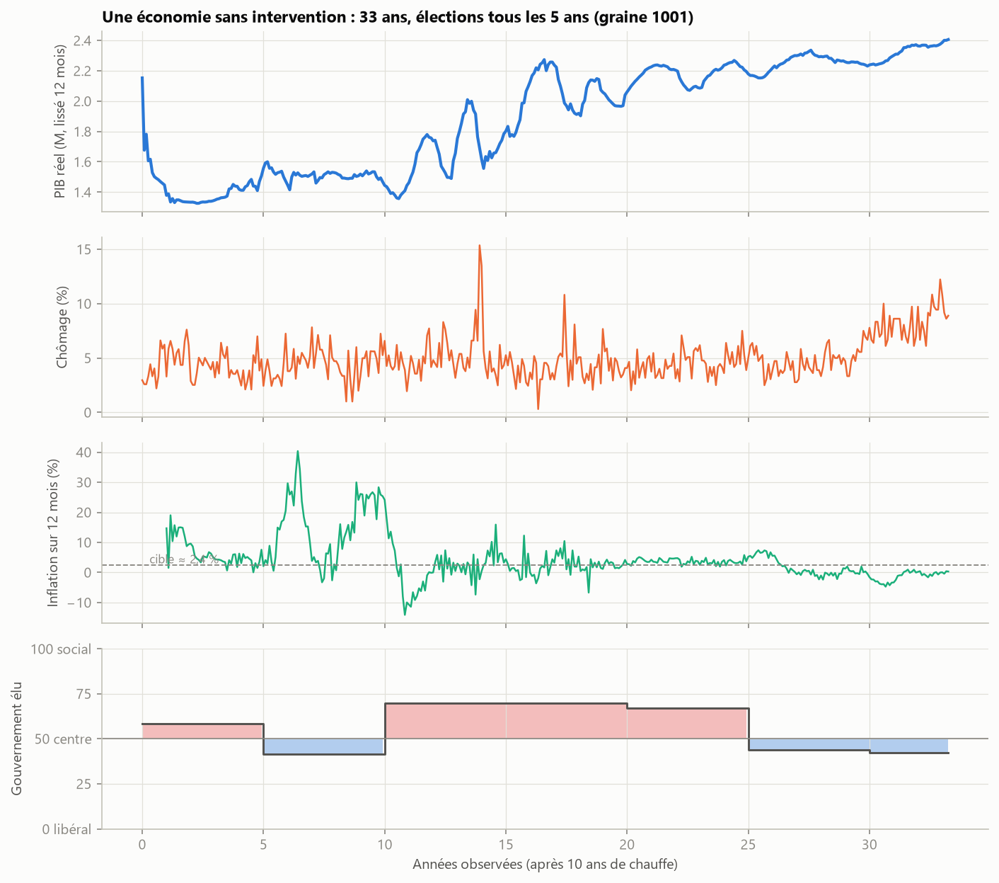
</p>

- **Multi-agents** : chaque ménage, entreprise et banque est un objet avec sa trésorerie, ses dettes,
  ses titres, son emploi ou ses salariés.
- **Mensuel et reproductible** : une graine donne exactement la même histoire, au bit près.
- **Monnaie cohérente** : la monnaie naît du crédit bancaire, chaque paiement a une contrepartie,
  et les bilans sont rapprochés tous les mois.
- **Politique endogène** : les ménages votent tous les cinq ans. Le gouvernement élu nomme
  des ministres parmi eux, vote une loi de finances, fixe le salaire minimum et mène une
  politique industrielle.
- **Démographie** : les chefs de ménage vieillissent et meurent. Un héritier leur succède, et
  l'État prélève des droits de succession.
- **Interface Streamlit** : on peut tout observer et intervenir en cours de route, par exemple
  donner de l'argent à un ménage, imposer un gouvernement ou forcer un taux d'impôt.
- **Moteur en Python pur** (bibliothèque standard), environ 15 000 lignes, et plus de 400 tests.

> Les crises, faillites, pénuries et récessions font partie des résultats possibles : le modèle
> n'est pas recalibré pour les éviter.

---

## Sommaire

1. [Démarrage rapide](#1-démarrage-rapide)
2. [Les agents](#2-les-agents)
3. [Le circuit économique : qui achète quoi à qui](#3-le-circuit-économique--qui-achète-quoi-à-qui)
4. [Un mois de simulation, phase par phase](#4-un-mois-de-simulation-phase-par-phase)
5. [Les mécanismes en détail](#5-les-mécanismes-en-détail)
6. [L'État et la politique](#6-létat-et-la-politique)
7. [Expérience : toujours la gauche, toujours la droite, ou des élections ?](#7-expérience--toujours-la-gauche-toujours-la-droite-ou-des-élections-)
8. [L'interface](#8-linterface)
9. [Utiliser le moteur en Python](#9-utiliser-le-moteur-en-python)
10. [Organisation du code](#10-organisation-du-code)
11. [Tests et reproductibilité](#11-tests-et-reproductibilité)
12. [Limites connues](#12-limites-connues)

---

## 1. Démarrage rapide

Python 3.11 ou plus récent (vérifié avec Python 3.13).

```bash
python -m venv .venv
# Windows (PowerShell) : .\.venv\Scripts\Activate.ps1
# Linux / macOS        : source .venv/bin/activate
python -m pip install -r requirements.txt
python -m streamlit run main.py
```

Dans la barre latérale, réglez les conditions de départ puis cliquez sur
**Réinitialiser la simulation**. **Un mois** fait avancer d'une période ; **Avancer** en
enchaîne plusieurs. Au démarrage, le moteur simule d'abord **120 mois de chauffe** (dix ans)
pour que l'économie trouve son propre régime avant l'observation. Le résultat de la chauffe est
mis en cache dans `.cache/` : le deuxième démarrage est immédiat.

Pour les graphiques et les expériences (Matplotlib) :

```bash
python -m pip install -r requirements-docs.txt
```

---

## 2. Les agents

| Agent | Nombre au départ | Ce qu'il possède | Ce qu'il décide |
|---|---|---|---|
| **Ménages** | 240 (environ 360 après 30 ans) | trésorerie, compétence, métier, âge, logement, actions, obligations, dettes | travailler, consommer, épargner, placer, acheter ou louer un logement, devenir bailleur, se reconvertir, créer une entreprise, voter |
| **Entreprises** | 3 par secteur, 8 secteurs | stocks, capacité de production, centrales, technologie, salariés, dettes, titres | produire, fixer prix et salaires, embaucher, licencier, investir, emprunter, verser des dividendes, racheter un concurrent |
| **Banques** | 3 (secteur « Banque ») | prêts, dépôts, fonds propres, titres publics | prêter selon leurs fonds propres, fixer leurs marges, absorber les pertes ; elles peuvent faire faillite et être résolues |
| **Banque centrale** | 1 | réserves, avances aux banques | taux directeur par une règle de Taylor lissée, avances de réserves |
| **État** | 1 | trésorerie, dette, participations, fonction publique | voir [§ 6](#6-létat-et-la-politique) : élection, ministres, budget, impôts, salaire minimum, politique industrielle |

Les huit secteurs : **Alimentation, Biens courants, Services, Technologie, Énergie,
Matières premières, Immobilier, Banque**, plus la **fonction publique**. Le travail est
organisé en dix métiers : opérateur, technicien, ingénieur, développeur, gestionnaire,
commercial, financier, bâtiment, extracteur et agent. Chaque secteur demande son propre
mélange de métiers, et un ménage au chômage peut se reconvertir.

<p align="center">
  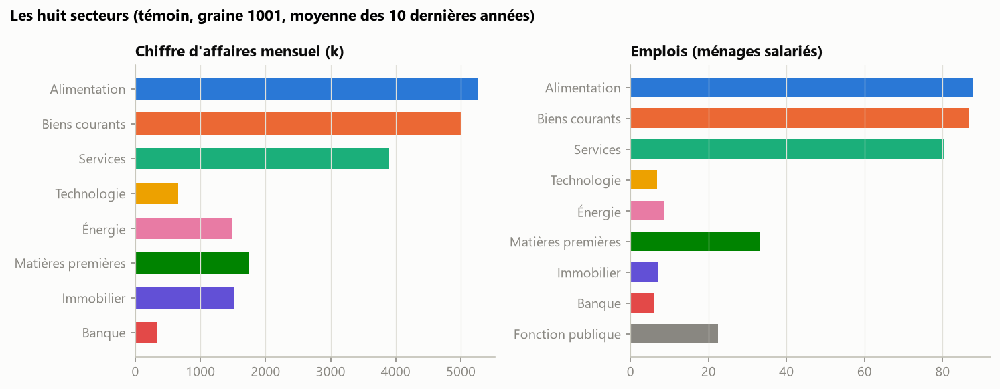
</p>

L'alimentation, les biens courants et les services emploient la plupart des ménages. L'énergie, la
technologie et l'immobilier réalisent un chiffre d'affaires important avec peu de salariés.

---

## 3. Le circuit économique : qui achète quoi à qui

### Vue d'ensemble

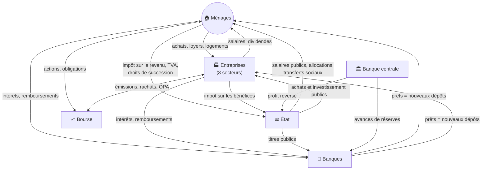

### La chaîne de production entre entreprises

Une entreprise achète à d'autres entreprises une partie de ce qu'elle utilise : énergie, matières,
services numériques, locaux. Ces achats sont de vrais paiements d'agent à agent. Un fournisseur
sans salarié ne livre rien et n'encaisse rien : la commande refusée est mesurée comme une pénurie.

| Secteur | Vend à | Ce qui est échangé |
|---|---|---|
| ⛏️ **Matières premières** | Alimentation, Biens courants | matières tirées d'un stock naturel qui s'épuise, plus le recyclage |
| ⚡ **Énergie** | toutes les entreprises | électricité produite par des centrales qui s'usent, et capacité de production vendue à l'Alimentation et aux Biens courants |
| 💻 **Technologie** | entreprises et ménages | équipements et services numériques, sources de gains de productivité |
| 🧰 **Services** | ménages et entreprises | loisirs, santé, réparation, commerce, transport, formation |
| 🏗️ **Immobilier** | ménages | logements construits par des chantiers, loués ou vendus |
| 🥖 **Alimentation**, 📦 **Biens courants** | ménages | consommation finale, TVA comprise |
| 🏦 **Banque** | tous | crédit, dépôts, frais |

### Les ordres de grandeur

Les flux mesurés dans une simulation témoin (graine 1001, moyenne des dix dernières années, en
unités monétaires simulées par mois) :

<p align="center">
  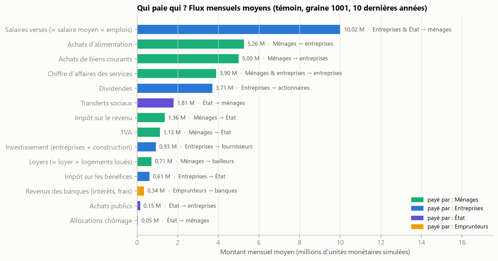
</p>

Le PIB nominal mensuel vaut alors environ 18 M. Les salaires (environ 10 M) financent l'essentiel
de la consommation : alimentation, biens et services. Les dividendes, à environ 3,7 M, sont
importants. Ils reviennent aux ménages actionnaires, ce qui fait de la Bourse un canal majeur de
répartition des revenus.

### La monnaie naît du crédit

Aucune monnaie n'est distribuée « d'en haut ». Lorsqu'une banque accorde un prêt, elle crée un
dépôt du même montant ; un remboursement le détruit. La banque centrale fournit seulement les
réserves exigées (10 % des dépôts) sous forme d'avances au taux directeur. Son profit revient
à l'État. Le contrôle mensuel `validate_financial_accounts` vérifie que la trésorerie des agents
correspond aux billets et aux dépôts inscrits dans les bilans bancaires. L'écart mesuré reste de
l'ordre de 10⁻⁶ sur des centaines de millions.

<p align="center">
  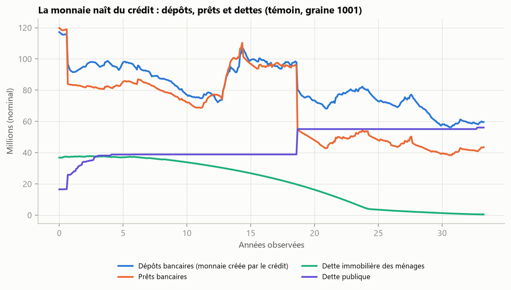
</p>

Les sauts visibles sont de vrais événements. Vers l'année 18, une faillite bancaire est résolue :
le portefeuille de prêts chute et la dette publique augmente avec la recapitalisation. Dans cette
graine, la dette immobilière des ménages s'éteint peu à peu. Le modèle ne force rien : c'est un
comportement observé, pas un objectif.

---

## 4. Un mois de simulation, phase par phase

`EconomySimulation.step()` enchaîne huit phases dans un ordre fixe. Chacune lit et complète les
flux du mois (`MonthFlows`). La dernière produit un relevé (`MarketRecord`) d'une centaine
d'indicateurs.

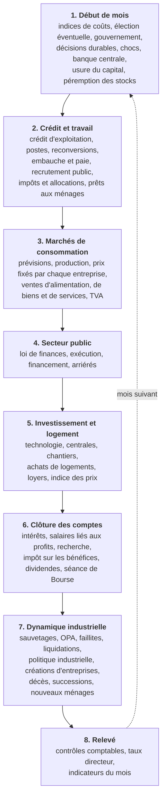

Plusieurs générateurs aléatoires séparés (marché du travail, prévisions, politique, démographie,
institutions) isolent les mécanismes. Ajouter un tirage dans l'un ne décale pas les autres, et
c'est ce qui permet une reproduction exacte.

---

## 5. Les mécanismes en détail

### Ménages
- **Revenus** : salaire, allocation chômage, transferts sociaux, dividendes, coupons
  d'obligations, intérêts des dépôts et loyers s'ils sont bailleurs.
- **Consommation** : le budget alimentaire et le budget de services suivent la **loi d'Engel**.
  Quand le revenu réel monte, la part de l'alimentation baisse et celle des services augmente.
  Chaque ménage anticipe son revenu et son risque de chômage avant d'acheter.
- **Épargne et placements** : le ménage garde environ trois mois de revenu en trésorerie et place
  le reste en actions et en obligations selon son goût du risque. Les portefeuilles sont
  rééquilibrés progressivement.
- **Logement** : un ménage est propriétaire, locataire ou sans logement. Il peut acheter à crédit
  (prêt hypothécaire, saisie en cas de défaut). Il peut aussi devenir bailleur si le rendement
  locatif attendu, vacance comprise, dépasse celui des obligations plus une prime de risque.
- **Crédit à la consommation** : il a des mensualités et peut tomber en défaut. La banque passe
  alors la perte.
- **Entrepreneuriat** : un ménage au tempérament entrepreneurial peut fonder une entreprise
  lorsqu'il voit des commandes non servies. L'entreprise porte son nom, et le fondateur revend
  ses titres en Bourse au fil du temps.
- **Vie et mort** : la mortalité suit une loi de Gompertz (espérance de vie d'environ 74 ans).
  Un héritier de 20 à 30 ans reprend le patrimoine, les dettes et l'emploi, mais tire sa propre
  compétence. Sa compétence de départ dépend de la qualité de l'**éducation publique**.

### Entreprises
- **Production** : elle dépend des salariés (et de leurs métiers et compétences), de la capacité
  installée, de l'énergie livrée, des matières et du niveau technologique.
- **Prix** : chaque entreprise fixe son prix selon ses commandes non servies, ses stocks, ses coûts
  et la concurrence. Le prix de marché est la moyenne des prix affichés.
- **Salaires** : l'offre salariale monte quand les postes restent vacants. Elle baisse quand le
  chômage de longue durée est élevé ou quand la recette ne couvre plus la paie. Elle ne descend
  jamais sous le salaire minimum légal.
- **Investissement** : une entreprise achète de la capacité ou des centrales, et investit en
  recherche, en jugeant la rentabilité au taux d'actualisation du moment. La connaissance
  accumulée fait monter la productivité globale (PGF).
- **Finance** : crédit d'exploitation, dividendes, rachats d'actions, obligations, offres
  publiques de rachat sur des concurrents moins bien valorisés.
- **Fin de vie** : une entreprise insolvable fait faillite. Une entreprise restée sans salarié et
  sans perspective est liquidée à l'amiable, et sa trésorerie revient aux actionnaires.

### Banques et banque centrale
- Les banques prêtent dans la limite de leurs **fonds propres** (8 % des prêts et titres) et de
  leurs **réserves** (10 % des dépôts). Leur marge dépend du risque de défaut qu'elles observent.
- Une banque peut lever des fonds propres en Bourse. Si elle fait faillite, elle est **résolue** :
  la perte retombe sur les actionnaires, puis sur les créanciers, et l'État paie le reste.
- **Règle de Taylor** : taux annuel visé = 1,8 % + inflation + 0,5 × (inflation − cible)
  − 1,0 × (chômage − 5 %), avec inertie, un plafond à 12 % et une cible d'environ 2,4 % par an.
  La crédibilité de la banque centrale s'apprend : plus l'inflation reste proche de la cible, plus
  les entreprises fondent leurs anticipations sur la cible.

---

## 6. L'État et la politique

### L'élection

Tous les **5 ans**, chaque ménage vote :

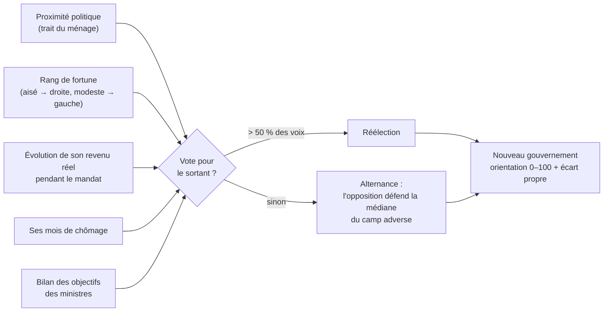

### L'orientation : de 0 (libéral) à 100 (social)

L'orientation se traduit en **doctrines explicites**. Chaque gouvernement s'écarte un peu de la
doctrine type de son camp : deux gouvernements de même couleur ne mènent pas exactement la même
politique.

| Domaine | Libéral (< 35) | Centre (35–65) | Social (> 65) |
|---|---|---|---|
| **Budget** | équilibre ou excédent, remboursement de la dette | stabilise le ratio de dette hérité | déficit accepté (1 à 5 % du PIB) pour financer le programme |
| **Impôts** | revenu −50 %, tranche supérieure −90 %, bénéfices −50 %, TVA +30 % (amplitudes maximales) | réglages de base | revenu +50 %, tranche supérieure +90 %, bénéfices +50 %, TVA −30 % |
| **Revenus du capital** | prélèvement forfaitaire bas | forfait sous 50, barème au-delà | au barème avec les salaires |
| **Salaire minimum** | 50 % du salaire médian, indexation partielle ou gelée | 50 à 60 % | 68 à 80 % du médian, jamais baissé |
| **Transferts** | universels, faibles | base (5 % du PIB) | jusqu'à +80 %, en partie sous condition de ressources |
| **Services publics** | couverture des besoins à 80 %, point d'indice peu indexé | 95 % | 110 %, point indexé avec rattrapage |
| **Industrie** | laisser faire, privatiser | réguler les monopoles durables | opérateur public dans les secteurs critiques, garder les participations |
| **Droits de succession** | nuls à l'extrême droite | 20 % au-delà d'un abattement | jusqu'à 40 % |

### Le gouvernement en action

- **Une présidence et quatre ministres** (Finances, Travail, Industrie, Services publics) sont
  nommés **parmi les ménages**, selon leur proximité politique, leur expérience de direction et
  leur métier. Une personne pressentie peut refuser si le salaire proposé est trop bas.
- Chaque ministre reçoit un **objectif** chiffré, avec une échéance et une enveloppe. L'objectif
  oriente ses décisions, mais ne fixe jamais un résultat.
- **Cinq services publics**, dont l'Éducation, recrutent des agents en concurrence avec le privé,
  selon une grille de salaires.
- **Loi de finances** annuelle : elle fixe les impôts, les programmes et le financement. Si
  l'argent manque, l'État accumule des arriérés.
- **Politique industrielle** : régulation des prix d'un monopole, création ou nationalisation
  d'une entreprise publique, recapitalisation, privatisation par la Bourse.
- **Journal des décisions** : chaque décision a un auteur, une date, un motif, un montant et un
  financement.

---

## 7. Expérience : toujours la gauche, toujours la droite, ou des élections ?

Que se passe-t-il si une économie est gouvernée **pendant 33 ans** uniquement par la droite la
plus libérale, uniquement par la gauche la plus sociale, ou par les gouvernements que ses
ménages élisent ?

### Protocole

- **10 graines** (1001 à 1010), configuration par défaut, **120 mois de chauffe identiques**,
  puis **400 mois observés**. Les statistiques portent sur les 33 années complètes.
- **Droite** : un gouvernement d'orientation **0** est imposé au premier mois observé, puis à
  chaque élection, via le mode intervention.
- **Gauche** : la même chose avec l'orientation **100**.
- **Témoin** : élections normales. Les orientations élues vont de 21 à 81.
- **Rien d'autre ne change** : chaque gouvernement applique sa propre doctrine (impôts,
  allocations, salaire minimum, budget, politique industrielle).
- La comparaison est **appariée** : même graine et même point de départ pour les trois
  scénarios. Les 30 simulations se terminent sans valeur non finie, avec un écart comptable
  maximal de 10⁻⁶.

Pour reproduire l'expérience (environ 5 minutes sur 8 cœurs) :

```bash
python experiences/gauche_droite_campagne.py 400 1001 1002 1003 1004 1005 1006 1007 1008 1009 1010 --jobs 8
python experiences/gauche_droite_analyse.py
python docs/figures_readme.py
```

### Les trajectoires

<p align="center">
  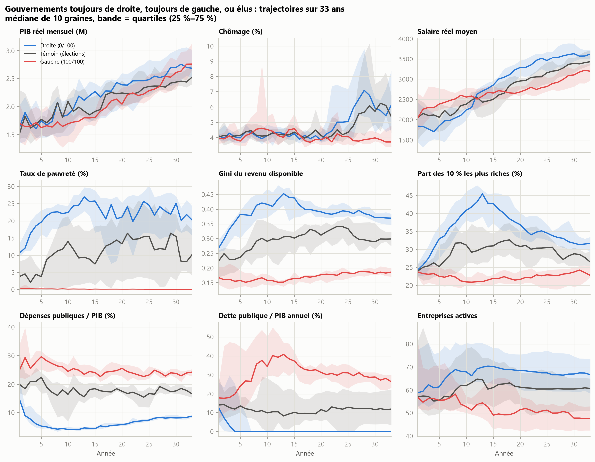
</p>

Le témoin oscille autour du centre, au gré des alternances :

<p align="center">
  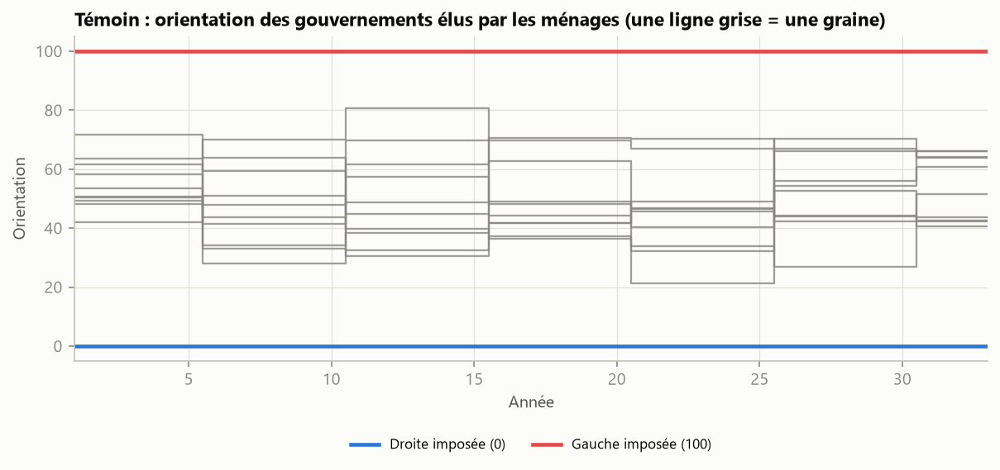
</p>

### Les moyennes

<p align="center">
  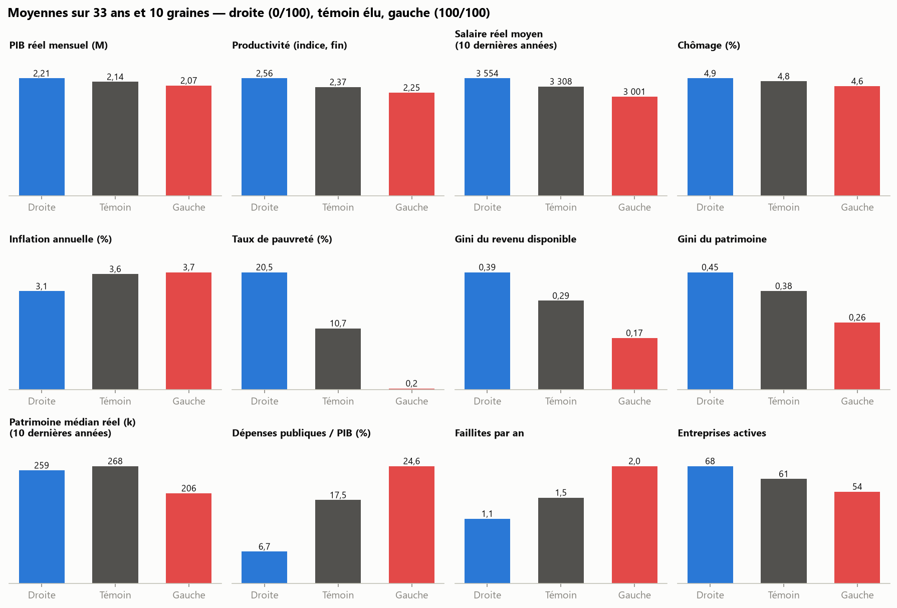
</p>

| Indicateur (moyenne de 10 graines sur 33 ans) | Droite (0) | Témoin | Gauche (100) | Gauche > Droite |
|---|---:|---:|---:|---:|
| **Activité** | | | | |
| PIB réel mensuel | 2,21 M | 2,14 M | 2,07 M | 3/10 |
| Croissance réelle annuelle | 1,57 % | 1,37 % | 1,61 % | 5/10 |
| Productivité (PGF en fin de période) | 2,56 | 2,37 | 2,25 | 1/10 |
| Entreprises actives | 68 | 61 | 54 | 0/10 |
| Faillites par an | 1,1 | 1,5 | 2,0 | 10/10 |
| Créations d'entreprises par an | 1,6 | 1,7 | 1,9 | 6/10 |
| **Emploi et prix** | | | | |
| Chômage | 4,9 % | 4,8 % | 4,6 % | 2/10 |
| Inflation annuelle | 3,1 % | 3,6 % | 3,7 % | 9/10 |
| Salaire réel moyen, 10 dernières années | 3 554 | 3 308 | 3 001 | 0/10 |
| Salaire minimum / salaire moyen | 12 % | 36 % | 50 % | 10/10 |
| **Ménages et inégalités** | | | | |
| Revenu réel total des ménages (transferts compris) | 1,53 M | 1,58 M | 1,61 M | 7/10 |
| Taux de pauvreté (< 60 % du revenu médian) | 20,5 % | 10,7 % | 0,2 % | 0/10 |
| Gini du revenu disponible | 0,39 | 0,29 | 0,17 | 0/10 |
| Gini du patrimoine | 0,45 | 0,38 | 0,26 | 0/10 |
| Part des 10 % les plus riches | 35,7 % | 29,5 % | 22,3 % | 0/10 |
| Part du 1 % le plus riche | 9,2 % | 7,0 % | 4,6 % | 0/10 |
| Patrimoine médian réel, 10 dernières années | 259 k | 268 k | 206 k | 0/10 |
| **État** | | | | |
| Dépenses publiques / PIB | 6,7 % | 17,5 % | 24,6 % | 10/10 |
| Recettes publiques / PIB | 7,5 % | 17,8 % | 23,8 % | 10/10 |
| Dette publique / PIB annuel (fin) | 0,1 % | 12 % | 26 % | 10/10 |
| Emplois publics | 13 | 19 | 25 | 10/10 |

La dernière colonne indique le nombre de graines où la valeur obtenue à gauche dépasse celle
obtenue à droite. 10/10 ou 0/10 signifie que l'écart va dans le même sens dans toutes les
histoires simulées.

### Graine par graine

<p align="center">
  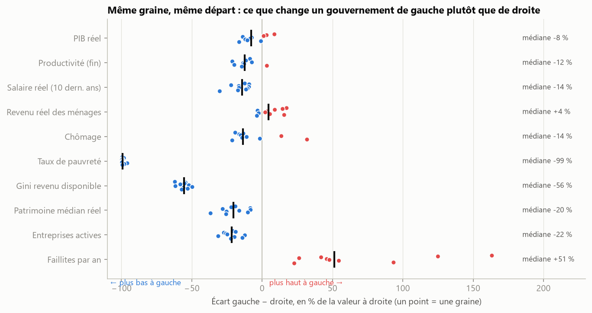
</p>

### Ce qu'on en retient

**La droite produit plus ; la gauche partage plus.** Dans ce modèle, la différence porte
surtout sur le **niveau** de production et sa **répartition**, pas sur le rythme de croissance.

- **Pour la droite, les écarts sont réguliers mais modérés.** Le PIB réel est plus élevé d'environ
  7 %, la productivité de 14 % en fin de période et le salaire réel de 18 % sur la dernière
  décennie (10 graines sur 10). L'inflation est plus basse, les entreprises sont plus nombreuses
  et font moins faillite. L'État est minimal (7 % du PIB) et sans dette.
- **Pour la gauche, les écarts sont très marqués.** La pauvreté disparaît presque (0,2 % contre
  20 %). Les inégalités de revenu disponible sont **divisées par plus de deux** (Gini 0,17 contre
  0,39). Le chômage est un peu plus bas, et le revenu réel total des ménages plus élevé, transferts
  compris.
- **La gauche a des contreparties.** Le salaire minimum atteint la moitié du salaire moyen. Les
  faillites sont presque deux fois plus fréquentes (2,0 contre 1,1 par an) et il y a moins
  d'entreprises, donc plus de concentration.
  La dette publique monte à 26 % du PIB et le patrimoine médian réel est **plus bas**
  (−20 %, 10 graines sur 10).
- **Les deux régimes croissent au même rythme** (environ 1,6 % par an) **et aucun ne
  s'effondre.** Les pires années (−20 % à −25 % de PIB réel) se rencontrent dans les trois
  scénarios avec une fréquence comparable.
- **Le témoin se situe entre les deux** sur presque tous les indicateurs. Il obtient le meilleur
  patrimoine médian, mais la croissance la plus faible.
- Fait notable visible sur les trajectoires : le chômage remonte en fin de période sous la droite
  (vers 6–7 % après l'année 25), alors qu'il reste vers 4 % sous la gauche.

> ⚠️ **Ce sont les conséquences des règles de ce modèle, pas une mesure du monde réel.** Les
> doctrines sont des hypothèses codées dans `economy/institutions.py`. Les gouvernements imposés
> sont extrêmes et durables (33 ans sans alternance), ce qu'aucune élection ne produit. Dix
> graines donnent des comparaisons reproductibles, pas une validation statistique.

---

## 8. L'interface

`python -m streamlit run main.py` ouvre cinq onglets :

| Onglet | Contenu |
|---|---|
| **Vue d'ensemble** | PIB, chômage, inflation, salaires, prix, inégalités, logement, monnaie, événements du mois |
| **État** | gouvernement et cabinet, budget, fonction publique, salaire minimum, industrie, journal des décisions |
| **Entreprises & bourse** | tableau des entreprises, fiche détaillée par entreprise, cours de Bourse, secteurs |
| **Ménages** | distribution des revenus et des patrimoines, fiche détaillée d'un ménage |
| **Modèle & réglages** | paramètres, description des mécanismes |

**Mode intervention 🛠** : sans réinitialiser la simulation, vous pouvez :

- ajouter ou retirer de l'argent à un ménage ou à une entreprise ;
- fixer la compétence d'un ménage ;
- **imposer un gouvernement** d'orientation 0 à 100 jusqu'à la prochaine élection ;
- **forcer** la TVA, l'impôt sur le revenu, la tranche supérieure, l'impôt sur les bénéfices,
  l'allocation chômage ou le salaire minimum.

L'argent ajouté est émis comme de la monnaie fiduciaire, ce qui garde la comptabilité exacte.
Toutes les actions sont inscrites au journal des interventions. Tant qu'on n'intervient pas, la
simulation reste identique au bit près.

---

## 9. Utiliser le moteur en Python

```python
from economy.models import SimulationConfig
from economy.simulation import EconomySimulation
from economy.interventions import request_orientation

sim = EconomySimulation(SimulationConfig(seed=1001))   # 120 mois de chauffe compris

for month in range(120):
    record = sim.step()                                 # un mois → un MarketRecord
    print(month, round(record.real_gdp), f"{record.unemployment:.1%}",
          f"{record.inflation_rate:+.2%}", round(record.government_orientation))

request_orientation(sim, 100.0)   # impose un gouvernement social au mois suivant
```

Tous les paramètres sont des champs de `SimulationConfig` (`economy/models.py`), par exemple
`population_size`, `companies_per_sector`, `warmup_months`, `election_period_months`,
`vat_rate`, `income_tax_rate`, `reserve_requirement`, `capital_requirement`, `inflation_target`,
`mortality_level` ou `policy_strength`.

Outils en ligne de commande :

```bash
python evaluate.py 800 1001 1002 1003                 # trajectoires longues, plusieurs graines
python evaluate.py 800 1001 --set credit_return_gain=10
python experiments.py 300 --seeds 1001 1002 1003 --jobs 4   # chocs (taux, énergie, TVA…) contre témoin
python docs/make_charts.py 7                          # cinq graphiques d'une simulation (results/figures/)
python realism_probe.py 400 1001 1002                 # critères de réalisme mesurés sur les agents
```

`experiments.py` applique des chocs (hausse des taux, panne d'énergie, hausse de TVA, baisse des
dépenses, durcissement du crédit) et les compare à la même graine sans choc.

---

## 10. Organisation du code

```
main.py                    Interface Streamlit
economy/                   Moteur, sans dépendance à Streamlit
├── simulation.py          Orchestration : les 8 phases du mois
├── models.py              SimulationConfig (paramètres), Person, Company, MarketRecord
├── records.py             Relevé mensuel, PIB, contrôles financiers
├── labor.py, trades.py, wages.py         Travail, métiers, salaires
├── business.py, goods.py, pricing.py,    Production, consommation, prix
│   firm_pricing.py, expectations.py
├── intersector.py, deliveries.py, energy.py   Achats entre entreprises, énergie
├── housing.py, real_estate.py            Logement, loyers, chantiers
├── finance.py, banking.py, credit_risk.py,     Crédit, banques, résolutions
│   household_credit.py, central_bank.py
├── stock_market.py, treasury.py,         Bourse, trésorerie, OPA, patrimoine
│   consolidation.py, wealth.py, innovation.py
├── institutions.py        Doctrines, objectifs, élection (règles pures)
├── state_government.py    Gouvernement, cabinet, journal
├── state_budget.py        Loi de finances, exécution, dette
├── state_services.py      Fonction publique, éducation
├── state_labor.py         Salaire minimum légal
├── state_industry.py      Politique industrielle, participations
├── demography.py          Âge, décès, successions
├── interventions.py       Mode intervention
├── ledger.py, payments.py Bilans consolidés, transferts sécurisés
└── warmup_cache.py        Cache de la chauffe
experiences/               Campagne gauche / droite / témoin
docs/figures_readme.py     Graphiques de ce README (docs/images/)
docs/make_charts.py        Cinq graphiques d'une simulation
evaluate.py, experiments.py, realism_probe.py, diagnose.py, autonomy_probe.py
diagnostic/                Sondes réutilisables (lots de variantes, tableaux de bord)
tests/, run_tests.py       Suite de tests
identity_check.py, identity_reference.json, performance_probe.py   Non-régression
AUTONOMIE.md               Registre des bornes du modèle, lu par les tests
```

---

## 11. Tests et reproductibilité

```bash
python run_tests.py -j 4      # toute la suite, en parallèle
python identity_check.py      # 5 trajectoires de référence, comparées au bit près
python performance_probe.py identity --output results/identity_before
python performance_probe.py ui --repeats 1 --output results/ui   # parcours de l'interface
```

- La suite contient plus de 400 tests : mécanismes, cohérence comptable, stabilité, État,
  interventions et régression.
- `identity_check.py` recalcule cinq simulations et compare leur empreinte à
  `identity_reference.json`. Le moindre changement dans l'ordre d'un calcul flottant ou d'un
  tirage est détecté.
- `AUTONOMIE.md` recense chaque borne et chaque paramètre du modèle avec sa justification. Un
  test vérifie qu'aucun paramètre n'est ajouté sans y figurer.
- **Anomalie connue et conservée (OPT-BANK-001)** : après la résolution d'une banque, l'État
  garde parfois des titres de la banque fermée. Le test correspondant est marqué « échec
  attendu » et le lanceur l'affiche explicitement.

---

## 12. Limites connues

- **Pas de calibration sur des données réelles.** Les ordres de grandeur sont cohérents entre
  eux, mais l'unité monétaire est fictive et la population très petite (240 à 360 ménages).
- **Monnaie en flottants.** Les bilans sont rapprochés au niveau consolidé, sans comptes de dépôt
  individuels par banque. Une version en centimes existe à l'état de prototype
  (`bank_ledger.py`, `bank_opening.py`), mais elle n'est pas branchée.
- **Stabilité non garantie.** Les récessions longues, la concentration bancaire et les booms de
  crédit qui finissent en faillites restent possibles. Le modèle est sensible à certaines
  élasticités, notamment l'élasticité-prix des achats entre entreprises.
- **Démographie simplifiée.** Il n'y a ni retraites, ni enfants à charge, ni partage d'héritage.
  Un ménage est une lignée, et l'héritier garde l'emploi.
- **Politique sur un seul axe.** Il n'y a ni partis, ni campagnes, ni coalitions. Les services
  reçus (éducation) n'influencent pas encore le vote.
- **Fonction publique perfectible.** Les recrues sont parfois débauchées aussitôt par le privé, et
  certains objectifs ministériels sont trop faciles.
- **Calendrier des comptes.** Certaines recettes tardives (ventes de capacité des centrales) ne
  sont pas comptées dans le bénéfice du mois.

---

## Licence

Distribué sous licence [MIT](LICENSE) : vous pouvez utiliser, modifier et redistribuer ce code
librement, à condition de conserver l'avis de copyright et de licence.
