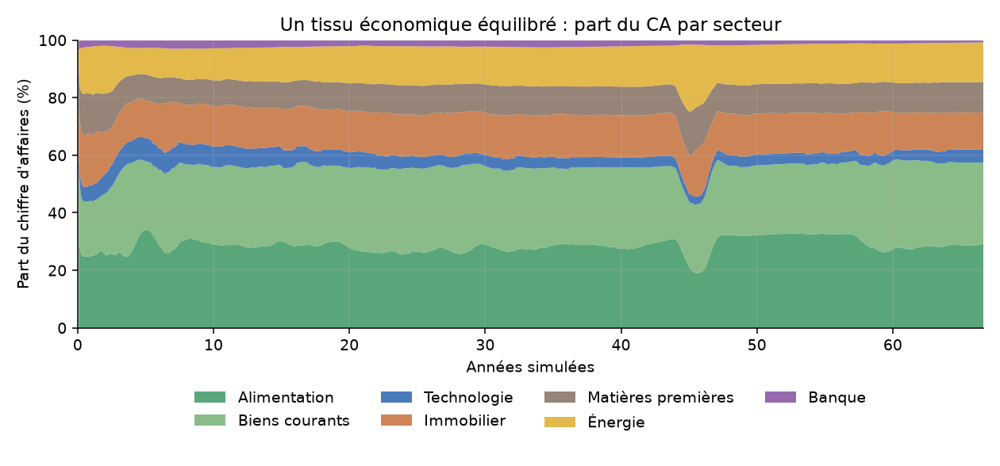
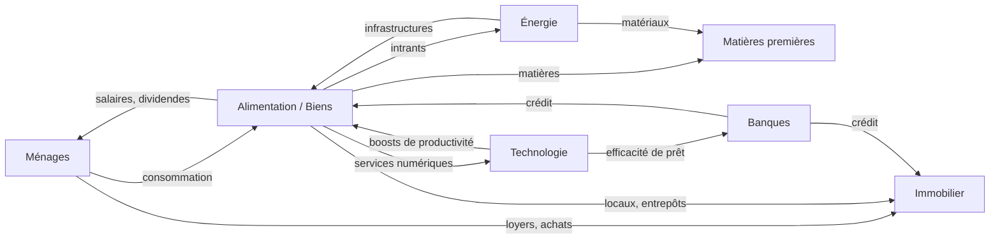
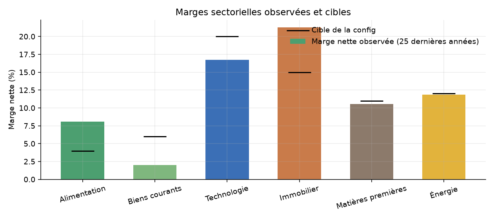
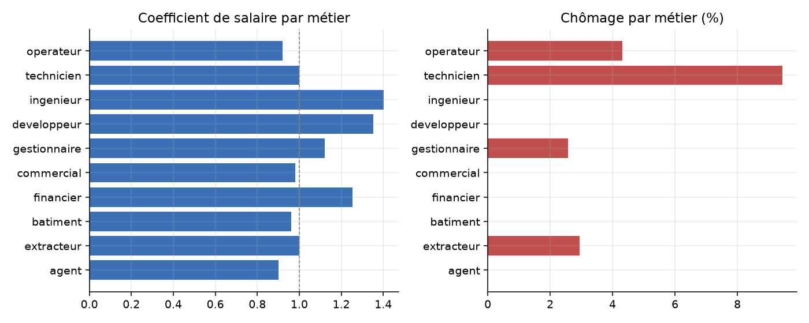
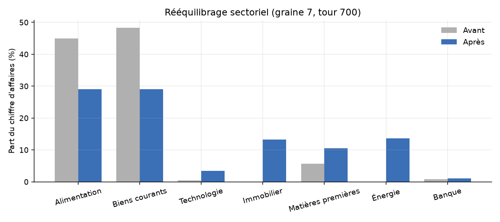
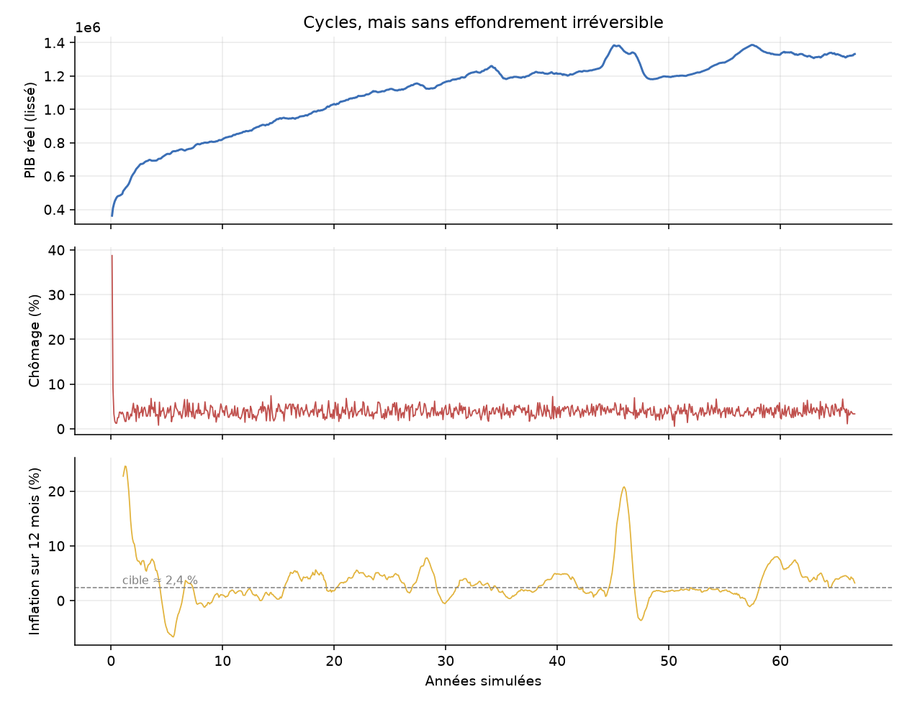

# 🏭 Économie en mouvement

**Simulation économique multi-agents, mensuelle et reproductible, avec tableau de bord Streamlit.**
Ménages, entreprises de sept secteurs, banques, État et banque centrale interagissent sans qu'aucun résultat soit imposé : l'emploi, les prix, les marges, les monopoles et les crises émergent des règles.

  



## Sommaire

[Démarrage](#-démarrage) · [Ce que modélise le projet](#-ce-que-modélise-le-projet) · [Principes de conception](#-principes-de-conception) · [Les mécanismes](#-les-mécanismes) · [Résultats](#-résultats-de-validation) · [Configuration](#-configuration) · [Tests et outils](#-tests-et-outils) · [Limites](#-limites-connues)

## 🚀 Démarrage

```powershell
python -m venv .venv
.\.venv\Scripts\Activate.ps1
python -m pip install -r requirements.txt
python -m streamlit run main.py
```

Sous Linux/macOS : `source .venv/bin/activate` à la place de l'activation PowerShell.
Dans l'interface, réglez les paramètres de la barre latérale puis cliquez sur **Réinitialiser la simulation** ; **Un mois** avance d'une période, **Avancer** en enchaîne plusieurs. Les fiches d'entreprises et de ménages s'ouvrent via les sélecteurs.

## 🧩 Ce que modélise le projet

| Agent | Rôle |
|---|---|
| **Ménages** | Travaillent (métier, compétences, rang hiérarchique), consomment, épargnent, achètent des actions et des logements, peuvent fonder une entreprise |
| **Entreprises** | 7 secteurs : alimentation, biens courants, technologie, immobilier, matières premières, énergie, banque. Prix, embauches, investissement, dividendes, fusions |
| **Banques** | Portefeuille de prêts, fonds propres, faillites, transfert à un survivant |
| **État** | Impôts, allocations, achats publics |
| **Banque centrale** | Émet ou retire de la monnaie selon l'inflation et le chômage |

Le salaire de départ est de 1 400 € par mois ; les montants sont en euros simulés.



## 🎯 Principes de conception

- **Cohérence monétaire** : le revenu d'une entreprise vient d'achats réels d'autres agents. L'argent n'est créé que par les banques et la banque centrale ; la conservation est testée.
- **Pas de bénéfice forcé** : on calibre des mécanismes, jamais des résultats. Les pertes sont possibles et mènent à des licenciements, des sorties du marché ou des changements de prix.
- **Un seul fichier de paramètres** : `SimulationConfig` dans [`economy/models.py`](economy/models.py).
- **Reproductible** : graine fixe, flux aléatoires séparés par mécanisme.

## ⚙️ Les mécanismes

### Demande inter-entreprises (matrice entrées-sorties)
Chaque secteur achète à d'autres une part de son activité (énergie, services numériques, locaux, matières, construction). Les paiements sont de vrais transferts ; un secteur sans fournisseur renvoie le paiement à un fonds amont agrégé qui le reverse en salaires. Les intrants suivent le niveau des prix.

### Technologie : une part de la valeur créée
Une entreprise achète un boost de productivité quand le gain actualisé dépasse le prix. La technologie ne capte que **30 %** de ce gain (40 % au plus) : son revenu est proportionnel à la valeur qu'elle crée. Les banques en achètent aussi (capacité de prêt, meilleur scoring).

### Énergie et infrastructures
Secteur capitalistique : il vend de l'énergie à tous et trois infrastructures : *production* (capacité), *réseau* (facture d'énergie réduite), *stockage* (production plus continue). Chacune a un coût, une durée de vie et un effet mesurable, et n'est achetée que si le gain attendu l'emporte sur le prix.

### Prix et marges
L'écart entre marge observée et marge cible déplace lentement les prix ; marges élevées → entrées, pertes durables → sorties.



### Marché du travail par métiers
Dix métiers, un mix de métiers par secteur. Un poste spécialisé exige le bon métier, les postes d'opérateur sont ouverts à tous. Le salaire de chaque métier suit la tension offre/demande ; la reconversion coûte de l'argent et prend 8 mois. Salaire = offre sectorielle × poste × compétence × coefficient de métier.



### Concurrence, monopoles, entrées
Aucun plafond de part de marché : un monopole peut apparaître et durer. Une acquisition n'a lieu que si l'acquéreur est plus rentable que sa cible. L'attrait d'un secteur pour un entrant augmente avec l'écart de marge, la concentration et la rentabilité du dominant. Les fondateurs sont des ménages dotés d'un **esprit entrepreneurial** (≈ 25 %) et d'un capital minimal ; l'entrant bénéficie 24 mois d'une clientèle de niche et d'un crédit facilité (capital du fondateur + prêt bancaire réel), puis suit les mêmes règles et peut échouer.

### Immobilier et foyers
Les ménages peuvent acheter autant de logements que leur capital le permet, mais **ne peuvent pas les louer** : pour louer, il faut fonder une entreprise immobilière (et y apporter ses logements). Le coût de construction est indexé, le prix suit l'offre et la demande, le foncier s'étend avec le parc.

### Banque centrale
Croissance monétaire de tendance corrigée par l'écart d'inflation et le chômage. Sans création monétaire, l'économie déflate et s'arrête ; trop de contraction déclenche de longues récessions.

## 📊 Résultats de validation

Rééquilibrage mesuré sur la graine 7 au tour 700 :



Cycles macroéconomiques (800 mois, graine 7) :



Validation sur **1000 mois × 5 graines** (7, 11, 23, 42, 101) :

| Indicateur | Résultat |
|---|---|
| Inflation moyenne | 3,2 à 3,6 % par an |
| Chômage moyen / maximum | 3,8–4,1 % / 7,4–14,4 % |
| Salaire réel | en hausse sur toutes les graines |
| Part du CA | technologie 3,9–5,3 %, énergie 9–15 %, matières 10–13 %, immobilier 12–15 % |
| Série de pertes la plus longue d'un secteur | 61 mois |
| Entrants | 11 à 39 par graine, 5 à 10 survivent plus de 24 mois |

## 🔧 Configuration

Tous les paramètres sont dans `SimulationConfig`. Les plus utiles :

| Thème | Paramètres |
|---|---|
| Marges et salaires | `sector_margin_target`, `sector_wage_factor`, `sector_payroll_share` |
| Inter-entreprises | `input_cost_split`, `operating_io`, `tech_value_capture`, `tech_effect_per_level` |
| Énergie | `infrastructure_types`, `energy_capex_share`, `sector_capital_depreciation` |
| Métiers | `trades`, `sector_trade_mix`, `trade_base_wage`, `retraining_months` |
| Concurrence | `acquisition_probability`, `entrepreneurial_trait_threshold`, `entrant_boost_months`, `entry_signal_scale` |
| Immobilier | `target_rental_yield`, `housing_markup_bounds`, `home_investment_probability`, `land_expansion_rate` |
| Monnaie | `monetary_trend`, `monetary_inflation_gain`, `reserve_replacement_rate` |

## 🧪 Tests et outils

```powershell
python -m unittest discover -s tests          # 123 tests
python diagnose.py --months 120               # 7 critères de stabilité, 5 graines
python evaluate.py 1000                       # validation longue par secteur, monopoles, entrées
pip install matplotlib; python docs/make_charts.py   # régénère les graphiques
```

## 🗂️ Structure

```
economy/
  models.py         configuration et entités
  simulation.py     boucle mensuelle
  intersector.py    demande inter-entreprises
  energy.py         énergie et infrastructures
  trades.py         marché du travail par métiers
  labor.py  goods.py  business.py  finance.py  consolidation.py
  real_estate.py  stock_market.py  government.py  wealth.py
main.py             tableau de bord Streamlit
tests/              tests unitaires et de stabilité longue
docs/               graphiques du README
```

## ⚠️ Limites connues

- **Récessions longues** : sur 3 graines sur 5, un creux du PIB à 54-67 % du pic dure 170 à 270 mois avant retour à 90 %. Non irréversible, mais à améliorer.
- **Marges** : l'immobilier dépasse sa cible (24-31 % pour 10-20 %), les biens courants restent sous la leur.
- **Banque** : un seul établissement subsiste dans toutes les simulations.
- **Fonds amont agrégé** : transport, négoce et formation ne sont pas des secteurs à part entière.
- Règles heuristiques, sans anticipation ni apprentissage ; pas de commerce extérieur ni de dépôts bancaires.
- Le dernier acteur d'un secteur essentiel est restructuré plutôt que liquidé.

## 📄 Licence

À définir avant publication (MIT conseillée).
