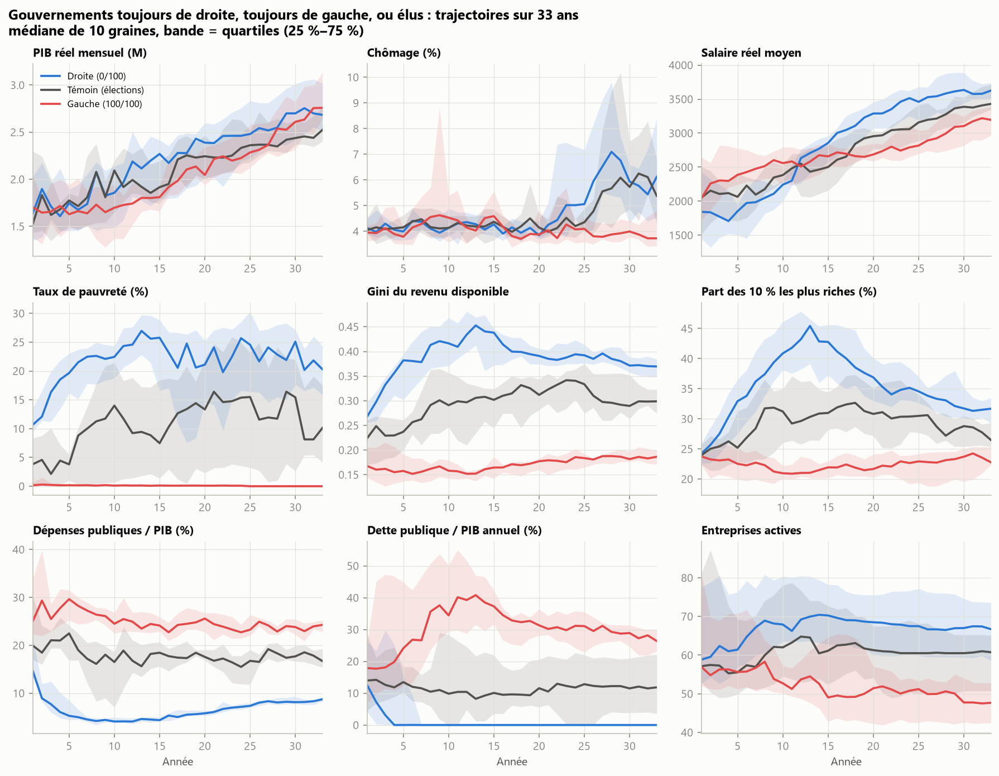
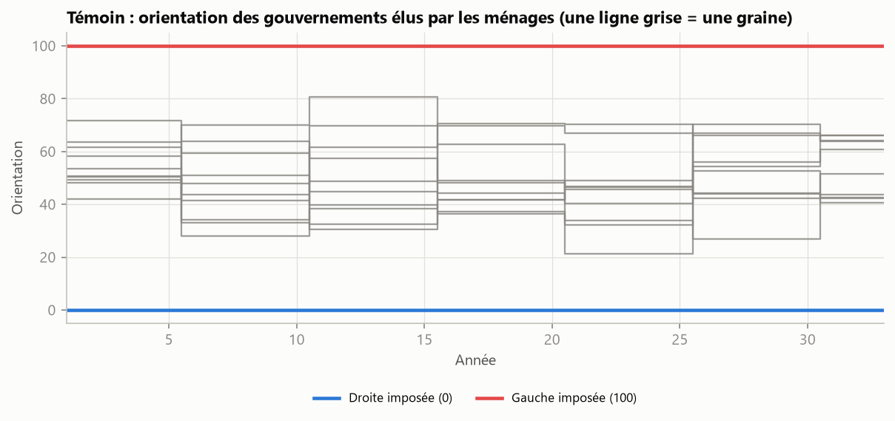
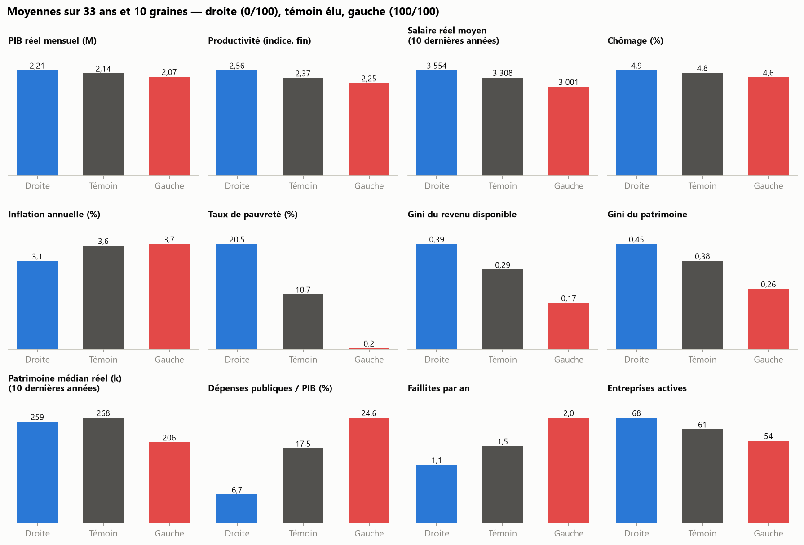
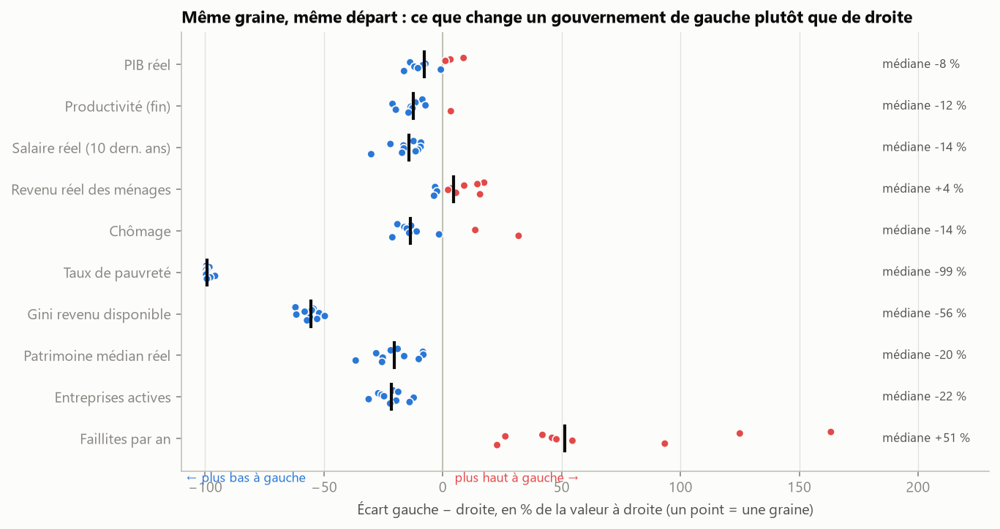

# Expérience : toujours la gauche, toujours la droite, ou des élections ?

> Campagne historique, avec les réglages de base utilisés à sa publication. Pour les mesures actuelles avec 500 ménages et les options actives, voir le [scénario complet](../README.md#7-le-scénario-complet-en-chiffres).

Que se passe-t-il si une économie est gouvernée **pendant 33 ans** uniquement par la droite la
plus libérale, uniquement par la gauche la plus sociale, ou par les gouvernements que ses
ménages élisent ?

### Protocole

- **10 graines** (1001 à 1010), configuration par défaut, **120 mois de chauffe identiques**,
  puis **400 mois observés**. Les statistiques portent sur les 33 années complètes.
- **Droite** : un gouvernement d'orientation **0** est imposé au premier mois observé, puis à
  chaque élection, via le mode intervention.
- **Gauche** : la même chose avec l'orientation **100**.
- **Témoin** : élections normales. Les orientations élues vont de 21 à 81.
- **Rien d'autre ne change** : chaque gouvernement applique sa propre doctrine (impôts,
  allocations, salaire minimum, budget, politique industrielle).
- La comparaison est **appariée** : même graine et même point de départ pour les trois
  scénarios. Les 30 simulations se terminent sans valeur non finie, avec un écart comptable
  maximal de 10⁻⁶.

Pour reproduire l'expérience (environ 5 minutes sur 8 cœurs) :

```bash
python experiences/gauche_droite_campagne.py 400 1001 1002 1003 1004 1005 1006 1007 1008 1009 1010 --jobs 8
python experiences/gauche_droite_analyse.py
python docs/figures_readme.py
```

### Les trajectoires

<p align="center">
  
</p>

Le témoin oscille autour du centre, au gré des alternances :

<p align="center">
  
</p>

### Les moyennes

<p align="center">
  
</p>

| Indicateur (moyenne de 10 graines sur 33 ans) | Droite (0) | Témoin | Gauche (100) | Gauche > Droite |
|---|---:|---:|---:|---:|
| **Activité** | | | | |
| PIB réel mensuel | 2,21 M | 2,14 M | 2,07 M | 3/10 |
| Croissance réelle annuelle | 1,57 % | 1,37 % | 1,61 % | 5/10 |
| Productivité (PGF en fin de période) | 2,56 | 2,37 | 2,25 | 1/10 |
| Entreprises actives | 68 | 61 | 54 | 0/10 |
| Faillites par an | 1,1 | 1,5 | 2,0 | 10/10 |
| Créations d'entreprises par an | 1,6 | 1,7 | 1,9 | 6/10 |
| **Emploi et prix** | | | | |
| Chômage | 4,9 % | 4,8 % | 4,6 % | 2/10 |
| Inflation annuelle | 3,1 % | 3,6 % | 3,7 % | 9/10 |
| Salaire réel moyen, 10 dernières années | 3 554 | 3 308 | 3 001 | 0/10 |
| Salaire minimum / salaire moyen | 12 % | 36 % | 50 % | 10/10 |
| **Ménages et inégalités** | | | | |
| Revenu réel total des ménages (transferts compris) | 1,53 M | 1,58 M | 1,61 M | 7/10 |
| Taux de pauvreté (< 60 % du revenu médian) | 20,5 % | 10,7 % | 0,2 % | 0/10 |
| Gini du revenu disponible | 0,39 | 0,29 | 0,17 | 0/10 |
| Gini du patrimoine | 0,45 | 0,38 | 0,26 | 0/10 |
| Part des 10 % les plus riches | 35,7 % | 29,5 % | 22,3 % | 0/10 |
| Part du 1 % le plus riche | 9,2 % | 7,0 % | 4,6 % | 0/10 |
| Patrimoine médian réel, 10 dernières années | 259 k | 268 k | 206 k | 0/10 |
| **État** | | | | |
| Dépenses publiques / PIB | 6,7 % | 17,5 % | 24,6 % | 10/10 |
| Recettes publiques / PIB | 7,5 % | 17,8 % | 23,8 % | 10/10 |
| Dette publique / PIB annuel (fin) | 0,1 % | 12 % | 26 % | 10/10 |
| Emplois publics | 13 | 19 | 25 | 10/10 |

La dernière colonne indique le nombre de graines où la valeur obtenue à gauche dépasse celle
obtenue à droite. 10/10 ou 0/10 signifie que l'écart va dans le même sens dans toutes les
histoires simulées.

### Graine par graine

<p align="center">
  
</p>

### Ce qu'on en retient

**La droite produit plus ; la gauche partage plus.** Dans ce modèle, la différence porte
surtout sur le **niveau** de production et sa **répartition**, pas sur le rythme de croissance.

- **Pour la droite, les écarts sont réguliers mais modérés.** Le PIB réel est plus élevé d'environ
  7 %, la productivité de 14 % en fin de période et le salaire réel de 18 % sur la dernière
  décennie (10 graines sur 10). L'inflation est plus basse, les entreprises sont plus nombreuses
  et font moins faillite. L'État est minimal (7 % du PIB) et sans dette.
- **Pour la gauche, les écarts sont très marqués.** La pauvreté disparaît presque (0,2 % contre
  20 %). Les inégalités de revenu disponible sont **divisées par plus de deux** (Gini 0,17 contre
  0,39). Le chômage est un peu plus bas, et le revenu réel total des ménages plus élevé, transferts
  compris.
- **La gauche a des contreparties.** Le salaire minimum atteint la moitié du salaire moyen. Les
  faillites sont presque deux fois plus fréquentes (2,0 contre 1,1 par an) et il y a moins
  d'entreprises, donc plus de concentration.
  La dette publique monte à 26 % du PIB et le patrimoine médian réel est **plus bas**
  (−20 %, 10 graines sur 10).
- **Les deux régimes croissent au même rythme** (environ 1,6 % par an) **et aucun ne
  s'effondre.** Les pires années (−20 % à −25 % de PIB réel) se rencontrent dans les trois
  scénarios avec une fréquence comparable.
- **Le témoin se situe entre les deux** sur presque tous les indicateurs. Il obtient le meilleur
  patrimoine médian, mais la croissance la plus faible.
- Fait notable visible sur les trajectoires : le chômage remonte en fin de période sous la droite
  (vers 6–7 % après l'année 25), alors qu'il reste vers 4 % sous la gauche.

> ⚠️ **Ce sont les conséquences des règles de ce modèle, pas une mesure du monde réel.** Les
> doctrines sont des hypothèses codées dans `economy/institutions.py`. Les gouvernements imposés
> sont extrêmes et durables (33 ans sans alternance), ce qu'aucune élection ne produit. Dix
> graines donnent des comparaisons reproductibles, pas une validation statistique.
